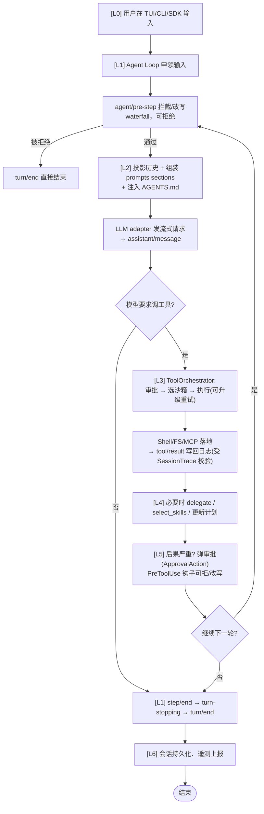

> 基于 `deepseek-ai/deepseek-harness`（TypeScript / Cordis 插件总线）与 `openai/codex`（Rust / codex-rs crate 体系）两个成熟开源项目的**真实源码**整理。
> 本文把每层的关键**数据结构、控制流、不变量**讲清楚，并为每个核心模块附上**实现逻辑**——这些是写 Agent 时真正会踩坑的地方。
> 所有 `代码路径` 均为实际文件，可下钻核对。伪代码为便于阅读对真实实现做了抽象，但结构与关键分支与源码一致。

---

## 0. 先定位：Agent 是什么

Agent = **以 LLM 为决策核心、以 Tool 为手、以 Sandbox 为边界、以 Append-Only 会话日志为记忆**的闭环。

两条**跨实现的底层信条**：

1. **会话日志是模型上下文的唯一真相（model-visible ⟺ logged）。** 任何进模型请求的内容都必须能从日志重建。
2. **能力是可替换的 seam。** 模型、工具、文件系统、沙箱都通过接口/adapter 解耦。

---

## 分层总览

| 层级 | 层级名称 | 核心职责与关键组件 |
| --- | --- | --- |
| **L6** | 配置与基础设施层 | `config` · `profile` · `bundle` · 身份 / 遥测 / 鉴权 · 持久化 |
| **L5** | 安全与治理层 | 权限 / 审批 / 护栏 · Hooks / 可扩展点 |
| **L4** | 智能体协作层 | 子智能体 / 多智能体 · Skills · 规划 / 目标 / Todo |
| **L3** | 能力执行层 | Tool 注册与执行管线 · 沙箱 · Shell / 子进程 · FS / 代码编辑 · MCP |
| **L2** | 模型与上下文层 | LLM 接入 · 提示词装配 · 上下文压缩 · 项目指令 (`AGENTS.md`) |
| **L1** | 编排内核层 | Agent Loop 状态机 · 会话历史 / 事件溯源 · 事件系统 |
| **L0** | 协议与接入层 | SDK / JSON-RPC · CLI / TUI / Web · ACP 自动化 |

*架构依赖说明：上层依赖下层；L1 是最核心的“大脑”，L3 决定“能不能安全干活”。*

---

## L1 编排内核层（Agent 的大脑，最该先吃透）

### 1.1 turn / step 状态机

一次用户交互 = 一个 **turn**（零到多个 step）；一个 **step** = 一次模型请求 + 它触发的工具调用。生命周期事件严格嵌套。`agent/pre-step` / `agent/request` / `llm/stream` / `tools/*` 是 **waterfall 事件**——监听器必须调用 `next()` 才能委托下去，否则短路整条链。

**实现逻辑**：

```rust
async fn run_turn(turn_ctx):
    emit EventMsg::TurnStarted(turn_ctx.model_context_window, mode)
    loop:
        # agent/pre-step 是一道 waterfall：每个监听必须 next() 才继续，否则可改写/拒绝
        input = await waterfall("agent/pre-step", claim_input(turn_ctx))
        if input.rejected: break                       # 被拦截 → 直接结束 turn
        step = await run_step(turn_ctx, input)
        if step.terminal: break                        # assistant 决定结束 / 无 tool calls
    emit EventMsg::TurnStopping → turn/end

async fn run_step(turn_ctx, input):
    history    = project_history(turn_ctx)             # 从 SessionTrace 投影（L1.3）
    sections   = assemble_system_prompt(turn_ctx)      # 见 2.2
    tool_schema= registry.tool_schemas()               # 见 3.3
    stream     = llm.stream(sections + history, tool_schema)   # 见 2.1
    msg        = await collect(stream → assistant/chunk*)       # 流式保真
    if msg.has_tool_calls:
        results = await ToolOrchestrator.execute(turn_ctx, msg.tool_calls)  # 见 3.1
        append tool/result* to trace                   # 回到 run_turn 循环
        return Step{non_terminal}
    else:
        return Step{terminal}                          # 模型自行收尾
```

落地：`packages/core/agent-loop`、`packages/core/agent`、`packages/core/session`（deepseek）；`codex-rs/core/src/agent`、`codex_thread.rs`、`thread_manager.rs`（codex）。

### 1.2 Agent 生命周期与取消

deepseek 把"创建 agent"做成**准备→发布→销毁**三段（`packages/core/agent-loop/src/index.ts`）。取消不是 `kill` 而是 `race`：`raceAbort()` / `raceAbortCall()` 用 `Promise.race([operation, aborted])`——signal 一 abort，正在 await 的创建/运行立即以 `signal.reason` 拒绝；若操作在取消后才返回，**`releaseAbandoned` 回调**回收那个"迟到的值"，避免孤儿资源。codex 用 `CancellationToken`（tokio）贯穿 `ToolCtx` / `StepContext`。

**实现逻辑**：

```typescript
// deepseek: raceAbort 模式（取消 = 竞速失败的 Promise 而非 kill 进程）
function raceAbort<T>(signal: AbortSignal, op: () => Promise<T>): Promise<T> {
  return new Promise((resolve, reject) => {
    if (signal.aborted) return reject(signal.reason);
    const onAbort = () => reject(signal.reason);
    signal.addEventListener("abort", onAbort, { once: true });
    op().then(
      (v) => { signal.removeEventListener("abort", onAbort); resolve(v); },
      (e) => { signal.removeEventListener("abort", onAbort); reject(e); }
    );
  });
}

async function create_agent(): Promise<PreparedAgent> {
  const signal   = new AbortSignal();
  const teardown = memoize(() => teardown_resources());   // memoized：多次 dispose 只跑一次
  const agent    = new ReactLoopAgent(/* session, plugins, model */);
  return {
    agent, signal,
    async publish()  { ownership.track(this); return agent; },          // 发布为 live agent
    async dispose()  {                                          // 销毁：不接受新任务 + 回收
      ownership.accepting = false;
      teardown.abort("agent loop is not active");
      await Promise.allSettled([...liveAgents, ...startupTasks]); // 等所有在途 settle
    },
  };
}
// raceAbortCall：操作在 abort 后才 resolve → releaseAbandoned(value) 回收迟到的资源，防泄漏
```

### 1.3 会话日志与关系不变量（本层精髓）

deepseek 在 `packages/core/session/src/invariant.ts` 维护 `SessionTrace`，`validateEvent()` 对每条候选事件做**不改状态的预校验**，返回延迟提交的 `SessionTraceTransition`。fork / resume / 重放 / telemetry 全部从日志投影，所以日志必须合法。

**实现逻辑**：

```typescript
interface SessionTrace {
  lastSeq: number; nextTurn: number; nextStep: number;
  openTurn: number | null; openStep: number | null;
  pendingCalls: Set<CallId>;            // 已调用未返回的工具调用
}

function validate_event(trace: SessionTrace, ev: SessionEvent): Transition | Err {
  if (ev.seq <= trace.lastSeq) return Err("seq 非严格递增");
  switch (ev.kind) {
    case "turn/start":
      if (trace.openTurn != null) return Err("已有 open turn");
      if (ev.turn !== trace.nextTurn) return Err("turn 序号错乱");
      break;
    case "turn/end":
      if (ev.turn !== trace.openTurn) return Err("turn 不匹配");
      if (trace.openStep != null)     return Err("turn 不能跨 open step 关闭");
      break;
    case "step/start":
      if (trace.openStep != null)   return Err("已有 open step");
      if (ev.step !== trace.nextStep) return Err("step 序号错乱");
      break;
    case "step/end":
      if (ev.step !== trace.openStep) return Err("step 不匹配");
      break;
    case "tool/call":   trace.pendingCalls.add(ev.call_id); break;
    case "tool/result":
      if (!trace.pendingCalls.has(ev.call_id)) return Err("无对应 call");
      trace.pendingCalls.delete(ev.call_id); break;
  }
  // 返回 Transition：只有真正 commit 时才 apply（更新 lastSeq/openTurn/openStep/next*）
  return Transition((t) => { t.lastSeq = ev.seq; /* ... */ });
}
// 半开调用（tool/call 无 tool/result）在恢复时由 repair.ts（TOOL_NOT_STARTED）兜底
```

codex 同构物在 `codex-rs/core/src/session`（fork / resume / `StoredThread` / `RolloutItem`）。

### 1.4 事件系统：三类扩展点

| 事件域 | 例子 | 生命周期 | 用途 |
|---|---|---|---|
| **Session 事件** | `tool/result`、`user/message` | 持久化 | 事实记录，模型上下文由其投影 |
| **Agent 事件**（`agent/*`） | `agent/pre-step`、`agent/request` | 仅内存 | 观察/拦截在途，携带活体 `Agent` |
| **Capability 事件**（`fs/*`、`tools/*`） | `tools/pre-execute` | 内存 | 把策略挂到 seam，无需 import 循环 |

改 Agent 的第一决策是"该用哪类事件"：要持久化 → Session；要拦截在途 → Agent；要加策略 → Capability。

---

## L2 模型与上下文层（感官与表达）

### 2.1 LLM 接入：adapter seam + 流式 + 重试

模型供应商是 seam 的 Service 角色；流式是第一公民（`assistant/chunk*` 保留原始 token 流，供 UI 渲染与日志 replay 保真）。重试/退避/token 计费/多模型路由收敛在 adapter 层，循环体不感知。

**实现逻辑**：

```rust
trait ModelClient {
    async fn stream(&self, req: Prompt, tools: &[ToolSchema]) -> Result<Stream<ResponseEvent>>;
}
enum ResponseEvent {
    Chunk(String),                 // → assistant/chunk*（保真回放，体现 model-visible ⟺ logged）
    ToolCall(ToolCall),
    Done,
    Error(Retryable),              // adapter 内部退避重试，循环体无感
}
// 换供应商（OpenAI/Bedrock/Ollama）= 换一个 impl ModelClient，整条产品链路不改
```

### 2.2 提示词装配（system-prompt sections）

每次请求前拼装若干 **section**（系统提示、工具 schema、注入上下文、AGENTS.md…）。`agent/pre-step` 决定本轮拼哪些。**约束**：增量构建（no history rewrite）、避免 cache 失效、单条 >10k token 禁止、>1k token 标 P0 审查。

**实现逻辑**：

```rust
fn assemble(turn_ctx) -> Vec<Section> {
    let mut sections = vec![];
    for provider in registry.section_providers() {        // 插件注册的 section 提供方
        let s = provider.provide(turn_ctx);               // 系统提示/工具 schema/AGENTS.md/注入
        let tok = approx_token_count(&s);
        if tok > 10_000 { reject(s, "无界项禁止"); }       // 硬上限
        if tok > 1_000  { warn_p0(s, "人工审查"); }        // 软上限
        sections.push(s);                                  // 增量构建，保 prompt-cache 命中
    }
    sections
}
```

### 2.3 上下文压缩（Compaction）

压缩不是"截断"而是**投影**——压缩后仍要能从日志重建等价上下文。codex 把压缩建模为正常生命周期（`compact_token_budget.rs` / `compact.rs`）：pre-compact hook → 发射 `ContextCompaction` turn item → 安装新上下文窗口 → post-compact hook。两种注入策略区分手动/轮前压缩与轮中压缩。

**实现逻辑**：

```rust
async fn run_compact_task_inner(sess, step_ctx, world_state, trigger) {
    match run_pre_compact_hooks(sess, trigger) { Stopped => return Err(TurnAborted) }
    sess.emit_turn_item_started(ContextCompactionItem::new());
    sess.start_new_context_window(step_ctx, world_state);   // 安装精简后的上下文
    sess.emit_turn_item_completed(ContextCompactionItem::new());
    if let Stopped = run_post_compact_hooks(sess, trigger) { return Err(TurnAborted) }
}

enum InitialContextInjection {
    // 手动/轮前：清零 reference_context，下个常规 turn 重新完整注入 initial context
    DoNotInject,
    // 轮中：模型训练为"压缩摘要位于历史末尾"，故把 initial context 注入到"最后一条真实用户消息之上"
    BeforeLastUserMessage { world_state, step_context },
}
// Token-budget 压缩：跳过模型摘要，直接按 token 预算裁剪（COMPACT_USER_MESSAGE_MAX_TOKENS=20000）
// Remote 压缩：compact_remote.rs 用更强/独立模型做摘要；挂了 → compact_model_fallback.rs 回退
```

### 2.4 项目指令（AGENTS.md）

把仓库级人类指令（约定、禁区、工作流）作为"项目级人格"注入。codex 在 `agents_md.rs` / `agents_md_manager.rs` 负责**发现（沿目录向上找）→ 合并（多文件）→ 缓存（改动才重读）**。

**实现逻辑**：

```rust
fn load_agents_md(root: Path) -> AgentsMd {
    let files = discover_upward(root, "AGENTS.md");   // 沿目录树向上收集各层 AGENTS.md
    let merged = files.iter().map(read).collect::<String>();  // 多文件合并（越靠近仓库根的优先级）
    let key = hash(&files, &mtimes);
    if key == cache.last_key { return cache.parsed.clone(); }  // 改动才重读
    cache = (key, parse(merged));
    cache.parsed
}
```

---

## L3 能力执行层（手与笼子——决定能不能安全干活）

### 3.1 Tool 分发管线：approval → 沙箱 → 执行 → 升级重试

`codex-rs/core/src/tools/orchestrator.rs` 文件头注释：`approval → select sandbox → attempt → retry with escalated sandbox strategy on denial (no re-approval thanks to caching)`。即被沙箱拒绝时自动升级沙箱重试一次，因审批结果已缓存不需用户再批——平衡"安全"与"体验"。

**实现逻辑**：

```rust
async fn execute(turn_ctx, calls: Vec<ToolCall>) -> Vec<ToolResult> {
    parallel(calls, MAX_PARALLEL, |call| async {
        let approval = with_cached_approval(turn_ctx, &call);  // 缓存命中 → 无需重新弹审批
        match approval {
            Denied if call.sandbox_deniable => {
                retry_with_escalated_sandbox(call)             // 升级沙箱重试一次，不重新审批
            }
            Denied => return ToolResult::Error("denied"),
            Approved => {
                let sandbox = select_sandbox(call.permissions); // 见 3.2
                sandbox.run(call).await
            }
        }
    }).await
}
```

### 3.2 沙箱隔离：平台后端 + 权限 profile

`codex-rs/sandboxing/src/manager.rs`：`SandboxType { None, MacosSeatbelt, LinuxSeccomp, WindowsRestrictedToken }`。**split filesystem policy** 声明 readable/writable roots 与只读挖空；`PermissionProfile` 打包文件系统与网络策略；`SandboxCommand` 在**执行边界**（exec-server）才构建。"策略在配置层声明，封禁在系统层落地"。**Managed Network MITM**：`with_managed_mitm_ca_readable_root()` 把代理 CA 信任包加为可读根，使沙箱内进程能信任拦截代理证书。

**实现逻辑**：

```rust
fn select_sandbox(perms: &PermissionProfile) -> Sandbox {
    match (current_os(), perms) {
        (MacOS, _)        => Seatbelt::new("/usr/bin/sandbox-exec", perms.fs_policy),
        (Linux, BwrapOk)  => Seccomp::new(bwrap, perms.fs_policy),
        (Linux, Wsl1)     => return Err("bubblewrap namespaces unsupported on WSL1"), // 拒绝进入
        (Windows, _)      => RestrictedToken::new(unelevated_or_elevated),
    }
    // fs_policy: readable_roots / writable_roots / read_only_holes(none)
    // 如需托管网络拦截：sandbox.with_managed_mitm_ca_readable_root(ca_path)
}
```

### 3.3 Tool 注册与并行执行

注册表是 seam 的 Consumer 角色；并行上限是部署级配置 `DEFAULT_MAX_PARALLEL_TOOL_CALLS`（deepseek `agent-loop/constants.ts`）——模型一轮返回的多个 tool call 可并行但必须封顶。

**实现逻辑**：

```rust
const MAX_PARALLEL = DEFAULT_MAX_PARALLEL_TOOL_CALLS;  // 防止扇出失控压垮沙箱/模型
async fn parallel<T, F: Future>(items: Vec<T>, limit: usize, f: impl Fn(T)->F) -> Vec<F::Output> {
    let sem = Semaphore::new(limit);
    join_all(items.into_iter().map(|x| async {
        let _g = sem.acquire().await;  f(x).await
    })).await
}
// 命名空间（tool namespaces）隔离不同来源工具，避免同名冲突
```

### 3.4 代码编辑：apply-patch 流式应用

`codex-rs/core/src/tools/handlers/apply_patch.rs` + `codex_apply_patch::StreamingPatchParser`：模型边生成边解析，**增量流式**应用补丁；diff 与回滚基于文本而非整文件替换。两种换行模式（`PreserveLineEndings` / `NormalizeToLf`），`PatchApplyUpdated` 事件按 500ms 节流下发。

**实现逻辑**：

```rust
struct ApplyPatchArgumentDiffConsumer {
    parser: StreamingPatchParser,        // 增量解析器
    last_sent: Option<Instant>,
    buf: Duration = 500ms,               // 节流间隔
}
impl ToolArgumentDiffConsumer for ApplyPatchArgumentDiffConsumer {
    fn consume_diff(&mut self, delta: &str) -> Option<PatchApplyUpdatedEvent> {
        let hunks = self.parser.push_delta(delta)?;   // 模型每吐一段就解析出若干 hunk
        if hunks.is_empty() { return None; }
        let changes = convert_hunks(hunks);            // 转协议层 FileChange
        let now = Instant::now();
        if within(self.last_sent, self.buf) { pending = Some(changes); return None; } // 节流
        self.last_sent = Some(now);
        Some(PatchApplyUpdatedEvent { call_id, changes })
    }
    fn finish(&mut self) -> Result<Option<_>, _> {
        let final = self.parser.finish();              // 收尾校验完整
        let mode = if config.PreserveLineEndings { Preserve } else { NormalizeToLf };
        // 文本级 diff → 可回滚、不整文件替换
    }
}
```

### 3.5 MCP：把能力无限外扩

`codex-rs/mcp-server` + `codex-mcp` + `rmcp-client`（codex）；deepseek `mcp` 包。外部 MCP server 不可信，必须当它是有副作用的未知工具来审批；关键在研究 connection manager 生命周期、tool 暴露策略、外部工具权限边界、**elicitation（向用户追问缺失参数）**。

**实现逻辑**：

```rust
async fn call_mcp(server: &McpServer, tool: &str, args: Value) -> Result<Value> {
    let approval = request_mcp_tool_user_approval(server, tool);  // 默认人工确认（不可信）
    if approval == Denied { return Err("denied"); }
    match rmcp_client.call(server, tool, args).await {
        Err(MissingArg(name)) => {                    // elicitation：缺失参数 → 追问用户
            let v = ask_user(format!("工具 {tool} 需要参数 {name}"));
            return call_mcp(server, tool, args.extend(name, v)).await;
        }
        other => other,
    }
}
```

---

## L4 智能体协作层（团队）

### 4.1 子智能体 / 多智能体

deepseek：`subagent`（标准 seam）+ `experimental/agent-team`（roster / 任务板 / mailbox 可续跑协调）。codex：`codex_delegate.rs` + `agent-path`（寻址）+ `agent_resolver`（解析）；`ThreadConfigSnapshot` 里 `parent_thread_id` / `forked_from_thread_id` 显式建模父子线程。**每个子智能体必须有隔离 realm**，委托协议要定义"如何传上下文、如何收结果、如何不被子智能体拖垮父代理"。

**实现逻辑**：

```rust
async fn delegate(parent_ctx: &TurnContext, task: Task, path: AgentPath) -> Result<TaskOutput> {
    let child = agent_resolver.resolve(path);                 // 按 agent-path 解析目标 agent
    let child_ctx = child.spawn(
        realm = Isolated,                                     // 隔离注册作用域
        parent_thread_id = parent_ctx.thread_id,              // 显式父子关系
    );
    match timeout(child_timeout, child.run(task)).await {
        Ok(out)              => out,
        Err(_) | Timeout     => { parent survives; }           // 不被子智能体拖垮
    }
}
```

### 4.2 Skills 技能

机制：解析（parser）→ 选择（selection）→ 调用（invocation）；支持 mention 语法触发。**按需加载**避免把所有技能塞进上下文。codex 的 `dynamic_skill_selector` 提供多个选择器（`fielded_bm25` / `weighted_lexical` / `routing_card_lexical` / `character_ngram` / `lru` / `rrf_lexical_char`），用 BM25、词项加权、路由卡、字符 n-gram、LRU 缓存等打分。

**实现逻辑**：

```rust
fn select_skills(query: &str, catalog: &[Skill]) -> Vec<Skill> {
    let selectors = [bm25, weighted_lexical, routing_card_lexical, char_ngram, lru];
    let mut scores: HashMap<SkillId, u32> = default();
    for sel in selectors {                         // 多个 selector 投票
        for skill in catalog {
            scores[skill.id] += sel.score(query, &skill.routing_card);  // 词项/路由卡评分
        }
    }
    scores.into_iter()
          .sorted_by_key(|(_, s)| -s)
          .take(K)                                 // 只取 top-K，按需加载进上下文
          .map(load_skill)
          .collect()
}
```

### 4.3 规划 / 目标 / Todo

把模糊意图落为可追踪计划与子目标。codex 在 `prompts/goals.rs` + `review_request` + `review_exit`。**计划是状态机而非一次性文本**——要有 reviewed exit，否则计划形同虚设。

**实现逻辑**：

```rust
state Plan = Draft → Reviewed → Executing → (ReviewExit | Done);
fn propose_plan()        -> Plan::Draft;
fn review_plan(human)    -> requires approval => Plan::Reviewed;   // 人工评审退出
fn exit_review()         -> Plan::Done;                            // review_exit 退出计划模式
// goal：同会话目标持久化与生命周期；todo：todo_write 工具维护清单
```

---

## L5 安全与治理层（规矩）

### 5.1 权限 / 审批 / 护栏（HITL）

按"后果严重度"分级——删库、推公网、付钱必须 `AskForApproval::Always`；低风险自动放行。codex `approvals.rs` 把每种受管动作建模为 `ApprovalAction` 枚举（ExecCommand / Execve / ApplyPatch / McpToolCall / NetworkAccess / RequestPermissions），审批路由到 `guardian`（`review_approval_request_with_cancel` 带取消令牌）。护栏还包括超时、loop-hygiene（重复调用提醒）防死循环。

**实现逻辑**：

```rust
enum ApprovalAction {
    ExecCommand { command, sandbox_permissions, .. },   // 执行命令
    Execve { program, argv, .. },                       // 直接 execve
    ApplyPatch { files, patch, .. },                    // 改文件
    McpToolCall { server, tool_name, approval_mode, .. },
    NetworkAccess { host, port, protocol, .. },          // 联网
    RequestPermissions { permissions },
}
fn decide(call: &ToolCall) -> Decision {
    if call.severity in [Destructive, NetworkPublic, Payment] {
        return AskForApproval::Always;                    // 人工确认
    }
    if cached_allow(call) { return Approved; }            // PermissionProfile 命中
    AskForApproval::OnFailure                              // 默认
}
// guardian review 带 CancellationToken：用户取消 → 审批请求随 token 撤销
```

### 5.2 Hooks / 可扩展点

生命周期钩子插入自定义逻辑（提交前 lint、审计日志）。codex `hook_runtime.rs` 提供 `run_pre_tool_use_hooks` / `run_post_tool_use_hooks` / `run_permission_request_hooks` / `run_pre_compact_hooks` 等；`PreToolUseHookResult` 可 `Continue{updated_input}`（改写入参）或 `Blocked(reason)`（拒绝工具）。deepseek `hooks` 与 Claude Code/Codex 共享 wire-protocol，且 `extensions` 让 Agent **自挂载/卸载自身插件**——effect 卸载必须干净（可逆性）。

**实现逻辑**：

```rust
async fn run_pre_tool_use_hooks(ctx, call) -> PreToolUseHookResult {
    let result = execute_all(HOOKS.pre_tool_use, timeout = HOOK_TIMEOUT);
    match result {
        Blocked(reason)          => return PreToolUseHookResult::Blocked(reason), // 钩子可拒工具
        Continue { updated_input }=> return PreToolUseHookResult::Continue(updated_input), // 可改写
    }
    // 任一钩子 should_stop → HookRuntimeOutcome.should_stop = true（中止整体）
}
async fn run_post_tool_use_hooks(ctx, call, out) {
    execute_all(HOOKS.post_tool_use);   // 审计日志 / 副作用
}
// 钩子时机：SessionStart / UserPromptSubmit / PreToolUse / PostToolUse / TurnStop / SessionEnd / PreCompact / PostCompact
// 可逆性：extensions 自挂载的 effect，卸载时必须干净回滚，否则 Agent 改完自己回不去
```

---

## L6 配置与基础设施层（地基）

### 6.1 配置 / Profile / Bundle（分层叠加）

deepseek：`profile → bundle → cordis.patch.yml` 有序叠加，每层可**替换任意一行配置**（`dsh --profile web --dump-config` 能看到实际启动的树）。codex：`config` crate + `cloud-config`（layers），`config_toml.rs` 改动后要 `just write-config-schema` 重生成 `config.schema.json`。

**实现逻辑**：

```rust
fn resolve_config(args) -> ConfigTree {
    let mut cfg = base_config();                       // 默认基线
    cfg = cfg.apply(profile(args.profile));            // 按 --profile web 选
    cfg = cfg.apply(bundle(args.bundle));              // 包级覆盖
    cfg = cfg.apply(cordis_patch_yml(args.patch));     // 行级替换（最后生效）
    cfg.verify();                                      // 校验 + 生成 schema
    cfg
}
```

### 6.2 身份 / 遥测 / 鉴权

匿名身份（`installation_id`）、用量上报（`analytics` / `otel`）、登录与凭据（`login` / `keyring-store` / `credentials`）。**凭据永不进日志**——这是"model-visible ⟺ logged"规则的例外，敏感值走独立 provider。

**实现逻辑**：

```rust
fn get_credentials() -> Credentials {
    keyring_store.get()        // 独立 provider，不落 SessionTrace（永不进日志）
}
const anonymous_id = installation_id;   // 匿名遥测，不与凭据关联
```

### 6.3 持久化 / 存储

deepseek `session`（持久化/投影/标题）+ `attachment`（内容寻址存储）+ `spill`（超限结果落盘）。codex `thread-store`（local / in-memory / queue_store）+ `state`（state_db）。是 resume 与多端同步的基础。

**实现逻辑**：

```rust
fn store_attachment(bytes: &[u8]) -> Addr {
    let addr = sha256(bytes);                  // 内容寻址
    if bytes.len() > SPILL_THRESHOLD { spill_to_disk(addr, bytes); }  // 超限落盘
    addr
}
fn persist_thread(thread: &Thread) { thread_store.save(thread); }    // resume / 多端同步
```

---

## L0 协议与接入层（门面）

同一套内核，多种门面：SDK/JSON-RPC、CLI/TUI/Web、ACP（自动化 Agent Client Protocol）。线格式约定（camelCase vs snake_case）、分页 `.cursor`、实验性 API 的 `#[experimental]` gating 是"让外部稳定集成"的细节。

**实现逻辑**：

```rust
// JSON-RPC server + TS client；CLI/TUI/Web 共用内核；ACP = 自动化接入标准协议
fn handle_jsonrpc(req: JsonRpcRequest) -> JsonRpcResponse {
    match req.method {
        "turn/start" => { let out = run_turn(parse(req.params)); JsonRpcResponse::result(out) }
        "turn/stop"  => { abort_current_turn(); JsonRpcResponse::result(()) }
        _            => JsonRpcResponse::error("method not found"),
    }
    // 线格式：camelCase；分页用 .cursor；#[experimental] 显式 gating
}
```

---

## 跨层串联：一轮对话如何走完所有层


