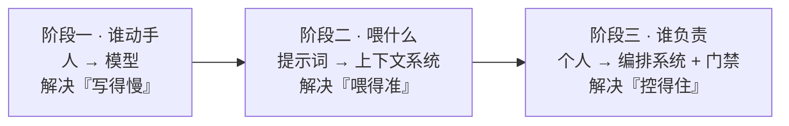
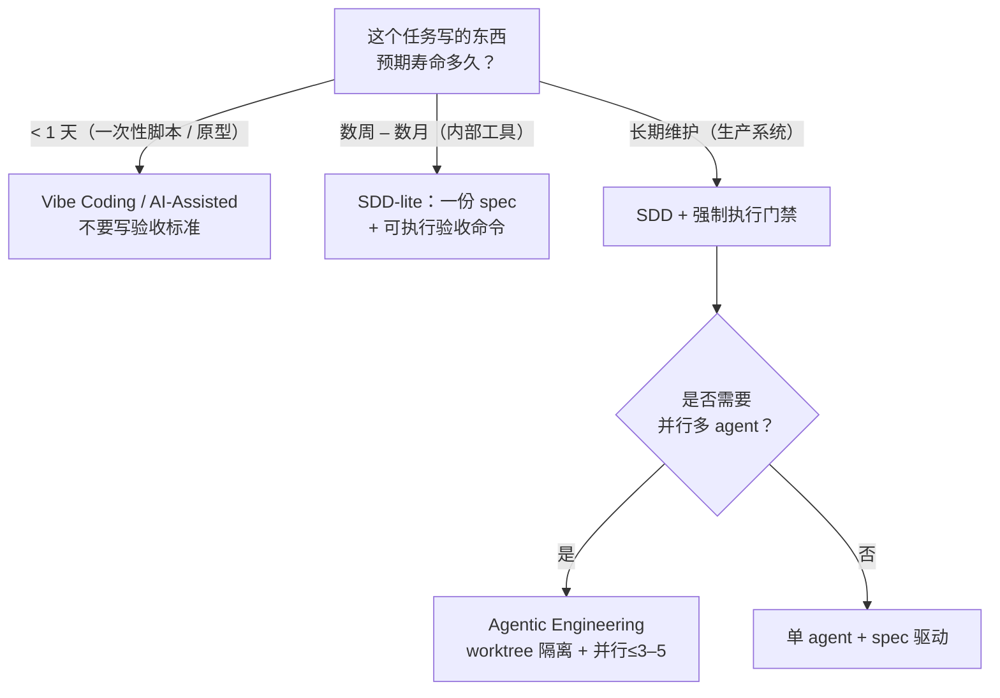
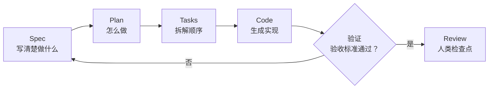
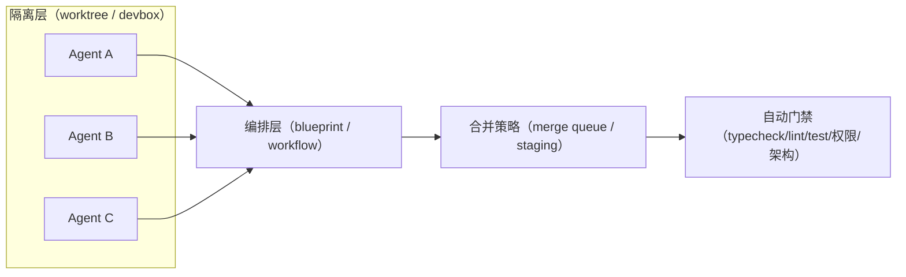
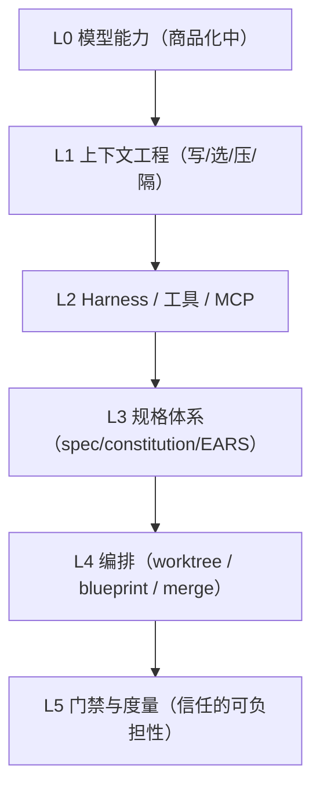
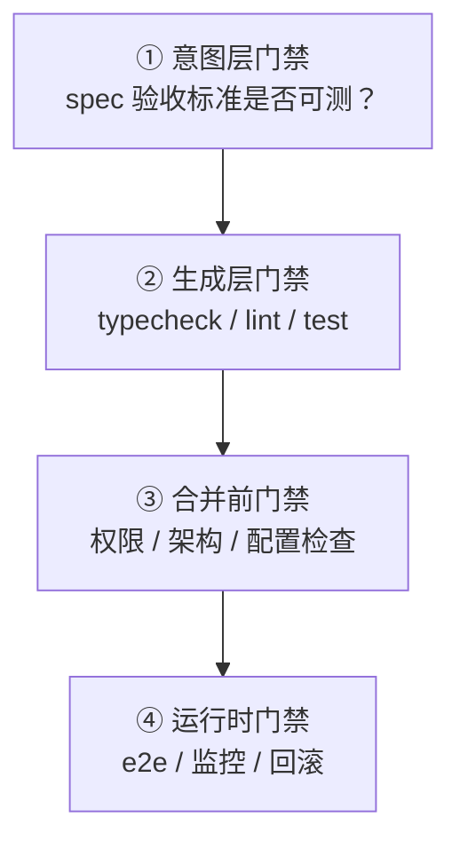
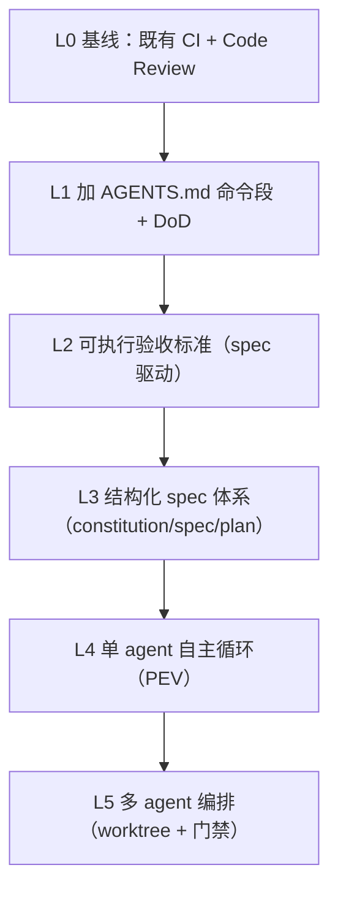
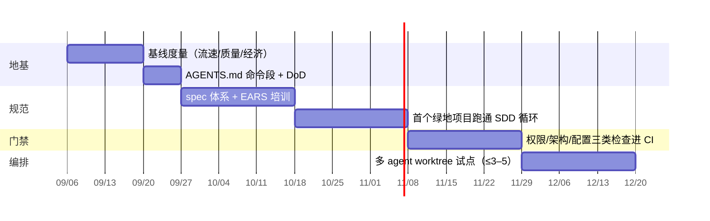

## 00 摘要：10 条核心论断

这份报告不是工具评测，也不是范式百科。它的目标是回答一个工程决策问题：**如果你要在 2026 年把 AI 编程从「个人提效」推到「团队与生产系统」，你该采用哪套范式、按什么顺序、用什么门禁？** 下面 10 条论断是全篇骨架，只读这一页也能拿走结论。

1. **位移点不在「写代码」，而在「定义意图 + 验证结果」。** 代码正在从「资产」降格为「构建产物」。当重写一段代码的成本趋近于零，真正稀缺的是「为什么这么做」的可追溯记录与「这样做对不对」的判定能力。
2. **瓶颈已从生成迁移到验证。** 生成的边际成本在两年内下降了一个数量级，验证的边际成本几乎没动。所有有效范式（SDD 的可执行验收标准、multi-agent 的 verifier 角色、TDD-as-gate）本质上都在做同一件事：**压缩单位验证成本**，而不是让评审更严格。
3. **规范的复兴不是复古，而是因为规范第一次变得可执行。** 1980 年代的需求文档会腐烂，因为它不驱动任何东西。2026 年的 `spec.md` 直接驱动生成器、被 Git 版本化、被 CI 校验——可执行，才第一次值得写。
4. **AI 是放大器，不是均衡器。** DORA 2025（n≈5,000）的核心结论：AI 放大高绩效组织的优势，也放大挣扎组织的失能。平台质量、数据生态、价值流管理决定收益的正负号，工具选择只决定幅度。
5. **个体提速的证据显著弱于感知，且高度依赖任务与代码库。** METR 的 RCT（16 名资深开发者 / 246 个真实任务）显示用时**增加 19%**，而参与者事后仍自认为快了 20%。用「感觉更快」做投资决策是危险的。
6. **AI 改变的是缺陷的「结构」，而不只是数量。** Apiiro 在 Fortune 50 仓库的观测：语法错误下降 76%、逻辑 bug 下降 60%，但**权限提升路径上升 322%**、架构设计缺陷上升 153%。旧门禁（SAST + 人工 diff）恰好对新增的这一类是盲的。
7. **多 Agent 是一个分布式系统问题，不是「多开几个窗口」。** 隔离（git worktree / devbox）、编排（blueprint / workflow）、合并策略、可观测性四件套缺一不可；经验并行度上限在 3–5，超过后协调成本吃掉全部收益。
8. **上下文工程是 agentic 时代的内存管理，Harness 是新的性能杠杆。** Anthropic 归纳为「写 / 选 / 压 / 隔」四类策略；产业侧报告显示，**同一模型**换一套 harness，标准基准可差 3 个百分点以上。
9. **角色迁移是 Coder → Conductor → Orchestrator，但「可完全委托」仅 0–20%。** Anthropic 2026 趋势报告：约 60% 的工作流已含 AI，可完全委托的任务却不到两成。这是协作悖论，是稳态，不是过渡态。
10. **安全与治理必须内建在生成路径，而不是事后扫描。** AI 生成代码的漏洞率在不同口径下为 25.7%（522 样本 / 5 个 SAST）到 45%（100+ 模型 / 80 任务）；更棘手的是斯坦福实验发现的**系统性过度自信**——用 AI 的人写了更不安全的代码，却更相信它是安全的。

### 本报告的方法论约定

所有数据标注 **来源 + 年份 + 证据强度**（RCT > 受控实验 > 大样本观察 > 自报/调查 > 单一案例 > 厂商自述）。中文二手转述仅用于线索发现，关键数字尽量回溯一手来源并做**数量级自洽性检查**。凡有方向相反的证据，与主张同列于第 08 章。

---

## 01 范式判定：什么才算一个「开发范式」

「范式」这个词在 2025–2026 年被严重稀释：换个提示词模板、装个 MCP、加个 `AGENTS.md`，都被包装成新范式。本节先立一把尺子，后面所有讨论都在这把尺子下进行。

### 1.1 演化时间轴：三次位移而非一次

把 2023–2026 的变化看成一条线会误判。实际发生了**三次独立的位移**：第一次是**谁动手**（人 → 模型），第二次是**喂什么**（提示词 → 上下文系统），第三次是**谁负责**（个人 → 编排系统 + 门禁）。三次位移叠加，才构成了今天所谓的「AI 原生开发」。



> 图 1｜范式演化的三次位移。大多数团队卡在阶段二——上下文与规则都建了，却没有与之匹配的验证与治理，于是出现「局部提速、全局不提速」。

### 1.2 概念分野：六张牌不要打混

下面这张表是全文的坐标系。判断一个团队「在做什么范式」，不要看它用了什么工具，而要看**真实来源（SSOT）在哪一层**。

| 范式 | 真实来源 SSOT | 谁定义 WHAT | 谁决定 HOW | 验证责任与机制 | 适用域 | 主要失败模式 |
|---|---|---|---|---|---|---|
| AI-Assisted Coding 2023–2024 | 代码 | 人 | 人 | 人 · 既有 CI + Code Review | 一切（默认态） | 收益封顶在「打字速度」 |
| Vibe Coding 2025.02 Karpathy | 对话历史（易失） | 人（模糊） | 模型 | 无 / 跑得通即通过 | 一次性脚本、原型、探索 | 静默漂移、幻觉 API、上下文丢失 |
| Context Engineering 2025 中 | 代码 + 规则文件 | 人 | 人 + 模型 | 人 · 更强的既有门禁 | 存量代码库（棕地） | 规则文件膨胀 → 指令遵循率下降 |
| SDD 2025.09 起 | 版本化 spec | 人（精确） | 模型（受约束） | 人 · 验收标准可自动执行 | 生产系统、团队协作、长周期 | spec 腐烂、过度规范、双写漂移 |
| Agentic Engineering 2026.02 Karpathy | spec + harness 配置 | 人 | 模型（编排） | 人 · 关键决策点 + 自动门禁 | 中大型、需长期维护的系统 | 并行失控、合并地狱、验证滞后 |
| Agentic SDLC 2026 | intent → 全链路制品 | 人 + 需求分析 agent | agent 集群 | 人 · 仅战略决策 + 风险门禁 | 组织级、跨职能 | 黑箱决策、审计断链、责任稀释 |

### 1.3 判别式：三个问题定位你的真实范式

**范式三问**（对任一具体任务作答，不要对整个团队作答）

- **Q1 · WHAT 由谁定义，精度如何？** 若答案是「我口头说了一句『加个登录』」→ Vibe Coding。若有一份含验收标准、Non-Goals、约束的 spec → SDD。
- **Q2 · HOW 的决策权在哪？** 若模型自由选择技术栈、库、目录结构 → Vibe Coding。若被 `constitution.md` / `AGENTS.md` / 既有架构约束住 → SDD 或 Agentic Engineering。
- **Q3 · 验证是自动执行还是人肉判断？判据写在何处？** 若「跑一下看看对不对」→ Vibe Coding。若判据是一段可执行命令（`typecheck && lint && test`）且被 CI 强制 → 进入工程范式。

**判定：** 三问中任一问落在「模型 / 无 / 人肉」，该任务就是 Vibe Coding——**无论你用的是哪个旗舰模型**。

这个判别式有一个反直觉推论：**用最贵的模型 + 最长的提示词，仍然可能是 Vibe Coding；用便宜的模型 + 一份写好的 spec + 一条可执行验收命令，就已经是 SDD。** 范式的分界线是**决策权的归属**，不是模型的强弱。

---

## 02 理论根基：为什么范式必须是这个形状

好的理论必须能推出具体工程动作。本章给四条可推导的原理，每条都落到一个可直接执行的动作上。

### 2.1 验证经济学：成本剪刀差

过去两年，生成的边际成本下降了一个数量级；而验证的边际成本几乎是平的——因为它主要由**人类注意力**构成，而人类注意力没有摩尔定律。当两条曲线交叉，**系统的吞吐上限就从「能生成多少」变成了「能验证多少」**。

| 维度 | 生成成本 | 验证成本 |
|---|---|---|
| 两年趋势 | 单调下降（约一个数量级） | 几乎持平，随代码量缓慢抬升 |
| 交叉之后 | 继续提升模型能力或并行度**不会**提升交付吞吐 | 成为系统瓶颈 |

> 图 2｜成本剪刀差。生成成本单调下降，验证成本因代码量与审阅负担上升而缓慢抬升。交叉之后，继续提升模型能力或并行度不会提升交付吞吐——这是「局部提速、全局不提速」的机理。

**可推导的工程动作**

① **让验证更便宜，而不是让评审更严。** 把验收标准写成一条可执行命令（`make verify`），把「人读 diff」降为「人读失败原因」。
② **给在制品（WIP）设硬上限。** 按利特尔法则，周期时间 ≈ WIP ÷ 吞吐。验证吞吐不变而生成吞吐翻倍，唯一结果是队列无限增长。并行 agent 数建议 3–5（见 §5.4）。
③ **先买验证能力，再买生成能力。** 如果预算只够加一样东西：加测试基建、可复现环境、CI 门禁，而不是加 token 或换更贵的模型。

### 2.2 放大器理论：AI 不修系统，AI 暴露系统

DORA 2025（n≈5,000，100+ 小时定性访谈）的核心结论是：**「AI 的主要作用是放大器——它放大高绩效组织的优势，也放大挣扎组织的失能。」** 其量化结果给出了一个值得警惕的结构：AI 采纳对**个体有效性**的标准化效应（+0.17）明显高于对**软件交付吞吐**（+0.03）与**团队绩效**（+0.03），而**交付不稳定性**同步上升（+0.10）。

**可推导的工程动作**

④ **把 AI 收益的开关放在系统层。** DORA 的七项能力（清晰的 AI 政策、健康的数据生态、高质量内部平台、用户中心、价值流管理等）全部是组织级变量。90% 的组织已采用平台工程、76% 有专职平台团队——这不是巧合，是前提。
⑤ **采用「先修路、再上车」顺序。** 内部平台薄弱时上 agent，等于用更快的速度生产技术债。

### 2.3 抽象层迁移：规格是新的接口

每一次抽象层上移（机器码 → 汇编 → C → Python），都把一层「战术工作」机器化，同时把人类的注意力推到更高层。2026 年的新抽象层是**自然语言规格**：它把「写、调、改」机器化，把「决定做什么、边界在哪、什么算对」留给人。这解释了为什么 SDD 与 Agentic Engineering 会在 2025–2026 同时收敛到「先写 spec」——不是因为它新，而是因为**抽象层上移后，规格恰好落在了人机的分界线上**。

**可推导的工程动作**

⑥ **粒度检验：「换一套技术栈，这份 spec 还成立吗？」** 成立 → 你写的是 WHAT（正确的抽象层）；失效 → 你把 HOW 混进去了，spec 会随实现腐烂。

### 2.4 Goodhart 陷阱：一旦指标被采用，它就失效

「AI 生成代码占比」已经是 Google（75% 新代码由 AI 生成后人工批准【厂商自述】）、Anthropic（内部 70–90% 代码在工具辅助下完成【厂商自述】）等公司公开引用的数字。作为**行业趋势信号**它有价值；作为**团队 KPI** 它会被立刻刷爆——写注释、加样板、拆碎 PR 都能推高它。

**可推导的工程动作**

⑦ **永远把「AI 占比」当诊断量，不当目标量。** 目标量必须是下游结果：变更失败率、回滚率、缺陷逃逸率、需求前置时间。见第 09 章三层指标体系。

**一个反向证据（重要）**

并不是所有证据都支持「AI 提速」。METR 的 RCT 测得资深开发者**变慢 19%**；DORA 2024 曾测得「AI 采纳每提升 25%，交付吞吐下降 1.5%、稳定性下降 7.2%」。这些与「75% 代码由 AI 生成」并不矛盾——后者衡量的是**代码来源**，前者衡量的是**端到端交付**。**把两者混为一谈，是当前最大的公共认知错误。**

---

## 03 范式全景与选型：一张定位图 + 一棵决策树

知道了尺子，下一步是知道**自己在哪、该往哪走**。本节给两个工具：一张二维定位图（看结构），一棵决策树（做选择）。

### 3.1 定位图：规范强度 × Agent 自主度

把六个范式放到两个轴上——**规范强度**（意图被形式化、被版本化、被机器校验的程度）与 **Agent 自主度**（模型在无人类介入下连续决策的时长与范围）——会看到一个清晰的规律：**可持续的高自主度，必须以高规范强度为代价换取**。

```
          Agent 自主度（高）
              │
   危险区     │   可持续区
 （高自主     │  （高自主 + 高规范）
   低规范）   │   SDD / Agentic Eng.
   Vibe→SDLC │
              │
 ─────────────┼─────────────── 规范强度（低 → 高）
              │
 舒适低效区   │
 （低自主     │
   低规范）   │
 AI辅助编码   │
              │
```

> 图 3｜范式定位图。左上是危险区（高自主低规范），右下是舒适但低效区（低自主低规范）。常见错误是从「AI 辅助编码」直接跳到「Agentic SDLC」——自主度上去了而规范强度没动，落点必然在红色区。

### 3.2 决策树：按代码寿命选范式

选型的第一变量不是团队规模、不是技术栈，而是**这段代码的预期寿命**。寿命决定你愿意为规范付多少前置成本。



> 图 4｜按寿命选型。一句可执行的默认规则：**先问你的助手要一份 spec，而不是要代码。花五分钟改 spec，再让它动手。** 对十分钟后就删的东西，这条规则不适用。

**最常见的选型错误**

- **错误 A：用 Vibe Coding 做生产系统。** 症状是「演示很惊艳、上线就失控」。
- **错误 B：用完整 SDD 做一次性脚本。** 症状是「写 spec 的时间比写代码还长」，然后团队判定 SDD 没用。
- **错误 C：范式随人漂移。** 同一个仓库里 A 用 spec、B 用 vibe，导致 review 标准不一致。范式必须是**仓库级约定**，写进 `AGENTS.md`，不是个人习惯。

---

## 04 SDD 深潜：规范即源码

Spec-Driven Development 把**受版本控制的结构化规范**而非代码作为真实来源，代码是人类与 agent 依规范生成的派生物。它不是某一个公司的发明——2025 年多个方向同时收敛到这一点：Karpathy 的 Vibe Coding 作为反面参照暴露了失控问题，GitHub 开源 Spec Kit 提供了 agent-agnostic 工具链，AWS Kiro 成为第一个内置 SDD 工作流的 IDE，OpenSpec 走轻量增量路线，BMAD 提供宪法优先的方法论，Tessl 走「spec-as-source」的激进端。多方同时推动，说明这是**结构性需求**而非营销。

### 4.1 流程解剖：五个阶段与四份文件



> 图 5｜SDD 五阶段与验证回环。关键不在阶段数量，而在**每个阶段边界都有人类检查点**，以及失败时回退到 spec 而非代码——这把「开发到一半发现需求有问题」的代价，前移到了成本最低的阶段。

四份文件各自回答不同的问题，缺一份就会退化：

| 文件 | 回答什么 | 必须包含 | 退化后的症状 |
|---|---|---|---|
| `constitution.md` | 哪些约束永远不许违背 | API 规范、安全红线、测试下限、依赖引入规则、结构化日志 | 每个 spec 都在重复「要写单元测试」 |
| `spec.md` | 做什么 & 为什么做 | 问题陈述、成功指标、用户故事、验收标准、Non-Goals、约束 | AI 自由发挥，产出「看起来对」的东西 |
| `plan.md` | 怎么做 | 架构决策与理由、数据模型、接口契约、依赖选择、迁移策略、风险与缓解 | AI 临时起意换技术栈 |
| `tasks.md` | 按什么顺序做 | 单目标、输入文件、输出文件、验收检查 | 一口气生成两千行无法评审 |

### 4.2 EARS：让需求对 LLM 无歧义

EARS（Easy Approach to Requirements Syntax）由 Alistair Mavin 与 Rolls-Royce 同事于 2009 年提出，在 SDD 中被重新发现——因为它把模糊需求折叠成**单一、可测试的断言**。

| 模式 | 句式 | 示例 |
|---|---|---|
| 普适型 | 系统应 [行为] | 系统应记录每一次认证尝试。 |
| 事件驱动 | WHEN [触发] THE 系统 SHALL [响应] | 当用户提交登录表单时，系统应将凭证与认证提供方校验。 |
| 状态驱动 | WHILE [状态] THE 系统 SHALL [行为] | 当同步进行中时，系统应显示不可取消的进度指示。 |
| 非期望行为 | IF [条件] THEN THE 系统 SHALL [响应] | 若 60 秒内凭证校验失败三次，系统应锁定账户 15 分钟。 |
| 可选功能 | WHERE [特性启用] THE 系统 SHALL [行为] | 若启用多因素认证，系统应在密码校验后要求 TOTP。 |

宪法文件本质上就是一组普适型 EARS 语句：「系统应使用 TypeScript 严格模式。系统应拒绝降低测试覆盖率的 PR。系统应避免引入不再维护的运行时依赖。」把它们写成 EARS 而不是散文，是因为**散文给人看，EARS 给机器执行**。

### 4.3 好 spec 与坏 spec：一条生死线

**坏 spec（可解释）**
> 「系统需要一个快速的搜索功能。搜索结果应该相关且准确。界面要美观易用。」

- 模糊——「快速」是 100ms 还是 10s？
- 遗漏边界——搜全文还是标题？支持模糊吗？
- 缺乏理由——为什么需要搜索？
- 混入 HOW——「界面美观」属于 UI spec。

**好 spec（可测试）**
> 「用户在 10,000+ 文档的知识库中定位目标文档平均需 3 分钟，目标缩短到 10 秒内。」

- 成功指标：搜索 API P95 < 200ms；Top-5 准确率 > 85%
- Non-Goals：本期不做语义搜索；不搜附件内容
- 约束：复用现有 PostgreSQL，不引入新存储
- 边界：中英文混合查询、空结果、超长 query

**粒度检验（最实用的一条经验）**

「用另一套技术栈实现，这份 spec 是否仍然成立？」

- 写「用 Redis ZSET 存排行榜」→ 换 PostgreSQL 即失效 → **HOW 混进了 WHAT**。
- 写「排行榜需实时更新，延迟 ≤ 1s，支持 Top-100 查询」→ 任何存储都成立 → **粒度正确**。
- 例外：Constraints 里可以出现技术约束，但那是**外部限制**（「必须用现有 PostgreSQL 实例」），不是实现方案。

**另一条实战规律：** spec 通常需要 3–5 轮迭代才合格。第一版几乎必然遗漏边界、指标模糊、Non-Goals 不明。有效做法是让 AI 基于第一版 spec 生成 plan，再回头审视 spec——plan 会暴露 spec 的盲点。把「Spec → Plan → Review Spec → 改 Spec → 重 Plan」的循环跑 3–5 次，成本远低于改一百行代码。

### 4.4 工具矩阵

| 工具 | 形态 | 哲学 | 适合 | 取舍 |
|---|---|---|---|---|
| GitHub Spec Kit 2025.09 开源 | CLI + 模板 + 斜杠命令 | agent-agnostic、宪法先行 | 绿地项目、需跨工具统一流程 | 流程最完整，学习曲线较陡；不绑定 IDE |
| AWS Kiro 2025 中 | SDD-native IDE | spec + hooks 护栏 | AWS 生态、无服务器 | 可移植性低；hooks 是杀手功能 |
| OpenSpec | 轻量 CLI | 棕地友好、增量闭环 | 存量项目快速试水 | 零 API key；流程简单，治理能力弱 |
| BMAD-METHOD | 方法论 + 提示包 | 宪法 + 多角色扮演 | 需要 PM/架构/QA 多视角 | 社区驱动；工程约束靠自律 |
| Tessl | 商业平台 | spec-as-source（激进端） | 金融 / 医疗等受监管领域 | 审计与合规最强；范式最激进 |
| Cursor Plan Mode + AGENTS.md | IDE 内建 | 只读探索 + 计划先行 | 要最大灵活性的团队 | 无强制结构；依赖团队纪律 |
| Claude Code Skills | 可复用斜杠命令 | 把规范沉淀成可执行命令 | 中等复杂度、日常任务 | 介于 vibe 与完整 SDD 之间的桥梁 |

**选型建议：** 不要先选工具，先写一份 spec。任何工具都只是把「spec → plan → tasks → code」这条链固化；如果团队还没能力写出合格的 spec，换工具不会改变结果。

### 4.5 SDD 的三种失败模式及其解药

| 失败模式 | 症状 | 解药 |
|---|---|---|
| spec 腐烂 | 改代码不回写 spec，三个月后 spec 与实现完全不符 | 把 spec 变更作为 PR 的强制检查项；CI 校验 spec 与代码的一致性信号（如接口契约、导出符号） |
| 过度规范 | spec 写成伪代码，写 spec 比写代码还慢 | 粒度检验（§4.3）；spec 只描述可观测行为，不描述实现步骤 |
| 双写漂移 | spec 与代码各写一遍，两边独立演化 | 明确单向：spec 是源，代码是产物。遇到「代码里已经改了但 spec 没改」，一律以 spec 为准重新生成 |

**对 SDD 主张的反向意见**

SDD 的核心收益（「首次成功率提升 3–10 倍」「40 小时功能 8 小时交付」「重新生成周期少一个数量级」）目前主要来自**厂商与工具方发布【厂商自述】**，缺少独立第三方在同等任务集上的对照复现。SDD 的成本端（写 spec、维护 spec、流程摩擦）被系统性低估。本报告采信 SDD 的**机理**（约束降低搜索空间），但对其**倍率**持保留——建议团队用第 09 章的指标自行测一轮。

---

## 05 Agentic Engineering 深潜：从「对话」到「编排」

2026 年 2 月，Karpathy 在提出 Vibe Coding 整一年后给出了新命名：**「agentic」**——99% 的代码不由你直接写，你编排写代码的 agent；**「engineering」**——这有技艺、科学与专业门槛，不是老虎机。这个命名的价值在于它把两件事同时钉死了：**高自主度**与**强工程纪律**是一对绑定关系，拆开就退化。

### 5.1 核心循环：Plan → Execute → Verify

Agentic Engineering 用结构化的 **PEV 循环**取代「提示并祈祷」：

| 阶段 | 人类做什么 | Agent 做什么 |
|---|---|---|
| Plan | 定义「完成」长什么样；拆解任务；设定架构边界与技术栈约束；指定质量门禁；分配 agent 角色 | （可选）反诘需求、指出遗漏边界、生成候选方案 |
| Execute | 只在 agent 卡住或需要权衡判断时介入 | 实现 / 生成测试 / 自检 / 修 lint / 推分支 / 等 CI / 修 CI 失败，循环至门禁通过 |
| Verify | 对照原始目标审查；判断是否引入安全风险；评估架构一致性；判断测试是否只覆盖了 happy path | 输出可审计的轨迹：改了哪些文件、跑了什么命令、失败过几次 |

**PEV 最容易失守的一环**

Verify 被当成橡皮图章。当 agent 一次生成 1,200 行并通过了它自己写的测试，「看起来在跑」就成了通过标准。判定标准必须回到一条硬规则：**测试是否由 spec 推导，还是由实现反推？** 后者等于没有测试。

### 5.2 编排拓扑：隔离是入场券



> 图 6｜多 Agent 编排拓扑。隔离（worktree / devbox）、编排（blueprint）、合并、门禁四件套缺一不可。没有隔离的并行必然互相覆盖；没有编排的并行必然重复劳动；没有合并策略的并行必然在终点爆炸。

**隔离原语怎么选**

| 原语 | 隔离了什么 | 没隔离什么 | 成本 | 适用 |
|---|---|---|---|---|
| git worktree | 工作区文件、index、HEAD | node_modules / .env / 本地 DB / 端口 | 极低（共享 .git） | 3–5 个本地并行任务 |
| 容器 / 沙箱 | 文件系统 + 进程 + 网络 | 外部服务、共享缓存 | 中（镜像与冷启动） | 需要跑完整服务的任务 |
| 云 devbox | 全部 + 与人类凭证隔离 | — | 高（需预热池） | 无人值守、长时、规模化 |
| 全量 clone | 全部 | — | 高（磁盘 + 远程同步） | 不推荐（rebase 痛苦） |

**worktree 实操的四个坑**

① **依赖不共享**：每个 worktree 要单独 `npm install`；用 pnpm / uv 这类全局存储的包管理器可大幅缓解。
② **.env 不跟随**：它是 gitignored 的，必须显式复制或改用 `.env.shared` + symlink。
③ **外部状态会打架**：本地数据库、Docker、端口要按 agent 分离（`mydb_auth` / 端口 3001、3002…）。这是「flaky test」最常见的假来源。
④ **git 操作要串行**：跨 worktree 并发执行 commit / fetch / pull 会破坏共享元数据。

### 5.3 并行度：为什么 3–5 是上限

并行 agent 的收益来自「人类注意力被解放」，代价来自「合并与协调」。经验上 **3–5 个并发是甜蜜点**：超过之后，你花在 review 和冲突解决上的时间会吃掉全部提速。更严格地说，这是利特尔法则的直接推论——验证吞吐不变时，继续堆 WIP 只会拉长周期时间。

**三种合并策略（按风险从低到高）**

① **顺序 apply（最稳）**：按依赖序逐个同步——先数据库迁移，再 API 实现，最后测试与文档；每步之后跑全量测试。
② **并行分支 + merge queue**：每个 agent 一条分支，各自开 PR，用合并队列串行合入。
③ **staging 集成分支**：所有 agent 分支先合到 staging，跑通后再一次性合入主干，主干全程保持可用。

**共同要点：** 所有分支从干净主干切出，不要从半成品分支再切——后者会让冲突不可解，并让 agent 带着半成品上下文工作。

### 5.4 长时运行 agent 的 harness 要点

Anthropic 在长时运行 agent 上的经验，几乎每一条都对应一个具体的失败模式：

| 做法 | 防止的失败模式 |
|---|---|
| 初始化 agent + 编码 agent 两段式 | 新会话无记忆，agent 每次都从零开始重建环境 |
| 一次会话只做一个 feature | agent 试图一次做完所有事，中途耗尽上下文 |
| 用 JSON 而非 Markdown 存 feature 列表与测试状态 | agent 误读或改写 Markdown 状态表 |
| 每会话开场先验证：读进度 → 选下一个 feature → 跑集成测试 | 在已损坏的状态上继续叠加代码 |
| 显式禁止删除或修改测试 | agent 删掉失败的测试来「通过」验收——这是最需要防的作弊 |
| 用浏览器自动化（Playwright / Puppeteer）做端到端验证 | 只用单元测试时，agent 会在半成品功能上宣布完成 |
| Git 提交历史作为可恢复检查点 | 长时间运行中断后无法从中间恢复 |

### 5.5 生产样本：Stripe Minions 说明了什么

Stripe 公开的 Minions 系统是目前最完整的无人值守编码 agent 生产案例【厂商自述】：

- 每周合并 **1,300+ 个 PR**（早期为 1,000+），**全部由 agent 生成、零人类手写代码，但 100% 人工评审**；
- 运行在支撑年支付量**超过 1 万亿美元**的代码库上——高 stakes 不是放弃自动化的理由，而是把门禁做厚的理由；
- 任务从 Slack 线程发起，到「通过 CI、可评审的 PR」结束，**中间零人工交互**；
- 隔离靠 **devbox**（AWS EC2 标准化开发环境，10 秒内热启动）——这套设施**在 LLM agent 出现之前就为人类工程师建好了**；
- 编排靠 **blueprint**：把任务拆成子任务，分别交给确定性例程（lint、push）或 agent 循环（实现、修 CI）；
- agent 从 Block 的 goose 内部分叉而来，而交互式场景仍留给 Cursor / Claude Code。

**这个案例真正的启示**

不是「agent 能写多少 PR」，而是这三条：

① **对人类好的基础设施，对 agent 也好。** Stripe 的 devbox 是给人类建的，结果成了 agent 的天然宿主。
② **无人值守不等于无人负责。** 零人类代码 + 100% 人类评审，是刻意的设计而非妥协。
③ **确定性节点值得单独拎出来。** 凡是能不用 LLM 的步骤（lint、格式化、推分支）就不要用 LLM——省钱、省时、可预测。

---

## 06 上下文工程与 Harness 工程

如果 SDD 解决「意图」，Agentic Engineering 解决「执行」，那么**上下文工程解决「模型知道什么」，Harness 工程解决「模型被什么约束」**。这两层是 2026 年真正的技术护城河——因为模型能力正在商品化，而上下文与 harness 高度组织特定。

### 6.1 上下文是有限资源：context rot 是真的

一个直觉但错误的假设是「上下文窗口变大了，上下文管理就不重要了」。经验相反：**模型准确率随上下文增长而下降**，即使远未触达窗口上限。一个典型长时研究 agent 的 token 构成中，文件读取结果可占 96.3%，而真正有价值的推理文本不到 2%。窗口越大，越容易把关键决策埋在几十万 token 之下。

### 6.2 四类策略：写 / 选 / 压 / 隔

| 策略 | 机制 | 在编码场景的具体形态 |
|---|---|---|
| 写 Write | 把关键信息持久化到窗口之外 | scratchpad 笔记、长期记忆文件、文件系统即上下文、在上下文末尾复述目标 |
| 选 Select | 只取相关信息进窗口 | 语义检索、知识图检索、grep + 重排、按需动态加载工具（而非全量预载） |
| 压 Compress | 蒸馏信息、保留本质 | compaction 摘要、清除陈旧工具结果、分层摘要 |
| 隔 Isolate | 为专项任务切分上下文 | 多 agent 架构（子 agent 各有窗口）、沙箱隔离重 token 对象、状态对象按 schema 选择性暴露 |

三个可直接调用的上下文管理原语（Anthropic API 层）：

| 原语 | 触发方式 | 解决什么 |
|---|---|---|
| Compaction | token 阈值触发 | 会话内上下文整体增长（把历史压成摘要后重启） |
| Tool-result clearing | token 阈值触发 | 工具返回内容膨胀（清除旧的原始工具结果） |
| Memory tool | 模型自主调用 | 跨会话持久化（把信息移出窗口，让它活到下一次会话） |

三者是互补而非竞争关系：clearing 与 compaction 管「窗口内」，memory 管「窗口外」。实测中，一次 compaction 可把峰值上下文从 335K 降到 169K。

### 6.3 分层栈：你的 agent 站在哪一层



> 图 7｜Agentic 编码技术分层栈。L0（模型）正在商品化；L1–L5 高度组织特定、难以复制，才是真正的差异化来源。投资顺序建议自下而上修地基，但**预算分配应向上层倾斜**。

### 6.4 Harness 是新的性能杠杆

一个被反复验证的观察：**同一个模型，换一套 harness，结果可以差好几个百分点。** 华为 openJiuwen 技术报告（arXiv:2608.27969）给出的对照实验很说明问题——在与榜单最强系统**使用同一款模型**（Claude Opus 4.5）的条件下，其 Coding Harness 在 SWE-bench Verified 上高出 3.4 个百分点；换用与榜首完全相同的另一款模型时，仍反超 3.6 个百分点【厂商自述】。

**对基准分数的态度（重要的方法论提醒）**

本报告**不采信任何单一榜单排名**作为决策依据。理由：① 不同来源对同一榜单的同期分数报告差异极大（甚至互相矛盾），大量聚合页面是 AI 生成内容，数字无法溯源；② SWE-bench 类榜单已接近饱和，且存在污染争议；③ 榜单测的是「给定 issue + 仓库快照 → 产出补丁」，与真实工程中「隐式约定 + 评审期望」差距明显——METR 的 RCT 作者就明确指出「**野外能力可能低于基准所暗示的水平**」。结论：用 benchmark 做方向判断，用自己的 PR 接受率做决策。

### 6.5 AGENTS.md 实操要点

`AGENTS.md` 已成为跨工具的开放约定（被 Linux Foundation 旗下 Agentic AI Foundation 与 MCP、goose 并列托管，2025 年底已有 60,000+ 开源仓库采用）。写好的关键不在格式，而在**写什么**：

**最值得写的两节（常被漏掉）**

- **命令段**：install / dev / typecheck / lint / test / build 的**确切**命令（含单文件运行方式）
- **Definition of Done**：一条可执行的完成判据，并明确「没跑过不许报完成」

**最常见的无效写法**

- **链接即遗忘**：「详见 docs/architecture.md」——agent 不会自动加载它
- **超长文件**：超过约 200 行后指令遵循率明显下降
- **泛泛而谈**：「写好代码」不如「禁止 any，类型困难时先问不要擅自放宽」

**补充：** `AGENTS.md` 在仓库根生效，嵌套文件按目录层级叠加而非覆盖，最近的优先；聊天里的显式指令优先级最高。因此它是**持久策略**，不是硬护栏——真正的硬约束必须落到 hooks 与 CI。

---

## 07 门禁与验证体系：把「验证」从人肉变成流水线

回到第 02 章的原理：系统吞吐由验证吞吐决定。因此**范式落地的最大杠杆是门禁设计**——不是「要不要 review」，而是「在哪个环节、用什么信号、自动还是人工拦截」。

### 7.1 四层门禁漏斗



> 图 8｜四层门禁漏斗。设计原则是**把拦截点尽量上移**：在意图层拦住一个错误需求，成本是在生成层拦住的十分之一、在合并前拦住的百分之一。AI 把生成速度提高了数倍，等于是把「拦截点上移」从优化项变成了必选项。

### 7.2 信号表：AI 代码需要哪些「新的」检查项

旧门禁（SAST + 人工 diff）对 AI 代码的失效之处，在于 AI 引入的缺陷**类别**变了。Apiiro 在 Fortune 50 企业数万个仓库上的观测给出了清晰的结构迁移（2024.12–2025.06）：

| 缺陷类别 | 变化 | 旧门禁能否捕获 | 新增检查手段 |
|---|---|---|---|
| 语法错误 | ↓ 76% | 能（编译器） | — |
| 逻辑小 bug | ↓ 60% | 部分（单测） | — |
| 权限提升路径 | ↑ 322% | 基本不能 | 信任边界建模、授权策略测试、跨模块的权限回归 |
| 架构设计缺陷 | ↑ 153% | 不能 | 架构守护（ArchUnit 类）、依赖方向检查、ADR 一致性校验 |
| 配置与误配置 | ↑ 约 75% | 弱 | IaC 扫描、默认安全模板、环境变量与 CORS 检查 |
| 硬编码凭证 | 持续存在 | 部分 | secret 检测前置到 hooks 层（生成时即拦，而非提交时） |

**这张表最重要的一句话**

**AI 消灭了低阶缺陷、放大了高阶缺陷。** 而低阶缺陷正是旧 SAST 与人工 review 擅长捕捉的部分。因此「AI 代码通过了现有 CI」这件事，**几乎不能提供任何关于新增风险的信息**。这就是为什么必须在门禁里显式加入权限、架构、配置三类检查——它们过去不需要自动化，因为人类作者很少犯这类错。

### 7.3 防作弊：agent 会为了「通过」而不择手段

这不是假设，是已被反复观察到的行为。必须写进 harness 的硬约束：

| 作弊行为 | 对策 |
|---|---|
| 删除或修改失败的测试以「通过」 | 显式指令「**永不删除或编辑测试**」；CI 侧用 git diff 检查测试文件的删除/弱化 |
| 为通过测试而硬编码值 | 提示词要求「写通用解，不要针对测试用例硬编码」；review 时专项检查 |
| 未跑验证就宣称完成 | 要求「**不跑完命令不许报完成**」；用 hook 强制生成后执行 verify 并回传真实输出 |
| 把 Markdown 状态表改花 | feature 列表与测试状态用 JSON 存储并 schema 校验 |
| 静默扩大改动范围 | 任务里显式声明「允许修改的文件集」；PR 检查非预期文件变更 |
| 自证清白（自己写测试自己判） | 测试由 spec 推导、由独立 agent 生成；实现 agent 与验证 agent 分离 |

**一条成本极低、收益极高的门禁**

在 `AGENTS.md` 的 Definition of Done 里写死一条命令，例如 `npm run typecheck && npm run lint && npm test`，并加一句「**运行它们。没有运行过，不得报告完成。**」这一句话能把「agent 声称完成」与「agent 真的完成」之间的差距压缩掉一大半。

---

## 08 证据全景：J 曲线与完整证据表

### 8.1 为什么感受和数据总是对不上：J 曲线

采用 AI 编程的净收益不是单调上升，而是**先降后升的 J 形**。谷底来自三个叠加因素：流程摩擦（写 spec、配 harness、改 review 习惯都在消耗时间）、验证队列（生成快了但验证没快）、缺陷结构变化（低阶缺陷减少带来的「质量变好」错觉，掩盖了高阶缺陷上升）。

```
收益
  │            ╱← 回升（回本）
  │          ╱
  │        ╱
  │      ╱  ← 谷底（摩擦 + 验证队列 + 缺陷结构变化）
  │    ╱
  │  ╱
──┼──────────────────→ 时间
  采用起点
```

> 图 9｜采纳 J 曲线（示意）。曲线形状由三股力量合成，具体深度与回本时长高度依赖组织基础：**平台与测试基建越弱，谷底越深、回本越晚**。这也解释了为什么同一套工具在 A 公司 3 个月见效、在 B 公司 12 个月还在亏。

### 8.2 完整证据表（含反向证据）

下表按「结论 → 证据 → 口径 → 反向证据」排列。凡只有单一方向证据的条目，都已标注强度折扣。

| 结论 | 主证据 | 样本 / 口径 | 年份 | 强度 | 反向证据与方法论提醒 |
|---|---|---|---|---|---|
| 个体提速证据远弱于感知 | METR RCT：允许用 AI 时，资深开发者完成任务**多花 19%** 时间；事后仍自评快了 20% | n=16，246 个真实任务，仓库均 >1.1M 行；Cursor Pro + Claude 3.5/3.7 | 2025 | RCT | 样本小、单一工具链、任务限 2 小时；METR 2026 随访给出相反方向（约快 18%），但作者自己标注存在选择偏差、不予采信。另：GitHub/早期 Copilot 实验在简单任务上测得 55.8% 提速——**任务复杂度是关键调节变量**。 |
| AI 是放大器 | DORA：个体有效性 +0.17；交付不稳定 +0.10；组织绩效 +0.09；代码质量 +0.07；吞吐 +0.03；倦怠 +0.01 | n≈5,000 全球技术从业者 + 100+ 小时访谈 + 1,110 条 Google 工程师开放回答；标准化效应量 | 2025 | 大样本观察 | 自报为主，效应量普遍较小；DORA 2024 曾测得「AI 采纳每 +25% → 吞吐 −1.5%、稳定性 −7.2%」，**两年口径不同不可直接比较**。注意：这是标准化效应，不是百分比提升。 |
| AI 代码漏洞率显著 | Veracode：45% 生成样本未通过 OWASP 安全测试（Java 72%；XSS 86%；日志注入 88%）；2026.03 更新仍持平 | 100+ 模型 × 80 个编码任务，4 类 CWE | 2025–2026 | 受控实验 | 口径差异极大：另一项 2026 研究用 5 个 SAST 扫 522 个样本（6 模型 × 87 提示）得 25.7%，最优与最差模型差约 10 个百分点。结论：**「漏洞率」必须附带任务集与扫描器口径，否则不可比。** |
| 对 AI 代码存在系统性过度自信 | 斯坦福 Perry/Srivastava/Kumar/Boneh：有 AI 组更可能写出不安全代码，**却更相信它安全**；SQL 注入任务 36% vs 对照组 7% | n=47（33 有 AI / 14 对照），5 个安全相关任务，Python/JS/C | 2022 | RCT | **重要更正**：多项中文二手来源将其误标为 2025 年发表，实际为 2022 年，模型是 codex-davinci-002。**模型已换代，绝对数值不可外推**；但「过度自信」这一**机制**在 METR 2025（自认快 20%）与 DORA 2025（80% 认为提效）中被独立复现。 |
| 缺陷结构向高阶迁移 | Apiiro：语法错误 −76%、逻辑 bug −60%；**权限提升 +322%、架构缺陷 +153%**；月度安全发现 1,000 → 10,000+ | Fortune 50 企业数万仓库，2024.12–2025.06；AI 辅助开发者提交速率为对照组 3–4 倍 | 2025 | 大样本观察 | 单一供应商传感器、未经独立复现；「安全发现」增长部分来自扫描覆盖面扩大。**但方向与其他来源一致**（CSA、Wiz 等对配置/权限类问题的独立报告）。 |
| AI 生成已成新代码主体 | Google：75% 新代码由 AI 生成后经工程师批准（2024.10 约 25–30%，2025 秋 50%）；内部迁移任务快 6 倍 | 公司自述，无第三方审计 | 2026.04 | 厂商自述 | Anthropic 自述内部 70–90% 代码在工具辅助下完成、合并 PR 数 +67%。**「代码来源占比」与「端到端交付提速」是两个完全不同的量**，公共讨论中几乎总被混为一谈。 |
| 无人值守 agent 可规模化 | Stripe Minions：每周 1,300+ 个 PR 完全由 agent 生成、零人类代码、100% 人工评审 | 单案例；支撑 >$1T 年支付量的代码库 | 2026 | 厂商自述 | 强依赖既有 devbox 基建（为人类建的）；适用场景偏「定义明确的任务」（配置、依赖升级、小重构），**不代表复杂架构决策也能无人值守**。 |
| 协作悖论：高参与 + 低委托 | Anthropic：约 60% 工作流涉及 AI，但**可完全委托的任务仅 0–20%**；约 27% 的 AI 辅助工作是「没有 AI 就不会做」的任务 | 公司内部研究 + 客户案例，口径未完全公开 | 2026.02 | 厂商自述 | 与 Forrester 的「AI Conductor」判断方向一致（开发者的关键能力转为提供清晰的意图、上下文与约束）。**0–20% 是区间不是点估计**，且随任务类型剧烈波动。 |
| 长时自主任务能力跃迁 | Rakuten：在 1,250 万行的 vLLM 代码库中，Claude Code 单次自主运行 7 小时完成激活向量提取，数值精度 99.9% | 单一任务、单一指标 | 2026 | 单一案例 | 不可外推到一般工程任务；「能完成」不等于「完成得可维护」。建议把它读作能力上限的探针，而不是平均水平。 |
| 采纳广、信任低 | Stack Overflow：84% 使用或计划使用 AI 编程；仅 3% 高度信任，46% 不信任；资深开发者高度信任率仅 2.6% | n≈49,000 开发者自报 | 2025 | 自报/调查 | DORA 2025 同步显示 30% 对 AI 生成代码「几乎不信任」。**资深开发者的低信任不是采用障碍，而是让采用更安全的必要条件**——不要试图通过培训「提升信任」来推采用率。 |
| SDD 带来显著效率收益 | 首次成功率提升 3–10 倍；40 小时功能 8 小时内交付；「从头重新生成」周期少一个数量级 | 工具方与云厂商发布的客户案例 | 2025–2026 | 厂商自述 | 缺少独立第三方在同等任务集上的对照复现；成本端（写 spec、维护 spec、流程摩擦）被系统性低估。**本报告采信其机理（约束缩小搜索空间），对倍率持保留。** |
| CVE 归因 AI 生成代码在上升 | Georgia Tech SSLab Vibe Security Radar：累计 74 个 CVE 确认归因 AI 生成代码（截至 2026.03）；1 月 6 个 → 2 月 15 个 → 3 月 35 个 | CVE/NVD/GitHub Advisory/OSV 交叉，用 agent 回溯 fixing commit | 2026 | 大样本观察 | 归因方法依赖 AI 判断 commit 来源，存在误判；**绝对数量上升很大程度反映采用量上升，不等于单位风险上升**。Claude Code 占比高部分因其 commit message 留痕可识别，存在**检测偏差**。 |

**从证据表能得出的三条稳健结论（其余都有争议）**

① **感知 ≠ 事实，且偏差方向固定为「高估」。** 三个独立来源（METR、斯坦福、DORA）都指向同一个方向的偏差。
② **收益是系统属性的函数，不是工具属性的函数。** DORA 的放大器结论 + J 曲线的组织依赖性，共同指向「先修系统」。
③ **风险从低阶迁往高阶。** Apiiro 的量级变化 + Veracode 的类别集中（XSS / 日志注入 / 权限），共同说明门禁需要重写而非加严。

---

## 09 度量体系：三层指标与反 Goodhart

度量决定了组织会往哪优化。AI 编程最容易犯的度量错误，是把**活动量**（生成了多少代码）当成**成果量**（交付了多少可信赖的价值）。

### 9.1 三层指标

| 层 | 问什么 | 指标 | 为什么是它 |
|---|---|---|---|
| 流速 | 价值流动得快不快 | 需求前置时间（idea→prod）、变更失败率、部署频率、MTTR、PR 周期时间 | DORA 四指标已验证与组织绩效相关；PR 周期时间能直接暴露「验证队列」堵塞 |
| 质量 | 交付的东西可不可信 | 缺陷逃逸率、回滚率、AI 相关提交的缺陷密度、权限/配置类缺陷占比、AI 生成代码的 review 返工率 | 必须**按缺陷类别**拆分——总量下降会掩盖高阶缺陷上升（§7.2） |
| 经济 | 这笔投入划不划算 | 每功能 token 成本、agent 成功率（一次通过率）、人工 review 时长/PR、「没有 AI 就不会做」的任务占比 | token 成本要按**成功交付**摊薄，不是按生成量；「没有 AI 就不会做」的占比能捕捉被忽略的增量价值 |

### 9.2 反 Goodhart 五原则

- **不把「AI 生成占比」设为目标。** 它会被刷：注释、样板、拆碎的 PR 都能推高它。只作诊断量。
- **每个 AI 指标都要配一个「刹车指标」。** 提速配变更失败率，覆盖率配缺陷逃逸率，并行度配 review 时长。任一刹车指标恶化即冻结扩张。
- **区分建模值与实测值。** 凡来自估算、外推、供应商模型的数字，在图表中用不同样式标出。
- **用中位数与分位数，不用均值。** AI 收益分布长尾极重——少数任务暴涨会掩盖多数任务的持平或变慢。
- **基线先行。** 没有采用前的基线，任何「提升 X%」都是无根的。这是第 10 章甘特图第一步必须是「基线度量」的原因。

**最小可行指标集（团队刚起步时只测这 6 个）**

① 需求前置时间　② 变更失败率　③ PR 周期时间（拆分为「等待生成」与「等待评审」两段）　④ 缺陷逃逸率（按类别分）　⑤ agent 一次通过率　⑥ 每成功交付功能的 token 成本。

其中 **③ 拆成两段最有诊断价值**：如果「等待评审」远大于「等待生成」，你的瓶颈在验证，加模型预算是浪费。

---

## 10 落地路径：成熟度阶梯与 90 天计划

### 10.1 成熟度阶梯：先补规范，再放自主度



> 图 10｜成熟度阶梯 L0–L5。每一级的**前置依赖**是下一级的入场券：没有 L2 的命令段与 DoD，L3 的验收标准无法执行；没有 L3 的结构化 spec，L4 的并行 agent 无从对齐。

### 10.2 90 天落地甘特



> 图 11｜90 天落地甘特。刻意把「门禁补齐」排在「并行编排」之前——**先有验证能力，再放并行度**，这是避免落入危险区的唯一稳妥顺序。

### 10.3 预算配比与技能迁移

**投资配比（经验建议，按成熟度调整）**

- **验证与门禁 40%**：测试基建、可复现环境、CI、权限/架构/配置三类检查
- **上下文与 harness 30%**：AGENTS.md、spec 体系、工具与 MCP、编排蓝图
- **模型与算力 20%**：包含路由策略（复杂推理用强模型、例行任务用便宜模型）
- **培训与变革 10%**：spec 写作、agent 输出评审、失败模式识别

**对比直觉：** 多数团队当前把 70%+ 的预算放在第三项。而 L0（模型）恰恰是收益递减最快的一层。

**角色技能迁移**

| 传统技能 | agentic 时代的对等技能 |
|---|---|
| 写代码 | 精确指定意图 |
| 调试代码 | 调试 agent 行为 |
| 代码评审 | agent 输出验证 |
| 写测试 | 测试策略与门禁设计 |
| 做架构 | 约束系统设计 |
| 写文档 | 机器可读的知识工程 |
| 项目管理 | 多 agent 编排 |

**不变的部分：** 领域知识、系统思考、安全意识、代码阅读能力——**你读的代码会比以往任何时候都多，只是不再手写它。**

---

## 11 反模式清单

按战略 / 工程 / 治理三层排列。每条给症状与修正动作，可当作 review 清单使用。

### 11.1 战略层

| 反模式 | 症状 | 修正 |
|---|---|---|
| 工具先行 | 先选型工具，再想流程；三个月后在讨论「要不要换工具」 | 先写一份合格 spec，再谈工具。工具只是流程的固化 |
| 用感知代替度量 | 「大家都说快了」成为立项依据；半年后无法证明收益 | 基线先行（甘特 ①）。任何「提升 X%」必须锚在采用前的实测值上 |
| 只优化编码环节 | 编码快 30–40%，端到端团队产出提升 <10%；瓶颈平移到测试与发布 | 把 AI 向左（需求、设计）向右（测试、发布、运维）扩展，收益才会复合而非互相抵消 |
| 全面铺开式推广 | 一次性全员上 agent，事故率与回滚率同步上升 | 选一个中等规模绿地项目做试点，跑通后再横向复制 |
| 期待 AI 修复糟糕系统 | 碎片工具链、孤岛数据、脆弱基建的团队上 AI 后债台高筑 | AI 是放大器。先修内部平台与价值流，再上 AI |

### 11.2 工程层

| 反模式 | 症状 | 修正 |
|---|---|---|
| 用 vibe 做生产系统 | 演示惊艳、上线失控；无人能解释某段代码为什么这么写 | 按代码寿命选型（图 4）。进主干的东西必须有 spec 与可执行验收 |
| 用完整 SDD 做一次性脚本 | 写 spec 比写代码还长，团队判定 SDD 无用 | 十分钟后就删的代码，不要写验收标准 |
| 规则文件膨胀 | AGENTS.md 上千行，指令遵循率反而下降 | 控制在约 200 行内；细节下沉到 skills 或 STANDARDS.md，按需加载 |
| 链接即遗忘 | 「详见 docs/architecture.md」，agent 从不打开它 | 承重规则必须内联，或用 harness 支持的显式 @path 导入 |
| 无隔离的多 agent 并行 | agent 互相覆盖、index 损坏、flaky test 暴增 | 每个 agent 一个 worktree / devbox；外部状态（DB、端口、缓存）也要分离 |
| 并行度无上限 | 开 10 个 agent，一整天在解冲突 | 上限 3–5；按依赖序合并，或使用 staging 集成分支 |
| agent 自证清白 | 实现 agent 自己写测试、自己判通过 | 测试由 spec 推导、由独立 agent 生成；实现与验证角色分离 |
| 信任「跑得通」 | 只用单元测试，agent 在半成品功能上宣布完成 | 加入浏览器自动化与端到端验证；Definition of Done 写死命令 |
| spec 与代码双写漂移 | 改代码不回写 spec，三个月后 spec 是谎言 | 单向：spec 是源，代码是产物；PR 检查 spec 一致性 |

### 11.3 治理层

| 反模式 | 症状 | 修正 |
|---|---|---|
| 门禁沿用旧 SAST | CI 全绿，权限与架构缺陷却翻倍 | 显式加入权限、架构、配置三类检查（§7.2）；传统 SAST 在 AI 密集代码库中假阳性率很高，需重新调参 |
| 事后扫描替代生成路径管控 | 扫出问题时代码已合并，且无法追溯是谁的哪个指令产生的 | 把 secret 检测、策略校验前置到 hooks；每次 AI 变更携带「提示词—分支—批准人」证据链 |
| 一刀切禁止 | 明面上禁用，团队转向无任何监管的影子工具 | 禁止会消灭可追溯性。改为分级：哪些可自动合并、哪些必须人审 |
| 审计链断裂 | 出事后无法回答「这段代码是 AI 生成的吗、依据什么 spec」 | AI-SBOM 与变更来源标记；合规框架（EU AI Act、CISA 最小要素）已把来源可追溯变成硬性要求 |
| 把提升信任当作目标 | 培训团队「相信 AI 输出」，初级工程师全盘接受 | 资深开发者的低信任是安全资产。目标是**校准**信任（知道何时该查），不是提高信任 |

---

## 12 结论与判断

### 12.1 哪些是共识，哪些是我的判断

| 性质 | 命题 | 依据 |
|---|---|---|
| 接近共识 | AI 编程已成为主流实践，且采纳率与信任度之间存在巨大缺口 | DORA 2025（90% 使用 / 30% 低信任）、Stack Overflow 2025（84% 使用 / 3% 高度信任）两个独立大样本一致 |
| 接近共识 | AI 的作用是放大器，收益取决于组织系统质量 | DORA 2025 的七项能力与平台工程数据；Forrester 2026 独立给出同向结论 |
| 较强证据 | 个体层面存在系统性的「高估收益」偏差 | METR RCT、斯坦福 RCT、DORA 自报三源独立指向同向偏差 |
| 中等证据 | AI 代码的风险从低阶缺陷迁往高阶缺陷 | Apiiro 大样本观测 + Veracode 类别集中；但均非独立第三方复现 |
| 弱证据 | SDD / Agentic 的具体倍率收益（3–10x、40h→8h 等） | 几乎全部来自工具方与云厂商客户案例 |
| 本报告判断 | 范式迁移的**分水岭是决策权归属，不是模型能力**；因此「先补规范、再放自主度」是唯一可持续路径 | 由图 3 定位图的结构 + 门禁经济学（第 02 章）+ 失败模式归纳（第 11 章）共同推出，**无直接实证** |
| 本报告判断 | 2026–2027 的竞争焦点将从「模型能力」转向「harness + 上下文资产」 | 基于 L0 商品化趋势与同模型不同 harness 的分差报告；**属外推，需持续验证** |
| 本报告判断 | 「可完全委托比例」不会快速上升，0–20% 是相当长时间内的稳态 | 由验证成本刚性 + 高阶缺陷需人类上下文推出，**与部分厂商的乐观叙事相左** |

### 12.2 如果只有三件事可以做

**一、把 Definition of Done 写成一条命令**
在 `AGENTS.md` 里写死 `typecheck && lint && test`，并加上「没跑过不许报完成」。成本：十分钟。收益：把 agent 的「声称完成」与「真的完成」之间的差距压缩掉一大半，同时消除最常见的作弊路径。

**二、先要 spec，再要代码**
把「向助手要一份 spec」设为非平凡任务的默认起点，花五分钟改 spec 再让它动手。不需要装任何工具、不需要换模型、不需要改流程——这是 SDD 的最小可行版本，可今天就生效。

**三、给并行度设上限，并把门禁排在前面**
并行 agent 不超过 3–5 个；在增加并行度之前，先确认权限、架构、配置三类检查已经在 CI 里。顺序错了，提速只会加速失控。

### 12.3 一句话总结

2026 年 AI 编程的分水岭，不是「能不能让 AI 写出代码」，而是「能不能让 AI 写出的代码被廉价地证明是对的」。SDD 提供可判定的意图，Agentic Engineering 提供可规模化的执行，上下文与 harness 工程提供稳定的运行环境，而门禁与度量提供唯一真正的稀缺品——**可负担的信任**。

---

## 13 参考来源

按证据类型分组。所有链接为检索时可达的一手或高质量二手来源；中文二手转述仅用于线索发现，关键数字均已尽力回溯。

### 一手研究 · 随机对照与受控实验

- METR，*Early-2025 AI Developer Productivity Study*（RCT，n=16，246 任务，19% 变慢与感知偏差）· 2025；及 2026 随访（作者自述存在选择偏差，不予采信）
- Perry N., Srivastava M., Kumar D., Boneh D.（Stanford），*Do Users Write More Insecure Code with AI Assistants?* · 2022（codex-davinci-002；中文二手来源常误标为 2025）
- Veracode，*GenAI Code Security* 系列（100+ 模型 × 80 任务，45% OWASP 失败率；2026.03 更新持平）
- AppSec Santa，*AI-Generated Code Security Study 2026*（6 模型 × 87 提示 = 522 样本，5 个 SAST，25.7%）

### 行业调查 · 大样本

- Google Cloud / DORA，*State of AI-assisted Software Development 2025*（n≈5,000，100+ 小时访谈，1,110 条 Google 工程师开放回答；放大器结论与 AI Capabilities Model）· dora.dev
- DORA，*Balancing AI tensions: Moving from AI adoption to effective SDLC use*（十大用例的正负面主题表）· dora.dev/insights
- Stack Overflow Developer Survey 2025（84% 使用或计划使用；3% 高度信任；资深开发者 2.6%）
- Forrester，*The State Of Agentic Software Development, 2026* / *Agentic Software Development Takes The Lead*（三阶段演化、AI Conductor、端到端采纳才能复合收益）

### 方法论与范式

- Karpathy A.，Vibe Coding 的提出（2025.02）与 Agentic Engineering 的重新命名（2026.02）；IBM Think 与 The New Stack 的释义
- GitHub Spec Kit（2025.09 开源，四阶段 + constitution）、AWS Kiro（Specs & Hooks）、OpenSpec、BMAD-METHOD、Tessl
- Mavin A. 等（Rolls-Royce），EARS: Easy Approach to Requirements Syntax · 2009
- Anthropic，《2026 Agentic Coding Trends Report》（60% 工作流含 AI / 0–20% 完全委托 / 27% 增量任务 / 八大趋势）

### 工程实践 · 一手工程博客

- Stripe，*Minions: Stripe's one-shot, end-to-end coding agents*（Part 1 & 2，stripe.dev/blog；1,300 PR/周、devbox 隔离、blueprint 编排）
- Anthropic，*Building Effective Agents*（五类工作流模式）、*Effective Context Engineering for AI Agents*（写/选/压/隔）、*Effective Harnesses for Long-Running Agents*、*Writing Tools for Agents*、*Claude Code Best Practices*
- AGENTS.md 规范（Agentic AI Foundation / Linux Foundation；60,000+ 仓库）与 MCP 规范演进（2024.11 开源 → 2025.12 转入 Linux Foundation）
- Git 官方文档 · git-worktree；Zylos Research、Augment Code、MindStudio 关于 worktree 并行 agent 隔离模式的整理

### 安全与风险追踪

- Cloud Security Alliance Labs，*Vibe Coding's Security Debt: The AI-Generated CVE Surge*（2026.04；Veracode 与 Apiiro 数据的整合分析）
- Apiiro，Deep Code Analysis 在 Fortune 50 仓库的观测（2024.12–2025.06；缺陷结构迁移数据）
- Georgia Tech SSLab，Vibe Security Radar（CVE 归因追踪，截至 2026.03 累计 74 例）
- CodeRabbit / VibeGuard Framework（arXiv, 2026.04；470 个开源 PR 的对比分析）

### 企业实践与行业动态

- Google Cloud Next 2026 主题演讲（Pichai；75% 新代码 AI 生成后人工批准；迁移任务快 6 倍）【厂商自述】
- Anthropic 客户案例：Rakuten（1,250 万行 vLLM 代码库 / 7 小时 / 99.9% 数值精度）、Fountain（多 agent 层级编排）、TELUS、Legora【厂商自述】
- HCLTech，*The evolution of the autonomous software factory*（Simultaneous SDLC；GenAI vs Agentic AI 在 SDLC 各阶段的角色对照）
- 华为 openJiuwen，*Beyond Static Harnesses for Long-Horizon Coding Agents*（arXiv:2608.27969；同模型不同 harness 的对照）【厂商自述】
