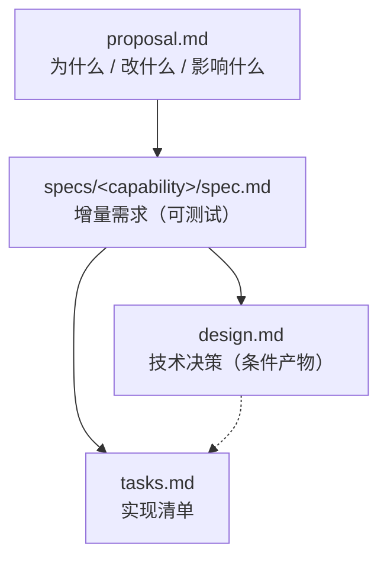

[HTML 版本](https://www.workbuddy.link/p/Vea9RFYuQQliYwiUmQcrDP?ext2=copy_link)

## 1. OpenSpec 是什么

OpenSpec 是一套**规约驱动开发（Spec-Driven Development）**的工作流工具。它要解决的问题是：在 AI 智能体参与编码的场景下，如何让"想清楚 → 写计划 → 写代码"这三个动作**不互相污染**，并且让**代码之外还有一份可追溯的事实来源**。

### 1.1 两种产物

| 产物 | 位置 | 回答的问题 | 生命周期 |
| --- | --- | --- | --- |
| **specs（规格）** | `openspec/specs/<capability>/spec.md` | 系统**现在**是什么行为（已交付、已归档的能力） | 长期存在，随每次归档增量演进 |
| **changes（变更）** | `openspec/changes/<change-name>/` | 这一次**要改什么**（尚未实现的计划） | 完成后整体移入 `changes/archive/` |

一句话：**`specs/` 是唯一事实来源，`changes/` 是待实现的增量，`archive/` 是它是如何达成的历史。**

关键差别在于 `specs/` 是**能力（capability）维度**、`changes/` 是**变更维度**。同一个能力会被多次变更反复修改，每次修改只写"增量"（delta），不重写整份规格。

### 1.2 五步循环

每个变更都走同一条闭环，本项目严格落在这条闭环上：


> 若渲染环境不支持 Mermaid，可读作线性流程：**Explore → Propose → Review → Apply → Archive →（回到 Explore）**。

每步的输入/输出与"谁在写文件"：

| 步骤 | 输入 | 输出 | 智能体是否可写文件 | 是否写业务代码 |
| --- | --- | --- | --- | --- |
| Explore | 一个模糊想法 | 更清晰的想法（对话记录） | 仅可在确认后写 OpenSpec 产物 | 否 |
| Propose | 清晰想法 | proposal / specs(delta) / design / tasks | 是 | **否（硬边界）** |
| Review | 计划产物 | 修正后的计划（人或 Agent 改） | 是（响应你的指正） | 否 |
| Apply | 变更文件夹 | 代码 + tasks 勾选 | 是 | **是** |
| Archive | 已完成的变更文件夹 | 主 specs 更新 + archive 目录 | 是 | 否 |

### 1.3 两条容易忽略的硬规则

1. **规划边界（Planning boundary）**：`openspec-propose` 技能里写得很死——"调用本工作流的请求只授权规划，即使该请求要求直接构建或修复。**不要编辑项目代码**。产物完成后停止，不要在同一轮响应里开始实现。"
2. **归档前必须同步且校验**：`archive` 不允许在主规格未同步、或同步校验未通过时移动变更目录——"Nothing has moved and `changeRoot` is intact"。即归档要么完整成功，要么完全不发生。

---

## 2. 项目与技术栈概览

### 2.1 项目本体

| 项 | 内容 |
| --- | --- |
| 产品 | 面向老年用户的 macOS 原生计算器 |
| 技术栈 | SwiftUI + AppKit（窗口控制）+ AVFoundation（语音） |
| 最低系统 | macOS 14 |
| 第三方依赖 | **零**；无网络请求 |
| 代码规模 | 7 个源文件（534 行）+ 4 个测试文件（326 行） |
| 测试 | 4 个 XCTest 文件，共 41 个测试方法 |
| OpenSpec 产物 | 1 个变更、3 份能力规格、11 条需求、20 个场景 |

### 2.2 四次提交 = 一条完整的 OpenSpec 闭环

`git log --oneline`：

```
bb41976 (HEAD -> main) chore: archive elder-friendly-calculator and sync main specs
0861499 feat: implement elder-friendly-calculator
6b1deb5 docs: propose elder-friendly-calculator change
277de51 chore: openspec init
```

| # | Commit | 类型 | 对应阶段 | 核心产出 | 代码行数变化 |
| --- | --- | --- | --- | --- | --- |
| 1 | `277de51` | chore | **Init** | 技能/命令定义、config、目录骨架 | +2402（无业务代码） |
| 2 | `6b1deb5` | docs | **Propose** | proposal + 3 份 delta spec + design + tasks | +306（无业务代码） |
| 3 | `0861499` | feat | **Apply** | 11 个 Swift 文件 + tasks 勾选 | +1295 |
| 4 | `bb41976` | chore | **Archive** | 3 份主规格 + 变更目录搬家 | +163 / -2 |

**这张表本身就是最好的教学材料**：第 2 个提交是 `docs:` 而第 3 个才是 `feat:`——规约与实现被物理隔离在两个提交里，`git log` 一眼就能看出"先有计划、后有实现"。而且第 2 个提交里 306 行新增**全部在 `openspec/` 目录内**，业务代码一行没动，正是规划边界的直接证据。

### 2.3 目录结构（当前 HEAD）

```
elder-friendly-calculator/
├── openspec/                                  ← 规约与变更的唯一事实来源
│   ├── config.yaml                            项目级配置（schema: spec-driven）
│   ├── specs/                                 已交付能力的主规格
│   │   ├── basic-arithmetic/spec.md
│   │   ├── chinese-number-readout/spec.md
│   │   └── elderly-friendly-ui/spec.md
│   └── changes/
│       └── archive/
│           └── 2026-09-10-elder-friendly-calculator/
│               ├── .openspec.yaml
│               ├── proposal.md
│               ├── design.md
│               ├── tasks.md
│               └── specs/{三份 delta}
├── .claude/                                   ← 智能体侧工作流实现
│   ├── commands/opsx/{explore,propose,apply,sync,update,archive}.md
│   └── skills/openspec-{explore,propose,apply-change,sync-specs,update-change,archive-change}/SKILL.md
├── Calculator/                                业务代码（App / State / Core / Views）
├── CalculatorTests/                           单元测试
└── Calculator.xcodeproj/                      Xcode 工程
```

注意 `openspec/changes/` 下**已经没有活跃变更**——`openspec list` 返回 `No active changes found.`，说明 `changes/` 已为下一个变更清空，闭环干净收尾。

---

## 3. 阶段 0 · Init：仓库骨架初始化

**Commit：`277de51` `chore: openspec init`（+2402 行，全部为工作流基础设施，零业务代码）**

### 3.1 产出物清单

| 产出物 | 数量 | 行数 | 职责 |
| --- | --- | --- | --- |
| `.claude/commands/opsx/*.md` | 6 | 1141 | 斜杠命令入口（`/opsx:explore`、`/opsx:propose`…） |
| `.claude/skills/openspec-*/SKILL.md` | 6 | 1229 | 每个阶段的完整操作规程（步骤 + 护栏） |
| `openspec/config.yaml` | 1 | 32 | 项目级上下文与规则 |
| `openspec/specs/.gitkeep` | 1 | 0 | 占位，保证空目录入库 |
| `openspec/changes/archive/.gitkeep` | 1 | 0 | 同上 |
| `openspec/specs/.gitkeep` 等 | — | — | — |

**命令与技能的对应关系**：命令（`commands/opsx/*.md`）是薄入口、技能（`skills/openspec-*/SKILL.md`）是厚规程。

| 斜杠命令 | 技能 | 本项目是否用到 |
| --- | --- | --- |
| `/opsx:explore` | `openspec-explore` | 用到（阶段 1，无独立提交） |
| `/opsx:propose` | `openspec-propose` | 用到 |
| `/opsx:apply` | `openspec-apply-change` | 用到 |
| `/opsx:archive` | `openspec-archive-change` | 用到 |
| `/opsx:sync` | `openspec-sync-specs` | 被 archive 内联调用 |
| `/opsx:update` | `openspec-update-change` | 未单独使用（对应阶段 3 的修订能力） |

### 3.2 `openspec/config.yaml` 详解

```yaml
schema: spec-driven

# Project context (optional)
# This is shown to AI when creating artifacts.
# Add your tech stack, conventions, style guides, domain knowledge, etc.
# ...
```

这个文件提供三类可注入智能体的输入，本项目的实际情况是**三个字段全部保留为注释模板、未填实值**：

| 字段 | 作用 | 本项目状态 |
| --- | --- | --- |
| `context` | 项目背景（技术栈、约定、领域知识），最多 51200 字节，会在起草产物前注入 | 未填写 |
| `rules` | 按产物类型的定制规则，如 `proposal: [不超过 500 字, 必须含 Non-goals]` | 未填写 |
| `operations` | `apply` / `archive` 的操作指引（如"归档前先总结结果"） | 未填写 |

**这是一个可改进点**：既然技能明确会读取 `context` 并作为约束，把"SwiftUI / macOS 14+ / 零第三方依赖 / 中文提交信息"写进去，能让后续变更的提案自动带上项目约束。详见[第 11 章](#11-观察与评价)。

### 3.3 `openspec new change` 生成的变更元数据

Propose 阶段创建变更时，脚手架会生成 `.openspec.yaml`：

```yaml
schema: spec-driven
created: 2026-09-10
```

这个文件跟随变更目录一起被归档，记录"这个变更用的是哪套 schema、什么时候建的"。它还有两个进阶用途（本项目未触发）：`skip_specs`（声明跳过规格）和 `retire_capabilities`（允许在需求清空时删除主规格文件）。

---

## 4. 阶段 1 · Explore：探索

**无独立提交** —— 这是设计使然，不是遗漏。

### 4.1 Explore 的定位（来自技能定义的原文口径）

`openspec-explore/SKILL.md` 在开头就声明：

> **IMPORTANT: Explore mode is for thinking, not implementing.** 你可以读文件、搜代码、跑只读命令，但**绝不能写代码或实现功能**。……这是一个**姿态（stance），不是工作流**：没有固定步骤、没有必需序列、没有强制产出。

技能定义的具体姿态要求：

- **好奇而非规定** —— 提自然涌现的问题，不照本宣科
- **开线头而非审问** —— 一次只问一个聚焦问题，说明"为什么这个问题重要、它解锁哪个决策"
- **可视化** —— 大量使用 ASCII 图帮助理清思路
- **务实** —— 去读真实代码库，而不是纯理论推演
- **不解锁就不写文件** —— 任何写操作前必须先说明要改哪些文件、改什么，问一个是/否问题，**单独一条消息等确认**

### 4.2 本项目探索阶段的痕迹

Explore 不产出文件，所以 Git 里没有痕迹。但探索的成果**沉淀在了 proposal.md 的 `Why` 段落里**：

> macOS 自带计算器对老年用户几乎不可用：字体小、按钮小、隐藏科学/编程模式、长数字无法快速核对位数、算错后找不到过程。目标场景是老人的日常生活账（**买菜算账、水电费、退休金核对**），核心矛盾是：让一个眼神不好、手不稳、对阿拉伯数字不敏感的老人，一次性把数算对，并且敢相信结果。

这段文字具备典型的探索特征：它不是在描述需求，而是在**定义问题**——列了具体生活场景、指出了"眼神 / 手 / 数字敏感度"三个维度、并提炼出"**算得对**"与"**敢相信**"这组核心矛盾。后面几乎所有设计决策都从这组矛盾派生：

- 因为"眼神不好" → 超大字体、四位分节
- 因为"手不稳" → 大按钮、固定窗口
- 因为"对阿拉伯数字不敏感" → 中文读法 + 语音播报（双通道确认）
- 因为"敢相信" → Decimal 精确运算（`0.1+0.2` 必须显示 `0.3`）、错误提示必须说人话

**这就是 Explore 的价值**：它把"做一个老人计算器"这种模糊需求，收敛成一组可判定的设计约束。

---

## 5. 阶段 2 · Propose：提案

**Commit：`6b1deb5` `docs: propose elder-friendly-calculator change`（+306 行，零业务代码）**

### 5.1 产出物目录树（变更创建后、实现前）

```
openspec/changes/elder-friendly-calculator/     ← changeRoot
├── .openspec.yaml          schema: spec-driven / created: 2026-09-10
├── proposal.md     35 行   为什么，以及改了什么
├── design.md       71 行   技术决策（怎么实现）
├── tasks.md        37 行   实现清单（16 项）
└── specs/                  什么是"完成"，以可测试的需求表达（增量）
    ├── basic-arithmetic/spec.md        58 行
    ├── chinese-number-readout/spec.md  48 行
    └── elderly-friendly-ui/spec.md     55 行
```

**关键特征：此时还没有一行代码。** Propose 在计划处停止，这是规划边界的体现。

四个产物的依赖关系（对应 `openspec status` 里的 `requires` 边）：



> 线性读法：**proposal → specs →（design）→ tasks**。`design.md` 是**条件产物**（技能原文："Spec-driven's `design.md` qualifies"——只在需要时才写），本项目因为要选技术栈、定精度策略，所以写了；`tasks.md` 是 `applyRequires` 里唯一被硬性要求的产物。

### 5.2 `proposal.md`：界定问题与范围

结构固定为四段，逐段看本项目的写法：

#### `## Why` —— 为什么做

不写"因为要加个功能"，而是写**待解决的矛盾**（见 4.2 节）。结尾一句话点题：核心矛盾是"一次性把数算对，并且敢相信结果"。

#### `## What Changes` —— 改了什么

以**可验收的负面清单**收尾，这是很成熟的一笔：

> - 明确不做（Non-goals）：历史记录/账本、人民币大写（留待第二版）、设置页、科学/编程模式、英文界面

Non-goals 直接决定了后面砍掉了 `%`、`+/-`、科学模式等入口，也是 specs 里"不得提供百分号 / 正负号切换 / 科学计算或编程计算功能入口"这条硬约束的来源。

#### `## Capabilities` —— 能力划分（本产物最有结构性的部分）

按 `New Capabilities` / `Modified Capabilities` 两栏组织，每个能力给出**一句话职责**，并且**能力名与后续目录名严格对应**：

| 能力名 | 一句话职责 | 对应规格文件 |
| --- | --- | --- |
| `basic-arithmetic` | 基础四则运算能力——加减乘除、小数、连续运算、清除，以及对非法运算（如除以零）给出老人友好的中文提示 | `specs/basic-arithmetic/spec.md` |
| `elderly-friendly-ui` | 适老化界面能力——大按钮大字体、固定窗口尺寸、四位分节数字显示、高对比度、浅色/深色模式适配、鼠标与键盘双输入 | `specs/elderly-friendly-ui/spec.md` |
| `chinese-number-readout` | 中文读数能力——将数字转换为中文读法文字并支持语音播报 | `specs/chinese-number-readout/spec.md` |

`Modified Capabilities` 栏明确写"（无——本变更为全新项目，不修改任何既有能力）"。**这一栏的显式留空很重要**：它证明了 Agent 检查过既有 specs（此时只有 `.gitkeep`），而不是漏写。

#### `## Impact` —— 影响面

分五类陈述：代码（全新工程，全部新增）、依赖（仅系统框架，无第三方、无网络）、系统要求（macOS、依赖系统中文语音包）、后续版本预留（Non-goals 不影响本变更范围）。

### 5.3 `specs/<capability>/spec.md`：增量规格（delta）

这是**整份计划里价值最高的产物**（评审阶段应优先读它）。它不是主规格，而是"本次变更给系统带来的变化"。

#### 格式骨架

```markdown
## Purpose                      ← 仅当引入全新能力时写，用于播种新主规格

## ADDED Requirements           ← 操作标记，四种之一
### Requirement: 能力需求名
需求陈述（用 MUST / SHALL 强制语气，可测）
#### Scenario: 场景名
- **WHEN** 触发条件
- **THEN** 可观察的预期结果
```

#### 四种操作标记（sync 时如何合并的语义）

| 标记 | 合并语义（agent-driven 智能合并） |
| --- | --- |
| `## ADDED Requirements` | 主规格没有 → 追加；已有 → 视为隐式 MODIFIED，更新为一致 |
| `## MODIFIED Requirements` | 找到对应需求，应用变化（加场景 / 改场景 / 改描述），**未提及的场景原样保留** |
| `## REMOVED Requirements` | 整块删除；若删空且满足 6 项条件（含 `.openspec.yaml` 声明 `retire_capabilities: true`）才删除整个 `spec.md`，**绝不允许留下空的 `## Requirements`** |
| `## RENAMED Requirements` | 找到 FROM 需求，重命名为 TO |

本项目是 greenfield，三份 delta **全部只有 `## ADDED Requirements`**。

#### 需求陈述的写法：强制语气 + 可测

以 `basic-arithmetic` 为例：

> **Requirement: 基础四则运算**
> 系统 **MUST** 提供加、减、乘、除四种运算，支持整数与小数操作数，运算结果必须精确显示（**不因浮点误差显示诸如 0.30000000000000004 的结果**）。
>
> 系统**不得**提供百分号（%）、正负号切换（+/-）、科学计算或编程计算功能入口。

两个细节值得学：

1. 用 `MUST` / `不得` 这类**可判定的强制语气**，而不是"支持四则运算"这种描述性语言；
2. 括号里的反例（`0.30000000000000004`）把"精确"这个模糊词**变成了可证伪的断言**——这条需求直接决定了 design.md 里"禁止 Double 参与运算路径"的决策。

#### 场景的写法：WHEN / THEN 二段式

```
#### Scenario: 小数运算结果精确显示
- **WHEN** 用户依次输入 `0`、`.`、`1`、`+`、`0`、`.`、`2`、`=`
- **THEN** 显示结果为 `0.3`
```

场景是**验收用例的规格化版本**：给一个具体输入序列，断言一个具体输出。这使"完成"变成客观的、可自动化的判定，也是后面 41 个单元测试的直接来源。

#### 三份规格的需求与场景分布

| 能力 | 需求数 | 场景数 | 场景主题 |
| --- | --- | --- | --- |
| `basic-arithmetic` | 4 | 7 | 加法 / 小数精度 / 乘法 / 连续运算 / 清除 / 除以零 / 错误后恢复 |
| `elderly-friendly-ui` | 5 | 6 | 元素尺寸 / 禁止缩放 / 长数字分节 / 短数字不分节 / 深色模式 / 键盘计算 |
| `chinese-number-readout` | 2 | 7 | 整数读法 / 含零读法 / 小数读法 / 实时更新 / 点击播报 / 播报中打断 / 错误提示播报 |
| **合计** | **11** | **20** | — |

### 5.4 `design.md`：技术决策（条件产物）

> 技能原文对 `design.md` 的定位：「本设计只回答"怎么实现"」——`proposal.md` 回答 why/what，`specs/` 回答"完成是什么样"，`design.md` 只回答 how。

结构为五段，本项目的实际内容：

#### `## Context`
一句话交代前提：仓库当前为全新空项目，动机见 proposal，行为契约见 specs。

#### `## Goals / Non-Goals`
- Goals：纯系统框架（零依赖零网络）、核心逻辑为纯函数可脱离 UI 测试、语音完全本地化
- Non-Goals：不做 iOS、不做发行工程（图标/签名/自动更新）、不抽象"主题引擎"

#### `## Decisions` —— 6 条决策，每条都带"备选 + 放弃理由"

这是 `design.md` 最有价值的部分。每条决策的组织方式是：**决策 → 理由 → 备选方案 → 为何放弃**。

| # | 决策 | 理由（可验证） | 被放弃的备选 |
| --- | --- | --- | --- |
| 1 | SwiftUI + AppKit 混合，最低 macOS 14 | 声明式布局最直白；`.windowResizability` 在 14 已稳定；语义色免费获得深浅色适配 | 纯 AppKit —— 布局代码量大，且失去免费的语义色适配 |
| 2 | 内核用 `Decimal`，**禁止 Double 参与运算路径** | 规格要求 `0.1+0.2` 显示 `0.3`，Double 必然踩坑；输入阶段以字符串累积避免入口精度损失 | `NSDecimalNumber` —— API 繁琐，`Decimal` 运算符已够用 |
| 3 | 中文读法为纯函数 `chineseReadout(of:)` | 这是最易写错、最值得测试的逻辑；语音与显示同源保证"看到的=听到的" | —（无备选，直接锁定） |
| 4 | `AVSpeechSynthesizer` + `zh-CN` | 播报前先 `stopSpeaking(.immediate)` 防叠加；**播报的是中文读法文字而非数字串**——合成器读纯数字串不可控 | — |
| 5 | 键盘用 SwiftUI `onKeyPress`，不走全局监听 | 生命周期简单；按钮需 `.focusable(false)` 避免"按回车触发上次点击的按钮" | `NSEvent.addLocalMonitorForEvents` —— 生命周期管理麻烦 |
| 6 | 单窗口单视图，MVVM 简化为一个 `@Observable` 状态对象 | 单页面应用不需要 Coordinator / 路由 | — |

决策 2 和 4 特别值得注意：它们**不是拍脑袋选的，而是被规格反推出来的**。规格说"不得显示 `0.30000000000000004`"，所以禁用 Double；规格说"看到的与听到的一致"，所以语音播报的输入是中文读法文本而不是数字串。**规格约束设计**，这是规约驱动与"先写代码再补文档"最本质的区别。

#### `## Risks / Trade-offs` —— 4 条风险，每条都带缓解方案

```
- [用户系统未安装中文语音包] → 启动时检测 zh-CN 可用性，不可用时按钮置灰并提示；中文读法显示不受影响
- [Decimal 除法精度边缘（1÷3 显示一长串 3）] → 显示层限位并去尾随零；生活账场景两位小数，长循环小数显示约 8 位可接受
- [固定窗口在高分辨率缩放下按钮过大或过小] → 以逻辑点定尺寸而非像素，跟随系统缩放
- [中文读法规则覆盖不全（亿边界、中间多组零）] → 配专门的边界用例测试集，这是测试投入最集中的地方
```

格式是 `[风险] → [缓解措施]`。注意这些风险在实现阶段被**逐条兑现**了：风险 1 → 任务 5.3；风险 2 → `DisplayFormatter.maximumFractionDigits = 8`；风险 4 → 15 个中文读法测试方法。

#### `## Open Questions`
只留一个："界面具体尺寸与字号数值在实现时按真机观感调整，不影响规格与任务拆分。"——并且明确声明它**不影响规格与任务拆分**，即不阻塞计划评审。这体现了对"哪些不确定性可以推迟"的判断。

### 5.5 `tasks.md`：实现清单

初始为 6 组 16 项，**每一项都内嵌了验收标准**（这是最值得学的一点）：

```markdown
## 1. 工程搭建

- [ ] 1.1 创建 Xcode macOS App 工程（SwiftUI、部署目标 macOS 14、纯中文 Info.plist 显示名），`xcodebuild` 编译通过
- [ ] 1.2 配置窗口固定尺寸：Window 场景 `.windowResizability(.contentSize)` 并移除 NSWindow 的 `.resizable`，运行后拖动窗口边缘无法缩放
- [ ] 1.3 建立目录分层（App / State / Core（纯逻辑）/ Views），Core 层不 import SwiftUI，可被单元测试 target 引用
```

任务分组与规格的对应关系非常清晰：

| 任务组 | 项数 | 对应规格 |
| --- | --- | --- |
| 1. 工程搭建 | 3 | 基础设施（支撑 `elderly-friendly-ui` 的固定窗口） |
| 2. 计算内核（纯逻辑，TDD） | 3 | `basic-arithmetic` |
| 3. 中文读法（纯逻辑，TDD） | 3 | `chinese-number-readout` |
| 4. 界面 | 4 | `elderly-friendly-ui` |
| 5. 语音播报 | 3 | `chinese-number-readout` |
| 6. 整体验收 | 2 | 全部规格 |

**"内嵌验收标准"是这份 tasks.md 的最大亮点**：不是"实现窗口固定尺寸"，而是"……运行后**拖动窗口边缘无法缩放**"；不是"实现显示格式化"，而是"……`123456789` → `1 2345 6789`，四位及以下不分节"。每条任务都自带一个**可在真机/测试里复核的断言**，这让 Apply 阶段的"打勾"有了客观依据，而不是凭感觉。

另外，任务标题明确标注了 **（纯逻辑，TDD）** ——把"哪些部分必须先写测试"写进了任务结构里。

### 5.6 阶段小结

| 产物 | 是否必写 | 本项目行数 | 作用 |
| --- | --- | --- | --- |
| `proposal.md` | 是 | 35 | 界定问题、范围、Non-goals、影响面 |
| `specs/*/spec.md` | 是（除非声明 `skip_specs`） | 161 | 定义"完成"——11 需求 / 20 场景 |
| `design.md` | **否**（条件产物） | 71 | 技术决策与权衡 |
| `tasks.md` | 是（`applyRequires` 唯一硬性项） | 37 | 实现清单，每项内嵌验收标准 |
| `.openspec.yaml` | 脚手架自动生成 | 2 | schema 与创建日期 |

---

## 6. 阶段 3 · Review：评审

**无独立提交** —— 评审的产出是"修改现有文件"，不新增文件，所以不产生独立提交。对应命令 `/opsx:update`（本项目未单独调用，但有间接痕迹）。

### 6.1 评审的阅读顺序（技能建议）

技能给出的顺序是：`proposal.md` → `specs/` → `tasks.md`。

1. **`proposal.md`**：这是不是正确的问题，规模是否合适？
2. **`specs/`**：**价值最高的阅读**。你会接受这些需求作为"完成"吗？
3. **`tasks.md`**：任务是否覆盖了规格，且不多不少？

### 6.2 修正的两种方式

- **自己编辑文件** —— 这些产物是纯 markdown，**文件即计划**
- **告诉智能体哪里不对** —— 例如"spec 缺少未认证的情况"，它会修订产物

### 6.3 本项目的评审痕迹

通过对比 `6b1deb5`（提案）与 `bb41976`（归档）中 `chinese-number-readout` delta 的内容，可以发现一处**文本规范化的修订**：

```diff
- 读法MUST 遵循中文计数习惯（以万、亿为单位，正确处理中间的零）。小数MUST 按位读出……
+ 读法 MUST 遵循中文计数习惯（以万、亿为单位，正确处理中间的零）。小数 MUST 按位读出……
```

中英文之间缺少空格的 `读法MUST` 被规范为 `读法 MUST`。这处修改出现在归档提交里，说明**计划产物在整个生命周期内都是可编辑的活文件**，而不是一次写死的文档——这正是技能里说的"文件即计划"。

另外，`tasks.md` 在实现提交里被整体勾选（见 7.2 节），也属于"评审/执行过程中修正计划产物"的一部分。

---

## 7. 阶段 4 · Apply：执行

**Commit：`0861499` `feat: implement elder-friendly-calculator`（+1295 / -17）**

### 7.1 产出物：11 个 Swift 文件

技能的流程是：读 `contextFiles`（proposal / specs / design / tasks）→ 逐项实现 → 每完成一项**立即**把 `- [ ]` 改成 `- [x]` → 遇到设计问题就暂停并建议更新产物。

| 分层 | 文件 | 行数 | 对应规格 |
| --- | --- | --- | --- |
| App | `Calculator/App/CalculatorApp.swift` | 34 | 窗口场景、固定尺寸（`elderly-friendly-ui`） |
| Core（纯逻辑） | `Calculator/Core/CalculatorEngine.swift` | 120 | `basic-arithmetic` |
| Core（纯逻辑） | `Calculator/Core/DisplayFormatter.swift` | 42 | `elderly-friendly-ui`（四位分节） |
| Core（纯逻辑） | `Calculator/Core/ChineseReadout.swift` | 80 | `chinese-number-readout` |
| Core | `Calculator/Core/SpeechService.swift` | 24 | `chinese-number-readout`（语音播报） |
| State | `Calculator/State/CalculatorState.swift` | 57 | 组装内核 + 语音，MVVM 状态 |
| Views | `Calculator/Views/ContentView.swift` | 177 | `elderly-friendly-ui` |
| 测试 | `CalculatorTests/CalculatorEngineTests.swift` | 153 | `basic-arithmetic` |
| 测试 | `CalculatorTests/ChineseReadoutTests.swift` | 73 | `chinese-number-readout` |
| 测试 | `CalculatorTests/DisplayFormatterTests.swift` | 58 | `elderly-friendly-ui` |
| 测试 | `CalculatorTests/CalculatorStateTests.swift` | 42 | 集成（读法实时更新、错误文本播报） |

**分层设计直接服务于规格的可测性**：`Core/` 不 `import SwiftUI`（任务 1.3 明确要求），所以运算、格式化、中文读法三个最易出错的模块可以脱离 UI 做单元测试。

### 7.2 `tasks.md` 的勾选：15 / 16

实现提交对 `tasks.md` 做了纯勾选修改（`- [ ]` → `- [x]`），**没有修改任何任务文字**：

| 分组 | 完成 |
| --- | --- |
| 1. 工程搭建 | 3/3 ✅ |
| 2. 计算内核 | 3/3 ✅ |
| 3. 中文读法 | 3/3 ✅ |
| 4. 界面 | 4/4 ✅ |
| 5. 语音播报 | 5.1 ✅ 5.2 ✅ 5.3 ✅ |
| 6. 整体验收 | **6.1 ❌ 未勾选** · 6.2 ✅ |

唯一未勾选的是 **6.1「对照 specs/ 三份规格的全部 Scenario 逐条人工验收」**——这是一项**必须人工做**的验收（含深浅色切换、窗口不可缩放、播报中打断等无法自动化的观感/交互项）。它在实现提交里没勾，在归档提交里**依然没勾**。

> 进度记录完全落在 `tasks.md` 的勾选框中，**没有隐藏状态**——这是 OpenSpec 的一个设计要点："被打断或上下文耗尽？开一个新会话再 apply，它会从第一个未勾选的任务处恢复。"

### 7.3 提交信息本身就是一份 DoD

```
feat: implement elder-friendly-calculator

面向老年用户的 macOS 原生计算器（SwiftUI，macOS 14+）：
- Decimal 运算内核：四则运算、连续运算、清除、除以零中文提示
- 大按钮大字体界面，固定窗口尺寸，四位分节显示，语义色适配深浅色
- 中文读法实时显示（万/亿规则、零处理、小数逐位读）
- AVSpeechSynthesizer 本地中文语音播报，可打断、不叠加
- 鼠标与键盘双输入；33 个单元测试全部通过

Co-Authored-By: Claude Code <noreply@anthropic.com>
```

提交正文的 5 条要点与三份规格的能力划分**一一对应**，等于把"这次交付覆盖了哪些能力"写进了版本历史。技能也建议"开启一个新的对话会话来 apply，因为实现在干净的上下文窗口中表现更好"——这条提交以 `feat:` 单独成篇，正好给了实现一个干净的边界。

---

## 8. 阶段 5 · Archive：归档

**Commit：`bb41976` `chore: archive elder-friendly-calculator and sync main specs`（+163 / -2）**

归档做**两件事**：用变更的需求更新主规格，并把整个变更文件夹移入带日期前缀的归档目录。

```
- 归档变更至 openspec/changes/archive/2026-09-10-elder-friendly-calculator
- 同步三份能力主规格：basic-arithmetic / elderly-friendly-ui / chinese-number-readout
```

### 8.1 分步拆解

#### 第 1 步：检查产物完成度
`openspec status --change <name> --json` 检查 artifacts 是否都为 `done` / `skipped`。若有未完成项，**显示警告并要求确认，但不阻塞归档**。

#### 第 2 步：检查任务完成度
读 `tasks.md`，统计 `- [ ]` 与 `- [x]`。**有未完成任务同样只警告、确认后即可继续**。本项目在此处应触发了警告（6.1 未勾选）。

#### 第 3 步：评估增量规格同步状态
用 `artifactPaths.specs.existingOutputPaths` 作为 delta 唯一来源，逐个与主规格对比，展示合并摘要后询问：
- 有变化 → "立即同步（推荐）" / "不同步直接归档"
- 已同步 → "立即归档" / "仍然同步" / "取消"

本项目选择了同步（提交信息明确写"sync main specs"）。

#### 第 4 步：内联执行 `openspec-sync-specs`（agent-driven 智能合并）
这里有个关键约束：

> **绝不允许在规格同步"在途"时归档** —— 必须内联同步并校验主规格后才能移动 `changeRoot`。……不要交给后台任务，否则第 5 步会在同步还在读 `changeRoot` 时把它搬走，导致"变更已归档、主规格却从未更新"。

同步完成后**必须重新比对**：ADDED 需求已存在、MODIFIED 需求带上了 delta 里的场景改动且其他场景完好、REMOVED 需求已消失（且不留空 `## Requirements`）、RENAMED 需求新名存在旧名消失。**任何一项不匹配就报错停止，不归档**——而且此时 `changeRoot` 未被移动，用户还有机会修。

#### 第 5 步：移动目录
```bash
mkdir -p "<changesDir>/archive"
mv "<changeRoot>" "<changesDir>/archive/2026-09-10-elder-friendly-calculator"
```
命名规则：变更名本身已带 `YYYY-MM-DD-` 前缀则原样使用，否则前置当前日期。**绝不叠加第二个日期**。`git log` 显示这是纯 rename（similarity 100%），`proposal.md` / `design.md` / `tasks.md` / 两份 delta **一个字节都没变**。

### 8.2 归档产生的三份主规格

| 主规格 | 需求数 | 来源 |
| --- | --- | --- |
| `openspec/specs/basic-arithmetic/spec.md` | 4 | delta `basic-arithmetic/spec.md` |
| `openspec/specs/elderly-friendly-ui/spec.md` | 5 | delta `elderly-friendly-ui/spec.md` |
| `openspec/specs/chinese-number-readout/spec.md` | 2 | delta `chinese-number-readout/spec.md` |

**主规格与 delta 的唯一差别是标题行**（这是 greenfield 变更的必然结果——所有需求都是 ADDED）：

```diff
- ## ADDED Requirements
+ ## Requirements
```

`## Purpose` 段逐字保留（技能规定："Add Purpose section: copy the delta's `## Purpose` body verbatim"）。

**归档后的状态**（可用 `openspec list` / `openspec list --specs` 复核）：

```
$ openspec list
No active changes found.              ← changes/ 已为下一次变更清空

$ openspec list --specs
Specs:
  basic-arithmetic           requirements 4
  chinese-number-readout     requirements 2
  elderly-friendly-ui        requirements 5

$ openspec validate --specs
✓ spec/basic-arithmetic
✓ spec/chinese-number-readout
✓ spec/elderly-friendly-ui
Totals: 3 passed, 0 failed (3 items)
```

### 8.3 归档的心理模型

技能里给的三个对照非常精准：

1. **变动前**：`specs/` 还不知道 rate limiting（对应本项目：主规格尚不存在）；增量仍躺在变更文件夹里。
2. **同步时**：增量里每条需求落入主规格——新增的追加、修改的替换旧版本；新能力得到一个新规格文件。
3. **归档后**：整个变更文件夹（含增量）移入带日期的归档，**不删除任何内容**；`changes/` 清空，`specs/` 成为系统实际行为的唯一事实来源，`archive/` 是它如何达成的历史。

> 有意思的是：`archive` 归档时**连 delta 也一起保留**。所以归档后的目录里同时存在"主规格"和"当初那份增量"，前者是结果、后者是过程。这套设计使"为什么这条需求长这样"永远可回溯。

---

## 9. 产物体系与格式规范

### 9.1 全产物一览（含生命周期的位置迁移）

| 产物 | 提出时位置 | 归档后位置 | 形态 | 生命周期 |
| --- | --- | --- | --- | --- |
| `proposal.md` | `changes/<name>/` | `changes/archive/<date>-<name>/` | md | 一次性（跟随变更） |
| `design.md` | 同上 | 同上 | md | 一次性 |
| `tasks.md` | 同上 | 同上 | md | 一次性（执行中持续勾选） |
| `specs/<cap>/*.md`（delta） | 同上 | 同上 | md | 一次性，但内容被合并进主规格 |
| `.openspec.yaml` | 同上 | 同上 | yaml | 一次性（记录 schema 与创建日期） |
| `specs/<cap>/spec.md`（主规格） | 归档时**新建** | 留在原地 | md | **长期**，每次相关变更归档后演进 |
| `changes/archive/<date>-<name>/` | 归档时**新建** | — | 目录 | **永久**历史 |
| `openspec/config.yaml` | init 时创建 | 不变 | yaml | 长期 |

### 9.2 主规格的格式

```markdown
## Purpose
（这个能力为什么存在 —— 归档时从 delta 逐字复制）

## Requirements
### Requirement: <名字>
<用 MUST/SHALL 写的强制语句>
#### Scenario: <名字>
- **WHEN** ...
- **THEN** ...
```

主规格只有 `## Requirements` 一个标题；delta 用 `## ADDED/MODIFIED/REMOVED/RENAMED Requirements`。这个"标题行差异"就是"增量 vs 快照"的机器可识别标记。

### 9.3 命名约定

| 对象 | 约定 | 本项目实例 |
| --- | --- | --- |
| 变更名 | kebab-case，动词开头 | `elder-friendly-calculator` |
| 能力名 / `capability-path` | kebab-case，可用 `/` 分层 | `basic-arithmetic` |
| 归档目录 | `YYYY-MM-DD-<change-name>` | `2026-09-10-elder-friendly-calculator` |
| 提交信息 | `conventional commits` | `chore:` / `docs:` / `feat:` / `chore:` |

### 9.4 计划产物与代码是否同一个提交？

技能的态度："Git 是另一个独立的问题。把变更文件夹与代码一起提交，你的工作流其余部分不变。**相对于 PR 何时归档是团队约定**。"

本项目采用的是**一个阶段一个提交**的粒度（init / propose / apply / archive），既不是"计划与实现同一提交"，也不是"计划跨多个提交"。这个粒度下：

- diff 边界清晰：看 `docs:` 提交就知道计划长什么样，看 `feat:` 提交就知道实现了什么
- 归档是独立提交，主规格的变更历史干净（`git log -- openspec/specs/` 只会命中归档提交）
- 代价：`feat:` 提交里混合了"业务代码"和"tasks 勾选"两类改动（这也是为什么它 -17 行）

---

## 10. 追溯矩阵：规格 → 任务 → 代码 → 测试

这是规约驱动开发最实际的收益：**每一条需求都能向下追到代码和测试，也能向上追到"为什么要做"。**

### 10.1 `basic-arithmetic`

| 规格 Scenario | 任务 | 代码 | 测试方法 |
| --- | --- | --- | --- |
| 完成一次加法运算（`1 2 + 8 =` → 20） | 2.1 | `CalculatorEngine.applyOperator/equals` | `testAddition` |
| 小数运算结果精确显示（`0.1+0.2` → `0.3`） | 2.1 | `Decimal` 内核 + `DisplayFormatter.plainString` | `testDecimalPrecision` |
| 乘法运算（`6×7` → 42） | 2.1 | `CalculatorEngine.evaluatePending` | `testMultiplication` |
| 基于上次结果继续计算（`2+3=5` 后 `+4` → 9） | 2.1 | `equals()` 后重置 `pendingOperator` | `testContinueFromLastResult` |
| 清除当前计算（`C` → 0） | 2.1 | `CalculatorEngine.clear/reset` | `testClear` |
| 除以零（`5÷0=` → "不能除以零"） | 2.2 | `errorDivideByZero` + `evaluatePending` 守卫 | `testDivideByZero` |
| 错误提示后继续计算（按 `3` 开始新输入） | 2.2 | `inputDigit` 里 `if isError { reset() }` | `testErrorRecoveryByDigit` / `testErrorRecoveryByClear` |

> 规格未覆盖但代码额外实现的边界（属于"实现中发现并补上"）：`testLeadingZeroReplaced`、`testDotOnlyOnce`、`testRepeatingDecimalDivision`（对应 design.md 风险条 2）、`testChainedOperators`。

### 10.2 `elderly-friendly-ui`

| 规格 Scenario | 任务 | 代码 | 测试方法 |
| --- | --- | --- | --- |
| 界面元素尺寸（超大按钮与字体） | 4.1 | `ContentView` 按钮网格 | **人工验收**（无自动化） |
| 禁止调整窗口（拖边缘不变） | 1.2 | `CalculatorApp` `.windowResizability(.contentSize)` | **人工验收** |
| 长数字分节显示（`123456789` → `1 2345 6789`） | 2.3 | `DisplayFormatter.grouped` | `testLongNumberGrouped` / `testFiveDigitsGrouped` |
| 短数字不分节（`1234` → `1234`） | 2.3 | 同上（`while intPart.count > 4`） | `testShortNumberNotGrouped` |
| 深色模式下显示 | 4.3 | 系统语义色 | **人工验收** |
| 键盘完成计算（`1 + 2 ⏎` → 3） | 4.4 | `ContentView` `onKeyPress` | **人工验收**（`CalculatorState` 层有间接覆盖） |

### 10.3 `chinese-number-readout`

| 规格 Scenario | 任务 | 代码 | 测试方法 |
| --- | --- | --- | --- |
| 整数读法（`123456` → 十二万三千四百五十六） | 3.1 | `ChineseReadout.integerReadout` | `testIntegerReadout` |
| 含零数字的读法（`10008` → 一万零八） | 3.1 | `fourDigitReadout` 的 `pendingZero` 机制 | `testZerosInMiddle` / `testZeroBetweenGroups` / `testMultipleZeroGroups` |
| 小数读法（`12.5` → 十二点五） | 3.2 | `ChineseReadout.readout` 小数分支 | `testDecimalReadout` / `testFractionDigitsReadIndividually` |
| 实时更新（每输入一位即更新） | 4.2 | `CalculatorState.readoutText` 计算属性 | `testReadoutUpdatesLiveWithInput` / `testReadoutFollowsResult` |
| 点击播报当前数字 | 5.1 | `SpeechService.speak` + `AVSpeechUtterance` | **人工验收**（需听觉判断） |
| 播报中重新开始计算（语音停止） | 5.2 | `CalculatorState` 每个输入动作先 `speech.stop()` | **人工验收** |
| 错误提示的播报（朗读"不能除以零"） | 3.3 | `CalculatorState.readoutText` 错误态返回 `errorText` | `testErrorTextAsReadout` |

> 任务 3.1 里列的边界用例（`100000000`→一亿、`100200300`、0、10、100000）在测试里都有独立方法：`testYi`、`testShiYi`、`testZero`、`testTen`、`testHundredThousand`、`testTrailingZerosNotRead`、`testNoZeroBetweenFullGroups`、`testNegative`、`testMaxInputLength`。

### 10.4 覆盖率观察

| 维度 | 数值 |
| --- | --- |
| 规格需求 | 11 |
| 规格场景 | 20 |
| 有自动化测试支撑的场景 | 约 13 / 20 |
| 仅能人工验收的场景 | 约 7 / 20（全部集中在 UI 观感与语音听觉） |
| 测试方法总数 | 41（Engine 13 / ChineseReadout 15 / DisplayFormatter 10 / State 3） |
| 测试代码行数 | 326 |

**"可测的写进 Core 层纯函数，不可测的留给人工验收"这个切分做得非常干净**：UI 观感、窗口缩放、语音听觉这三类无法自动化的，集中在 `elderly-friendly-ui` 和语音场景里，正好对应未勾选的 6.1 人工验收任务。而中文读法这种"规则复杂、边界多、极易写错"的逻辑被抽成纯函数，配了 15 个测试方法——正是 design.md 里预判的"测试投入最集中的地方"。

---

## 11. 观察与评价

### 11.1 做得好的地方

| # | 做法 | 证据 | 为什么值得学 |
| --- | --- | --- | --- |
| 1 | **规约与实现物理隔离** | `docs: propose`（+306，零代码）与 `feat: implement`（+1295）是两个提交 | 规划边界不靠自觉，靠提交边界强制 |
| 2 | **能力划分前置且贯穿全局** | proposal 定义 3 个能力名 → 目录名 → 规格文件名 → 测试文件大致 1:1 | 变更、规格、代码、测试用同一套词汇，追溯零成本 |
| 3 | **需求用 MUST 语气 + 反例** | "结果精确显示（不因浮点误差显示诸如 `0.30000000000000004` 的结果）" | 把模糊形容词变成可证伪断言，直接推出 design 决策 2 |
| 4 | **每条决策都带被放弃的备选** | design.md 的 6 条 Decisions 里 3 条写了"放弃 XX 因为 YY" | 未来的读者能知道"为什么不用那个更显然的方案" |
| 5 | **风险项在实现中被逐条兑现** | 风险 1 → 任务 5.3；风险 2 → `maximumFractionDigits = 8`；风险 4 → 15 个测试 | Risks 不是文档装饰，是可核对的清单 |
| 6 | **任务内嵌验收标准** | "……运行后拖动窗口边缘无法缩放"、"……`123456789` → `1 2345 6789`" | 打勾有客观依据，Apply 阶段不靠感觉 |
| 7 | **测试任务标注 TDD** | 任务组标题"计算内核（纯逻辑，TDD）"、"中文读法（纯逻辑，TDD）" | 把"先写测试"变成计划的一部分而非个人习惯 |
| 8 | **分层为可测性服务** | 任务 1.3 要求 Core 层不 import SwiftUI | 最易错的逻辑可脱离 UI 测试，13+15+10 个测试因此成立 |
| 9 | **提交信息即 DoD 摘要** | `feat:` 正文 5 条要点与 3 份规格能力一一对应 | 版本历史里直接能查到"这次交付覆盖了哪些能力" |
| 10 | **归档不删任何东西** | `git show -M` 显示 4 份产物 100% similarity rename | 主规格是结果、delta 是过程，两者并存可回溯 |
| 11 | **归档后主动清空变更区** | `openspec list` → `No active changes found` | 闭环干净，下一个变更从空状态起步 |

### 11.2 值得注意的问题与可改进点

| # | 观察 | 影响 | 建议 |
| --- | --- | --- | --- |
| 1 | **归档时仍有 1 项任务未完成（6.1 人工验收）** | 归档提交对 `tasks.md` 是 100% rename，6.1 至今为 `- [ ]`；即"三份规格的 20 个场景从未被逐条人工确认过" | OpenSpec 允许带警告归档，但这属于**把验收债记在账上**。可改为：拆出真正能自动化的场景（如键盘映射逻辑抽到 Core 层测试），并在归档前完成剩余人工项；或显式记录"人工验收已由 XX 完成" |
| 2 | **`config.yaml` 三个字段全为空注释** | 技能明确会读 `context` 并作为约束注入，此处白白浪费了一个"项目约束自动生效"的机制 | 填入 `context: \|`（SwiftUI / macOS 14+ / 零第三方依赖 / 中文提交）、`rules`（如 proposal 必须含 Non-goals）、`operations.apply.guidance`（保持测试摘要简洁） |
| 3 | **测试数量口径不一致** | 提交信息写"33 个单元测试全部通过"，实际 4 个测试文件里有 **41 个 XCTest 方法** | 提交信息里的数字口径要统一（是 test method 还是 test case），否则追溯时对不上 |
| 4 | **`.DS_Store` 已被版本控制** | `.gitignore` 里有 `.DS_Store`，但 `openspec/`、`.claude/` 下的 `.DS_Store` 已在库中（`git log` 可见） | 执行 `git rm --cached` 清理存量，`.gitignore` 只防新增 |
| 5 | **greenfield 场景下 delta 与主规格仅差标题行** | 归档后同一份内容在 `specs/` 和 `changes/archive/` 各存一份 | 这是机制的必然结果，不是问题；但读者需理解"archive 里的 delta 是历史快照，不是待同步项" |
| 6 | **未使用 `skip_specs` / `retire_capabilities` 等进阶能力** | 本项目用不到；但 `config.yaml` 的 `operations` 指引、`.openspec.yaml` 的这两个开关是处理"非代码变更"和"能力下线"的关键 | 留待后续变更实践 |
| 7 | **`.claude/` 目录下同时存在 commands 与 skills 两套定义（1141 + 1229 行）** | 存在重复表述（两者内容高度重叠） | 这是 OpenSpec 生成器的既有设计（命令=薄入口、技能=厚规程），保持不动即可，但需知道改行为时两处可能要同步 |
| 8 | **进阶指南里的"先建原型""迭代式构建"未实践** | 本项目是"一次大提案"（单变更 16 任务 1295 行代码） | 对中小需求是合适的；若变更再大，可拆成"原型 → 提案 → 一连串小变更"，减少一次 AI 会话的实现压力 |

### 11.3 一句话总结

这个项目用**四个提交**把一次完整的规约驱动开发演示得很标准：`chore: init`（装工具）→ `docs: propose`（只写计划、零代码）→ `feat: implement`（按清单打勾实现）→ `chore: archive`（同步主规格 + 归档）。它的最大价值不在于"用了 OpenSpec"，而在于**每个阶段的产出物都有明确的读者和用途**——proposal 给决策者看范围，specs 给验收者看标准，design 给后来者看权衡，tasks 给执行者看进度，主规格给所有人看系统现在是什么样。唯一明显的缺口是最后一公里：**20 个场景的逐条人工验收没有真正执行完就归档了**。

---

## 12. 可复用执行清单（SOP）

### 12.1 命令速查

| 动作 | 命令 |
| --- | --- |
| 初始化 | `openspec init` |
| 探索（思考，不写码） | `/opsx:explore <topic>` |
| 提案（生成全部计划产物） | `/opsx:propose <change-name>` |
| 查看状态 | `openspec status --change <name> --json` |
| 查看某产物怎么写 | `openspec instructions <artifact-id> --change <name> --json` |
| 列活跃变更 | `openspec list` |
| 列已交付能力 | `openspec list --specs` |
| 执行 | `/opsx:apply <change-name>` |
| 修订计划 | `/opsx:update <change-name>` |
| 只同步规格不归档 | `/opsx:sync <change-name>` |
| 归档 | `/opsx:archive <change-name>` |
| 校验规格 | `openspec validate --specs` |

### 12.2 逐阶段 Checklist

**阶段 0 · Init**
- [ ] `openspec init`，确认生成 `openspec/config.yaml` + `specs/` + `changes/archive/`
- [ ] **填写 `config.yaml` 的 `context`**（技术栈、约定、领域知识）
- [ ] 视需要填写 `rules`（各产物类型的定制规则）与 `operations`（apply/archive 指引）

**阶段 1 · Explore**
- [ ] 用 `/opsx:explore` 把想法想清楚，允许反复停留
- [ ] 让智能体调查真实代码库，不要纯理论推演
- [ ] 产出标准是"更清晰的想法"——**能提炼出核心矛盾与约束**
- [ ] 想清楚后再交接：`/openspec-propose`（可跳过第一步提示）

**阶段 2 · Propose**
- [ ] 用 kebab-case 命名变更（动词开头）
- [ ] `proposal.md`：Why 要写核心矛盾；What Changes 必须有 **Non-goals**；Capabilities 分 New / Modified 两栏并显式留空"无"
- [ ] `specs/`：需求用 **MUST/不得**；每个需求配 **WHEN/THEN** 场景；场景要能当验收用例用
- [ ] `design.md`（条件产物）：每条决策带**备选 + 放弃理由**；Risks 用 `[风险] → [缓解]` 格式
- [ ] `tasks.md`：**每条任务内嵌可复核的验收标准**；标注哪些是 TDD
- [ ] 确认此阶段**零业务代码**

**阶段 3 · Review**
- [ ] 按 `proposal → specs → tasks` 顺序读；specs 是重点
- [ ] 修正方式二选一：直接编辑文件 / 告诉智能体哪里不对
- [ ] 检查：任务是否覆盖规格且不多不少

**阶段 4 · Apply**
- [ ] 新开一个对话会话（干净上下文）
- [ ] 逐项实现，**每完成一项立即勾选**
- [ ] 被打断就从第一个未勾选处恢复
- [ ] 计划被证明有误 → 回到阶段 3 修产物再继续
- [ ] 实现中发现范围外的工作 → **暂停并上报，不要静默吸收/裁剪**

**阶段 5 · Archive**
- [ ] **先完成人工验收任务**（本项目在此处留下了缺口）
- [ ] 确认全部任务已勾选、产物齐全
- [ ] 同意同步 → 让 archive 内联跑 sync 并校验
- [ ] 校验主规格：ADDED 已存在 / MODIFIED 场景完好 / REMOVED 已消失且不留空 `## Requirements`
- [ ] 确认变更目录已移入 `changes/archive/YYYY-MM-DD-<name>/`
- [ ] `openspec validate --specs` 通过；`openspec list` 显示无活跃变更

### 12.3 常见陷阱

| 陷阱 | 后果 | 规避 |
| --- | --- | --- |
| Propose 阶段顺手把代码也写了 | 计划与实现混在一个提交，规划边界失效 | 记住 propose 技能里的硬边界；实现必须由新请求触发 |
| 归档时同步交给后台任务 | 变更被搬走而主规格从未更新 | 技能明确要求**内联同步并等待完成** |
| `specs` 未写但 `tasks` 已写就以为齐了 | `status` 只看文件是否存在 | 用每个产物的 `requires` 边传递闭包，而不是只看 `status` |
| 归档时带着未完成任务不声不响过去 | 验收债被遗忘（本项目的 6.1） | 归档前显式过一遍 checklist；有缺口就补完或明确记录 |
| 忘了填 `config.yaml` | 项目约束不会自动注入提案 | Init 阶段就填 |
| 把 archive 里的 delta 当成"待同步项" | 误判还有未同步内容 | archive 里的是历史快照 |

---

## 13. 附录

### 附录 A · 全产物清单（含行数）

```
openspec/config.yaml                                   32 行
openspec/specs/basic-arithmetic/spec.md                58 行   (4 需求)
openspec/specs/chinese-number-readout/spec.md          48 行   (2 需求)
openspec/specs/elderly-friendly-ui/spec.md             55 行   (5 需求)
openspec/changes/archive/2026-09-10-elder-friendly-calculator/
├── .openspec.yaml                                      2 行
├── proposal.md                                        35 行
├── design.md                                          71 行
├── tasks.md                                           37 行
└── specs/
    ├── basic-arithmetic/spec.md                       58 行
    ├── chinese-number-readout/spec.md                 48 行
    └── elderly-friendly-ui/spec.md                    55 行

.claude/commands/opsx/{apply,archive,explore,propose,sync,update}.md   1141 行
.claude/skills/openspec-*/SKILL.md                                     1229 行
```

### 附录 B · 关键提交命令对照

```bash
# 完整阶段轨迹
git log --oneline
# bb41976 chore: archive elder-friendly-calculator and sync main specs
# 0861499 feat: implement elder-friendly-calculator
# 6b1deb5 docs: propose elder-friendly-calculator change
# 277de51 chore: openspec init

# 提案阶段改了哪些文件（应全在 openspec/ 内）
git show --stat 6b1deb5

# 归档是纯 rename、不改内容
git show -M --stat bb41976

# tasks 勾选的全过程
git show 0861499 -- openspec/changes/elder-friendly-calculator/tasks.md

# 归档前后 delta 的文本变化
git show 6b1deb5:openspec/changes/elder-friendly-calculator/specs/chinese-number-readout/spec.md
git show bb41976:openspec/changes/archive/2026-09-10-elder-friendly-calculator/specs/chinese-number-readout/spec.md
```

### 附录 C · 让 Mermaid 优雅降级的注意事项

本文档内的 Mermaid 图都附了线性读法（如"线性读法：proposal → specs →（design）→ tasks"）。在不支持 Mermaid 的渲染环境（部分 Markdown 阅读器、纯文本终端、部分文档平台）中，图会退化为代码块，此时按线性读法理解即可，不损失信息。

---

*分析基于仓库当前 HEAD（`bb41976`）与 OpenSpec CLI 1.13.0。*
