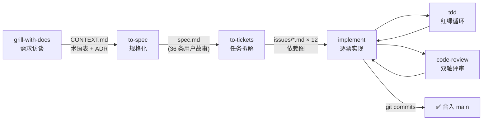
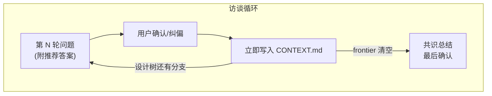
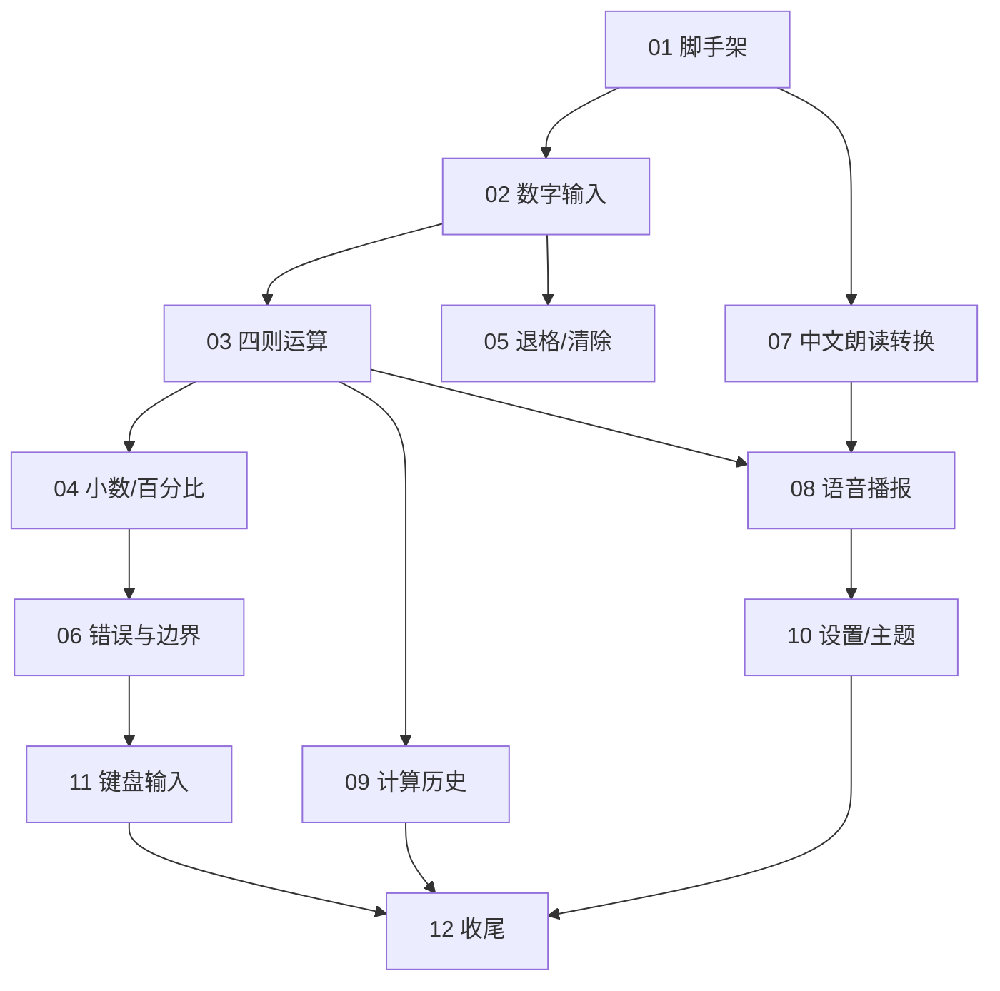
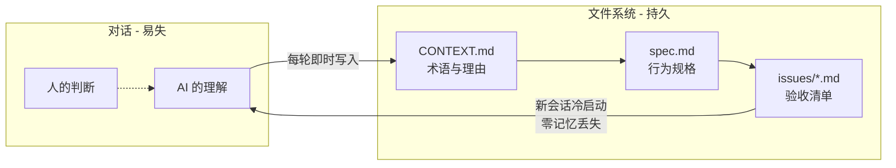

> 实践记录：我用 Claude Code 加 [mattpocock/skills](https://github.com/mattpocock/skills) 技能集，从零开发了一款 macOS 原生应用「长辈计算器」。本文以这次真实开发为主线，拆解这套"AI 原生"软件工程流水线的每个环节、它背后的设计哲学，以及实战中暴露的问题。原始对话实录见[前一篇](/posts/2026-09-17-ai-sdlc-matt-pocock-skills/)。

## 一、为什么是"AI 原生"而不是"AI 辅助"

大多数人的 AI 编码方式是：打开编辑器，描述一个需求，AI 吐出代码，人肉检查。这是 **AI 辅助**——AI 是打字快的初级程序员，工程过程还是人的那套。

**AI 原生**的含义不同：整个软件工程过程——需求澄清、规格化、任务拆解、实现、测试、评审——都围绕 AI 的特性重新设计。AI 的特性是什么？

| AI 的特性 | 对工程过程的要求 |
|---|---|
| 上下文窗口有限，塞满后质量衰减 | 任务必须切成"单个上下文能装下"的批次 |
| 每次会话开始时最"清醒" | 频繁开新会话，而不是一条会话干到底 |
| 不会主动追问，猜错了就错到底 | 需求阶段强制访谈，分歧在写代码前解决 |
| 产出无限、判断有限 | 人只做检查点决策，不做中间执行 |
| 记不住上一次的对话 | 共识必须落盘为文件，而不是留在脑子里 |

mattpocock/skills 就是围绕这张表设计的。它的口号是 "skills for engineers who actually ship"——面向真正要交付软件的工程师，而不是 demo 玩家。

## 二、工具链与全景链路

安装和初始化只需两步：

```bash
npx skills add mattpocock/skills
# 每个仓库运行一次：
/setup-matt-pocock-skills
```

初始化会问你三件事（用什么 issue tracker、triage 打什么标签、文档放哪里），然后生成仓库约定文件：

```
.
├── CLAUDE.md              # agent 的仓库级说明书
├── CONTEXT.md             # 领域术语表（grill 阶段产出）
└── docs
    └── agents
        ├── domain.md
        ├── issue-tracker.md
        └── triage-labels.md
```

核心是这条流水线：

```txt
grill-with-docs → to-spec → to-tickets → implement(→ tdd → code-review)
```

用图看更直观——注意每一环的**产出物都是文件**，下一环消费的是文件而不是对话记忆：



下面逐环节拆解。

## 三、grill-with-docs：有状态的需求访谈

这一步解决的是 AI 编码最大的坑：**你以为说清楚了，AI 以为它懂了**。

`grill-with-docs` 对你的方案做多轮访谈，每轮抛出一组问题，**每个问题都附带 AI 的推荐答案**，你只需说"都按推荐"或指出不同意见。这个设计很关键——它把"开放式的需求收集"变成了"低成本的选择题确认"，人的负担极小。

以「长辈计算器」为例，四轮访谈覆盖了：目标用户画像、功能范围、技术栈、语音播报粒度、计算语义（实体计算器式 vs 表达式式）、防误触机制、错误处理、窗口行为……直到设计树的分支全部走完，AI 主动宣布 "frontier 已清空" 并给出共识总结请你确认。

但它真正的杀手锏是**有状态（stateful）**。mattpocock 自己的对比是：其他 grilling skill 把 session 留在你脑子里；这一份把文件留在磁盘上——

- **一个术语被敲定的那一刻**，它就落地到 `CONTEXT.md`，而不是最后批量补交；
- **一个决策通过三道闸门**（不可逆 × 影响 × 分歧），它就以一条 ADR 落地。

每一轮访谈结束，你会看到 AI 当场重写 `CONTEXT.md`。比如"砍掉记忆功能"这个取舍，落地成了这样一条术语：

> **不做记忆功能**（M+/M− 等）——历史记录已覆盖"之前算的数字想再用"的场景，记忆键的隐式状态对老人是纯负担。

注意这句话不只是记录了决策，还记录了**理由**。三个月后任何人（或任何 AI）读到这里，都不需要重新争论一遍。



## 四、to-spec：接缝（Seam）先行

`to-spec` 把共识转成正式规格，发布到 `.scratch/<feature-slug>/spec.md`，标记 `Status: ready-for-agent`。

spec 的结构很传统：Problem Statement、User Stories（本项目 36 条）、Implementation Decisions、Testing Decisions、Out of Scope。**不传统的是它的写入顺序**——在写 spec 之前，AI 会先和你确认**测试接缝（seams）**。

Seam 是 Michael Feathers（《修改代码的艺术》作者）的术语：**一个无需在那个位置编辑代码就能改变行为的地点**。换句话说，seam 是测试从外部观察系统的位置。

AI 的提议是这样的：

> **接缝 1：计算引擎**——纯逻辑状态机。测试从"用户按键"这个最高点进，断言"屏幕显示什么、历史里多了什么"，完全不碰内部实现。
>
> **接缝 2：中文数字朗读转换**——纯函数，规则最复杂、最容易出错，独立成接缝。
>
> **不在接缝上的**：SwiftUI 界面、配色、语音实际播放——这些手工验证。
>
> 理由：**接缝越少越好**，这两个模块是真正独立的纯逻辑，其余都是它们的薄壳。

人确认后，这些接缝就写进了 spec 的 Testing Decisions，成为后续所有 TDD 的边界。这一步的价值在于：**架构决策（哪里是深模块、哪里是薄壳）在写代码之前就以"可测试性"的形式被双方锁定**，而不是实现到一半才想起"这玩意儿怎么测"。

## 五、to-tickets：ticket ≠ 用户故事

这是这套流程里我最欣赏的一步。36 条用户故事描述的是"系统该有什么行为"；`to-tickets` 拆的是**实现批次**——按 tracer-bullet（曳光弹）原则，每张 ticket 是**一次能端到端跑通的一小片**。

「长辈计算器」被拆成 12 张垂直切片，依赖图如下：

| # | Ticket | Blocked by |
|---|--------|-----------|
| 01 | 工程脚手架 | 无 ✅ |
| 02 | 数字输入与大屏显示 | 01 |
| 03 | 四则运算与等号 | 02 |
| 04 | 小数、正负号、百分比 | 03 |
| 05 | 退格与分级清除 | 02（可与 03 并行）|
| 06 | 错误与边界 | 04 |
| 07 | 中文数字朗读转换模块 | 01（可与主干并行）|
| 08 | 语音播报接入 | 07, 03 |
| 09 | 计算历史 | 03 |
| 10 | 设置面板与高对比双主题 | 08 |
| 11 | 键盘输入 | 06 |
| 12 | 窗口行为与应用收尾 | 09, 10, 11 |



注意几张票的切法：**一张"计算引擎"票（03）打包了链式语义、运算符替换、重复等号等十几条故事**，因为它们是同一个状态机的同一层逻辑；而"中文朗读转换"（07）单独成票，因为它和主干**可以并行**，且是独立的纯逻辑模块。这就是垂直切片和水平分层的区别——每张票都贯穿"引擎 → UI → 测试"，做完就能打开应用点点看。

这直接决定了人的介入节奏：**手工介入次数 ≈ ticket 数量**（拆票 1 次 + 每票启动 1 次，本项目 6~9 次），每次介入之间 implement 全自动。

一个容易忽略的设计意图：**频繁介入不是这套流程的缺点，而是特性**。

- 每张票之间有天然检查点，可以亲手点点看，方向错了马上纠偏——而不是等 36 条故事全写完才发现不对；
- 每张票开全新会话，AI 永远在最清醒的状态下写代码。让一个会话连续做完 36 条故事，后半程代码是上下文塞满的 AI 写的，质量衰减的代价远大于多敲几次命令。

## 六、implement：TDD 红绿循环 + 双轴评审

`/implement <issue 文件>` 是执行层，内部串起 `tdd` 和 `code-review` 两个子技能。以 ticket 03（四则运算与等号）为例，一次完整的实现过程是：

**1. 上下文装载**——读 issue 文件、CONTEXT.md、既有代码，确认依赖的 ticket 02 已完成。

**2. TDD 红绿循环**——在接缝上先写测试（红灯），再写实现（绿灯），切片推进：

- 切片 1：基本加法与完整算式 → 红灯 → `CalculatorEngine.swift` → 绿灯
- 切片 2：四则与链式执行
- 切片 3：运算符替换 / 出结果开新笔 / 重复等号
- 切片 4：结果格式化（10 位有效数字、去尾零、千分位）

最终 23 个引擎行为测试全绿。关键是**测试只断言外部行为**（按键事件 → 展示状态），不碰内部字段——这正是 spec 里锁定接缝时定下的规矩。

**3. 双轴 code review**——并行拉起两个评审 agent：

| 评审轴 | 关注点 | 实战结果 |
|---|---|---|
| **Spec 轴** | 实现是否偏离规格 | 发现真实偏差：算式行中的数字未带千分位（CONTEXT.md 要求"屏幕上的数字带千分位"）→ 补测试修复 ✅；另注明"12 + ="静默无反应是 spec 未定义行为，**留待 ticket 06 错误态处理**而不是当场拍脑袋决定 |
| **Standards 轴** | 代码标准、坏味道 | 两项轻量重构被采纳（消除数据泥团、橙色按钮去重）；一项"算式字符串拼搭"的 Primitive Obsession 建议**暂不做**——现有实现已被 23 个测试钉住，留待 ticket 09 再评估 |

**4. 收尾**——提交代码（`feat:` + `chore:` 两个 commit），勾选 issue 验收项。

整个过程中最有价值的细节是评审的处理方式：**Spec 轴发现的是"和共识的偏差"，必须修；Standards 轴给的是"判断性建议"，可以基于测试覆盖情况有理有据地拒绝**。AI 评审不再是无差别的意见倾泻，而是有优先级的工程判断。

## 七、这套流程到底解决了什么

回头看，整条流水线其实在系统性地解决 AI 编码的四个经典失败模式：

| 失败模式 | 传统做法的结局 | 本流程的解法 |
|---|---|---|
| 需求理解偏差 | 写完代码才发现做错了 | grill 多轮访谈 + 推荐答案，共识实时落盘 CONTEXT.md |
| 上下文腐化 | 长会话后半程代码质量下降 | tracer-bullet 切票，每票全新上下文 |
| 无法验证 | AI 说做完了，人不敢信 | 接缝先行 + TDD，23 个行为测试钉住语义 |
| 评审失焦 | 一次 review 几十条意见，无法处理 | 双轴分离：spec 偏差必修，标准建议可拒绝 |

以及我认为最核心的一条设计哲学——**共识的所有权在文件系统，不在对话**：



每一次会话切换、每一个新 agent 接手，都是从文件冷启动。人在访谈中说过的话可以忘，写进 CONTEXT.md 的一句都不能丢。

## 八、局限与踩坑

实战中暴露的问题，记录如下：

**1. `/implement` 的调用方式有坑。** 不带参数的 `/mattpocock-skills:implement` 会尝试执行**所有** tickets——必须显式传入单个 issue 文件路径。这在多票并行时尤其危险。

**2. AI 工具链本身的噪音需要人有判断力。** 实现过程中 SourceKit 持续报错，但 `xcodebuild` 实际编译通过——AI 正确识别了这是"缓存噪音"而非真实失败。反过来，如果 AI 没有这种判断力（或者错了呢？），"测试全绿"的结论就可能建立在幻觉上。**人的检查点价值正在于此。**

**3. spec 的完备性有边界。** "12 + ="（只有运算符没有右操作数就按等号）是 spec 没覆盖的行为，AI 的处理是"静默无反应 + 记录在案，留待错误态 ticket"。这个处理是对的，但也说明 36 条用户故事仍不可能穷尽所有边界——**Out of Scope 和"已知未定义行为"的显式记录，比假装 spec 完备更重要**。

**4. 适合的规模。** 这套流程的重型仪式（四轮访谈、12 张票、双轴评审）对「长辈计算器」这种中等复杂度项目刚好。一个 200 行的脚本用这套流程是杀鸡用牛刀；一个 10 万人日的系统可能还需要在 to-tickets 之上加一层里程碑规划。工具没有银弹，但**"访谈落盘 → 接缝先行 → 曳光弹切票 → 每票新上下文"这四个原则是规模无关的**。

## 九、结语

这次实践给我最大的冲击不是"AI 写代码有多快"，而是**工程过程本身被重新定义了**：

- 需求评审变成了多轮选择题（每轮 5~7 个问题、附推荐答案、确认成本趋近于零）；
- 架构设计以"测试接缝"的形式提前锁定；
- 任务拆解以"人的检查点节奏"为约束反推；
- 代码评审按"是否偏离共识"和"是否够好"分轴处理。

人在这条流水线里的角色，从"写代码的人"变成了**共识的仲裁者和方向的把关人**——每一次介入都发生在决策点，而不是执行点。这才是"AI 原生"的含义：不是 AI 替人干活，而是把工程过程改造成人和 AI 各自做最擅长的事。

原始对话实录（含完整的四轮访谈、spec 全文、12 张 ticket 全文和 ticket 03 的完整实现过程）见[前一篇](/posts/2026-09-17-ai-sdlc-matt-pocock-skills/)。

---

*工具链接：[mattpocock/skills](https://github.com/mattpocock/skills) · 安装：`npx skills add mattpocock/skills`*
