> **摘要**：在 LLM 标称上下文窗口动辄 1M、2M 的今天，工程落地的残酷真相却是：**上下文用得越多，模型表现往往越差**。本文基于 **Smart Zone（黄金上下文区间）** 概念，深度拆解上下文用量超越 40% 后的能力崩塌逻辑，剖析能力、行为、经济三大隐形边界，并结合“大文本处理”、“KV-Cache”等场景给出 Agent 上下文管理的最佳工程实践。

---

## 一、 引言：为什么上下文窗口越大，AI 反而越“傻”？

随着长上下文（Long-Context）技术的普及，许多开发者形成了一种思维惯性：把整个项目代码库、长篇文档、全量日志和全部历史对话一股脑塞给 AI Agent。

然而，HumanLayer 创始人 Dex Horthy 提炼出的工程实践法则表明：**当上下文占用突破标称窗口的 40% 后，AI 的输出质量、推理准确率和任务完成度会面临急剧下滑**。

为了直观展现这一现象，我们可以总结出**Smart Zone（黄金上下文区间）** 核心图景：

```mermaid
gantt
    title AI 编程助手上下文区间与边界示意图 (Smart Zone vs Danger Zone)
    dateFormat X
    axisFormat %s%%

    section 区间划定
    Smart Zone (黄金上下文区间)  :active, zone1, 0, 40
    Danger Zone (危险/衰减区间)  :crit, zone2, 40, 100

    section 核心边界拐点
    能力边界 (Accuracy Degrades, 16-24%)  :milestone, m1, 20, 20
    经济边界 (Cost Escalation, ~20%)      :milestone, m2, 20, 20
    行为边界 (Context Anxiety, ~30%)      :milestone, m3, 30, 30
    Safeguard Line (/clear 截断告警线, 40%) :milestone, m4, 40, 40
```

---

## 二、 核心公式：决定模型输出质量的两大隐形杠杆

在长上下文互动中，控制模型输出质量的本质是控制以下两个指标：

### 1. 信号密度（Signal Density）

$$\text{信号密度} = \frac{\text{任务相关 Token}}{\text{窗口内总 Token}}$$

* **工程含义**：信号密度决定了模型的“焦点清晰度”。即使塞入的内容全部与项目“相关”，过多的背景细节也会构成**信息稀释（Information Dilution）**，降低模型提取核心约束条件的能力。

### 2. 余量可见性（Margin Visibility）

$$\text{余量可见性} = \frac{\text{模型感知到的剩余空间}}{\text{完成任务所需的预估空间}}$$

* **工程含义**：模型在生成推理链（Reasoning Chain）或长代码时，会隐式评估上下文剩余空间。空间不足时会触发**行为恶化**。

---

## 三、 标称窗口内的三条隐形边界与 40% 告警线

为什么 200K 标称窗口的“黄金区间”只到 40%？因为在到达 40% 之前，系统就已经撞上了三条密集的物理/经济边界：

### 1. 经济边界（~20%）：成本与延迟的非线性激增

* **阶梯溢价**：主流 API 厂商（如 Anthropic、OpenAI 等）对长 Prompt 设有分段阶梯单价。

* **Cache Miss 暴击**：在 20% 以内，上下文变动少，KV-Cache 命中率高。一旦超过 20%，历史轨迹频繁变动导致 Cache 失效，每次请求都需要为巨量 Token 支付昂贵的全额 Prefill 费用。

* **首 Token 延迟（TTFT）**：Prefill 阶段的自注意力计算复杂度为 $O(N^2)$，过长的 Prompt 会导致严重的响应停顿。

### 2. 能力边界（16%–24%）：推理准确率断崖

* **基准实测**：根据 LOCA-bench 等基准测试，模型在长依赖推理和复杂状态下的准确率拐点普遍在 **32K（约 16%–24%）** 附近出现。

* **大海捞针（Needle in a Haystack）与首尾偏好**：受 Transformer 注意力机制影响，模型对放置在上下文中间 70% 区域的关键约束敏感度会显著下降。

### 3. 行为边界（~30%）：触发 Context Anxiety（上下文焦虑）

* **早衰与偷懒**：当上下文占用达到 30% 左右，模型感知到剩余空间受限，会触发**上下文焦虑（Context Anxiety）**。典型表现为：提前收尾（Early Termination）、偷懒跳过步骤、省略代码实现细节或给出高度概括的敷衍回答。

### 4. 40% 经验告警线（Safeguard Line）

* **缓冲区判定**：40% **不是**最佳使用上限，而是工程上的**硬性缓冲截断线**。它用来容忍突发的大文件读取或工具输出（Token Spike），也是提醒开发者**必须执行 `/clear` 清理会话**的操作临界点。

---

## 四、 关键场景剖析与认知误区

### 误区 1：“如果输入 70% 全是任务相关原文，准确率就不会差？”

**案例**：用长篇小说原文进行“万字总结归纳”。

* **错误直觉**：输入占了 70%，信息最全，总结应该最准。
* **真实结果**：**质量严重下滑**。

1. **信号密度极低**：全书 98% 的描写和细节对“总结”这一任务而言都是背景噪声，核心剧情被严重稀释。

2. **极度挤压输出空间**：生成“万字总结”需要极其庞大的思考和生成空间，70% 的输入占用直接让余量可见性降至冰点，引发严重的上下文焦虑，导致模型生成 3000 字就草草收尾。

* **工程解法**：采用 **Map-Reduce（分治与递归提取）** 架构。先将章节分块提炼出高浓度梗概（Map），再把控制在 20% 以内的梗概喂给模型生成万字总成（Reduce）。

### 误区 2：“KV-Cache 命中率极高（90% 折扣），黄金区间就能无限扩大？”

* **真实影响**：高 KV-Cache 命中率确实能将**经济边界**从 20% 放宽至 40%–50%。

* **隐形瓶颈**：
1. **一次 Cache Miss 成本极惨重**：会按高阶梯单价重新支付 40%+ 巨量 Token 的 Prefill 费用。

2. **Decode 速度变慢**：生成阶段每个新 Token 仍需全量读取 KV-Cache 显存，拖慢吞吐率。

3. **能力与行为边界不可逆**：KV-Cache 解决了“便宜和速度”，但**完全无法修复注意力稀释导致的能力断崖与行为焦虑**。

---

## 五、 AI Agent 黄金上下文管理最佳实践

1. **严格管理 I/O 数据结构**：编程 Agent 消耗上下文的大头通常是 Tool Return（如文件树、Terminal 输出、大型 API 响应），必须通过剪枝和摘要裁剪结构。

2. **及时清理错误轨迹**：上下文里最昂贵的是“失败的尝试与纠错历史”。在一个方向上连续纠错 2 次以上，应直接执行 `/clear` 并重构 Prompt。

3. **保持高信号密度与高余量可见性**：时刻将上下文控制在 **0%–30% 的核心甜点区**，为 Agent 预留充足的推理与生成空间。