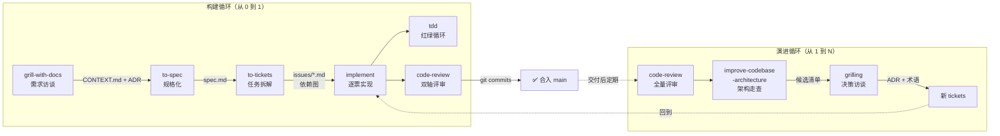
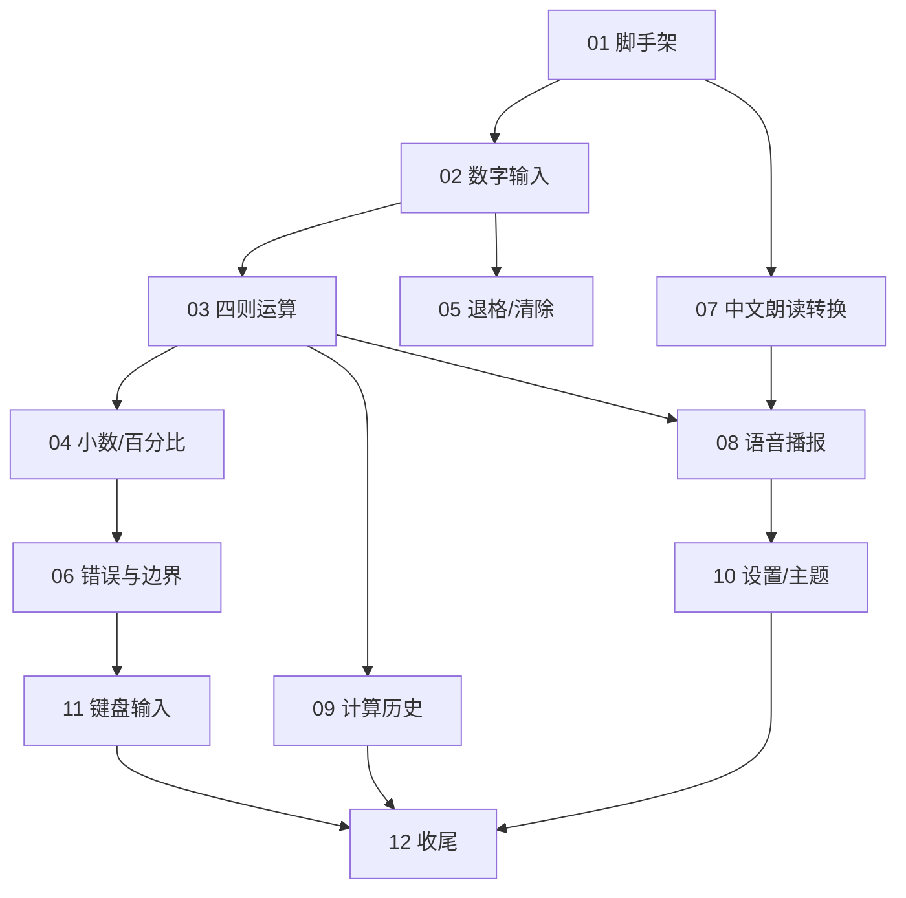

> 这是一份**可以照着做**的 AI 原生软件开发工作流指南。我用 Claude Code 加 [mattpocock/skills](https://github.com/mattpocock/skills) 技能集，从零开发了一款 macOS 原生应用「长辈计算器」，并在交付后走完了完整的架构演进循环。本文拆解这条工作流的每一个环节——**为什么这样设计（所以然）、具体怎么做（操作步骤）、实战中长什么样（真实证据）**——让没有经验的开发者也能照着走完全程。完整对话实录见[实践实录](/posts/2026-09-17-ai-sdlc-matt-pocock-skills/)，速读版见[上一篇实践总结](/posts/2026-09-18-ai-native-sdlc-practice/)。

## 一、为什么需要「AI 原生」工作流

大多数人的 AI 编码方式是：打开编辑器，描述一个需求，AI 吐出代码，人肉检查。这是 **AI 辅助**——AI 是打字快的初级程序员，工程过程还是人的那套。

**AI 原生**的含义不同：整个软件工程过程——需求澄清、规格化、任务拆解、实现、测试、评审、演进——都围绕 AI 的特性重新设计。

### 1.1 四个经典失败模式

mattpocock/skills 的作者 Matt Pocock 在仓库 README 里总结了他观察到的四个 AI 编码失败模式，这套技能集就是对着这四个失败模式设计的。理解它们，就理解了整条工作流的"所以然"：

**失败模式 #1：智能体做的不是我要的（misalignment）**

> "No-one knows exactly what they want" —— 《程序员修炼之道》

软件开发最常见的失败是供需错位：你以为开发懂了，看到成品才发现完全不是那么回事。AI 时代一模一样——你和智能体之间隔着一条沟通鸿沟。药方是 **grilling（盘问式访谈）**：让智能体在动手之前，先把你追问到无处可逃。

**失败模式 #2：智能体太啰嗦（没有共享语言）**

> "With a ubiquitous language, conversations among developers and expressions of the code are all derived from the same domain model." —— Eric Evans《领域驱动设计》

项目开始时，开发者和领域专家说的是两种语言。智能体被扔进项目时也一样，只能边猜边学，于是一句话能说清的事它用二十句。药方是一份**共享术语表（CONTEXT.md）**。它的好处不只是省字：变量、函数、文件命名全都跟着术语表走，代码库对智能体更好导航，它思考时烧的 Token 都更少。

**失败模式 #3：代码不工作（没有反馈环）**

> "The rate of feedback is your speed limit." —— 《程序员修炼之道》

就算需求对齐了，智能体还是会产出垃圾——如果它得不到"代码跑起来到底对不对"的反馈，就是闭着眼睛飞。药方是反馈环：静态类型、自动化测试，尤其是 **TDD 红绿循环**——先写一个失败的测试，再让它通过，智能体的每一步都有即时反馈。

**失败模式 #4：滚成泥石流（熵增加速）**

> "The best modules are deep." —— John Ousterhout《A Philosophy of Software Design》

智能体让写代码变快，也让软件熵增变快——代码库以前所未有的速度腐化。药方是**真正关心代码设计**：深模块、清晰的接缝、定期的架构走查。

### 1.2 从 AI 特性反推工程过程

换一个角度，从 AI 的客观特性出发，可以直接反推出工程过程必须长什么样：

| AI 的特性 | 对工程过程的要求 |
|---|---|
| 上下文窗口有限，塞满后质量衰减 | 任务必须切成"单个上下文能装下"的批次 |
| 每次会话开始时最"清醒" | 频繁开新会话，而不是一条会话干到底 |
| 不会主动追问，猜错了就错到底 | 需求阶段强制访谈，分歧在写代码前解决 |
| 产出无限、判断有限 | 人只做检查点决策，不做中间执行 |
| 记不住上一次的对话 | 共识必须落盘为文件，而不是留在脑子里 |

mattpocock/skills 就是围绕这两张表设计的。它的口号是 "skills for engineers who actually ship"——面向真正要交付软件的工程师。和 GSD、BMAD、Spec-Kit 这类"接管整个流程"的重型框架不同，它的设计取向是**小、可改、可组合**：每个技能是一份 Markdown 文档，你可以读、可以改、可以只取其中几个用。

## 二、准备工作：安装与初始化

### 2.1 安装（30 秒）

两种安装方式，**二选一，不要都装**（否则每个技能会出现两遍）：

```bash
# 方式一：Claude Code 官方插件市场（订阅式，自动更新，只读）
claude plugins install mattpocock-skills

# 方式二：skills.sh 安装器（把技能文件拷进你的仓库，可编辑、可魔改）
npx skills add mattpocock/skills
```

想长期定制自己团队的工作流，选方式二——技能落地为仓库里的普通文件，改完就是你自己团队的版本；想省心跟着作者更新，选方式一。

### 2.2 初始化（每个仓库一次）

```bash
/setup-matt-pocock-skills
```

它会问你三件事，回答后生成仓库约定文件：

1. **用哪个 issue tracker**：GitHub（用 `gh` CLI）、GitLab、本地 Markdown 文件（`.scratch/` 目录，适合个人项目），或其他（Jira/Linear，用一段话描述你的工作流即可）。
2. **triage 标签词汇**：五个标准状态标签——`needs-triage`、`needs-info`、`ready-for-agent`、`ready-for-human`、`wontfix`。直接用默认值就好。
3. **领域文档放哪**：默认单上下文（根目录一个 `CONTEXT.md` + `docs/adr/`），monorepo 才需要多上下文布局。

产出结构：

```txt
.
├── CLAUDE.md              # 追加「## Agent skills」约定块
└── docs
    └── agents
        ├── domain.md          # 领域文档的布局与消费规则
        ├── issue-tracker.md   # issue 在哪、怎么读写
        └── triage-labels.md   # 五个状态标签
```

这些文件是给**智能体**看的约定——后续每个技能启动时都会先读它们，知道"issue 写去哪、术语表在哪、状态标签叫什么"。之后想改约定，直接编辑 `docs/agents/*.md` 即可，不用重跑初始化。

### 2.3 技能体系地图

这套技能集分两类，理解这个分类有助于后面看懂它们怎么互相调用：

- **User-invoked（用户触发）**：只有你敲命令才会启动，负责**编排流程**——`/grill-with-docs`、`/to-spec`、`/to-tickets`、`/implement`、`/improve-codebase-architecture` 等。
- **Model-invoked（模型触发）**：智能体在合适时机自动加载，承载**可复用的纪律**——`/tdd`、`/code-review`、`/grilling`、`/domain-modeling`、`/codebase-design` 等。

规则是：用户触发的技能可以调用模型触发的技能，但反过来不行。所以你会看到 `/implement` 内部自动驱动 `/tdd` 和 `/code-review`，`/grill-with-docs` 内部自动驱动 `/grilling` 和 `/domain-modeling`——**你只敲一条命令，纪律自动跟着来**。

主流程是一条线：`idea → ship`。此外有三条"入口匝道"：issue 堆积用 `/triage`、疑难杂症用 `/diagnosing-bugs`、大到看不清全貌的项目用 `/wayfinder`。本文聚焦主流程加上交付后的架构演进循环——这是 80% 的日常开发会走的路。

## 三、全景图与上下文纪律

整条工作流的全貌：



注意图里每一条边上的标注：**每一环的产出物都是文件，下一环消费的是文件而不是对话记忆**。这是整条工作流最重要的结构特征，后面第九节会展开。

### 3.1 上下文纪律：什么时候一个窗口，什么时候开新窗口

这套流程对上下文窗口的使用有明确纪律（来自 `ask-matt` 技能的 Context hygiene 规则）：

- **访谈 → spec → 拆票，保持在同一个窗口**。grill 的讨论、spec 的归纳、tickets 的切分建立在同一坨思考上，中间不要 `/clear` 也不要 `/compact`。
- **每个 `/implement` 开全新窗口**。实现智能体冷启动，从 ticket 文件读上下文，看不到你 grill 时的任何讨论——这正是 spec 和 tickets 必须存在的原因。

### 3.2 Smart zone 与阶段边界

纪律有一个例外出口：**smart zone（黄金上下文区间）**——大约是前 150k Token，模型还能清晰思考的区间。如果 grill 到一半发现事情比预想的大、会话逼近上限，不要硬撑：在阶段边界 `/compact`，或者升级路径补走 `/to-spec`。关于 smart zone 的详细分析见站内这篇 [Smart Zone：AI 编程助手黄金上下文区间](/posts/2026-09-18-smart-zone/)。

在每个**阶段边界**上，你有五个选项：继续（continue）、`/clear`（清空）、`/handoff`（写成交接文档）、子智能体（派发任务拿回报告）、`/compact`（压缩续接，默认兜底）。记住结论就够了：**单会话判断不是签生死状，中途可以改道**。

## 四、第一环：grill-with-docs 需求访谈

### 4.1 为什么：设计树与 frontier 机制

`grill-with-docs` 解决的是失败模式 #1（供需错位）。它底层的 `/grilling` 技能把你的方案建模成一棵**设计树**：每个决策都分叉出挂在它下面的子决策。

访谈按**轮次**推进。每一轮，智能体把 **frontier（前沿）**——所有前置条件已敲定、现在就可以问的决策——一次性全部抛出，每个问题**附带它自己的推荐答案**，然后停下来等你回答。你的答案落定后，前沿向外推进，解锁下一轮问题。终止条件是 frontier 清空：设计树的每个分支都走过，没有任何"默默假设"残留。

这个机制里有两个关键分工：

- **找事实是智能体的活**。问题需要查证环境（文件系统、工具版本）时，它自己去查或派子智能体查，绝不问你"你能帮我看一下吗"。
- **做决定是你的活**。每个决策都摆到你面前，等你拍板。

### 4.2 为什么：stateful 是杀手锏

其他访谈类技能把会话留在你脑子里；`grill-with-docs` 把文件留在磁盘上——它内部同时驱动 `/domain-modeling` 技能：

- **一个术语被敲定的那一刻**，它就落进 `CONTEXT.md`（领域术语表），而不是访谈结束批量补交；
- **一个决策同时满足三道闸门**，就落成一条 ADR（架构决策记录）：
  1. **难逆转**：以后反悔的代价是真实的；
  2. **缺背景会意外**：未来的读者会疑惑"当时为什么这么做"；
  3. **真实权衡**：存在过真正的备选方案，你基于具体理由选了一个。

三道闸门缺任何一道，就不写 ADR——这个克制很重要，后面演进循环里会看到它的效果。

`CONTEXT.md` 有严格的纯度要求：**只放领域术语与共识，不放任何实现细节**——它不是 spec、不是草稿本，只是词汇表。

### 4.3 怎么做

```bash
/mattpocock-skills:grill-with-docs 给老人开发一款计算器 macOS 原生应用。
```

发起后，你的工作量极小：每轮看 5~7 个问题，每个都带推荐答案，**回答"都按推荐"即可**，或者针对某几条给出不同选择。访谈结束的标志是：智能体宣布 frontier 已清空，给出完整共识总结，请你确认。**在它给出总结、你确认之前，它不会动手写任何代码。**

中途有两个改道口：

- 冒出"只能在纸上吵不出结果"的问题（比如某个交互手感）→ 绕道 `/prototype`，用一次性原型代码回答这个问题，再回到访谈；
- 发现规模比预想的大 → 按 smart zone 规则 `/compact`，或升级走多会话路径。

### 4.4 实战：四轮访谈定案一款产品

「长辈计算器」的访谈共四轮 27 问，我四轮都只回了三个字："都按推荐"。

第一轮铺最外层分支：目标用户画像、功能范围、界面语言、技术栈、分发方式、适老化核心手段。第二轮深入：语音播报粒度与读法、记忆功能取舍、窗口形态、配色、历史记录形态、键盘输入、错误边界。第三轮：计算语义（实体计算器式 vs 表达式式）、清除防误触、千分位、设置项、测试策略、命名。第四轮收尾：系统版本、历史条目交互、重复等号、首次启动、图标。

每一轮结束，智能体当场重写 `CONTEXT.md`。看一个真实条目——"砍掉记忆功能"这个取舍落地成这样：

> **不做记忆功能**（M+/M− 等）——历史记录已覆盖"之前算的数字想再用"的场景，记忆键的隐式状态对老人是纯负担。

注意它不只记录了决策，还记录了**理由**。三个月后任何人（或任何智能体）读到这里，都不需要重新争论一遍。这就是共享语言的复利。

四轮结束后智能体给出共识总结，最后一句话是：

> **请确认：以上理解是否与你心目中的产品一致？** 确认后我就开始动手搭建工程和实现。如有任何一条想改，现在说是最便宜的时机。

"现在说是最便宜的时机"——这句话就是整个环节的存在意义。

### 4.5 访谈之后：单会话还是多会话

访谈完成后按规模分岔：

- **一个会话能做完** → 直接 `/implement`（内部驱动 TDD 和 code-review），不落 spec。此时盘问结论还活在当前上下文窗口里，再写 spec 等于把模型已经知道的东西序列化一遍再读回来，纯属搬运。但注意这不等于"零存档"——`CONTEXT.md` 和 ADR 在访谈过程中已经落盘了。
- **多会话才能做完** → 走 `/to-spec` → `/to-tickets` → 逐票 `/implement`。

一句话记住：**"为什么这么做"永远落盘（ADR + 术语表）；"具体做什么"只在需要跨窗口传递时才落盘（spec + tickets）**。

## 五、第二环：to-spec 规格化

### 5.1 为什么：spec 是序列化工具，不是思考工具

`/to-spec` 的技能说明里有句话极其重要：**"no interview, just synthesis"**——不做访谈，只综合你们已经讨论过的内容。思考在 grill 阶段已经完成，spec 的职责是把盘问结论**压缩成一份能跨窗口传递的文档**。

它存在的唯一理由是对抗上下文丢失：`/implement` 是在新窗口冷启动的，看不到你 grill 时的任何讨论。所以多会话构建必须把思考固化成可携带的制品。

这也解释了 spec 模板里一条看似奇怪的禁令：**不许写具体文件路径和代码片段**——它们过时得太快。spec 是易腐的执行计划，写的是决策和行为，不是实现快照。

### 5.2 为什么：接缝（Seam）先行

`to-spec` 最不传统的地方是它的**写入顺序**：动笔写 spec 之前，先和你确认**测试接缝**。

**Seam（接缝）**是 Michael Feathers（《修改代码的艺术》）的术语：一个无需在那个位置编辑代码就能改变行为的地点。对测试来说，接缝就是"测试从外部观察系统的位置"。

确认接缝的三条原则（来自技能原文）：

1. **优先复用既有接缝**，新接缝能不开就不开；
2. 必须开新缝时，**在尽可能高的位置开**——测试从离用户最近的地方进；
3. **接缝越少越好，理想数量是一个**。

这一步的价值在于：**架构决策（哪里是深模块、哪里是薄壳）在写代码之前就以"可测试性"的形式被双方锁定**，而不是实现到一半才想起"这玩意儿怎么测"。

### 5.3 怎么做

```bash
/mattpocock-skills:to-spec
```

智能体先提出接缝方案请你确认，确认后写出完整 spec，发布到初始化时约定的 tracker（本地模式是 `.scratch/<feature-slug>/spec.md`），并标记 `Status: ready-for-agent`。

spec 的固定六段结构：

| 段落 | 内容 |
|---|---|
| Problem Statement | 用户视角的问题 |
| Solution | 用户视角的解决方案 |
| User Stories | 编号用户故事长清单，格式 `作为 <角色>，我想 <功能>，以便 <收益>`，要写到穷尽 |
| Implementation Decisions | 模块划分、接口、架构决策——不含文件路径和代码 |
| Testing Decisions | 什么是好测试、测哪些模块、测试先例 |
| Out of Scope | 明确排除什么 |

### 5.4 实战：两个接缝 + 36 条用户故事

「长辈计算器」是全新代码库，没有既有接缝，智能体提议在最高层设两个：

> **接缝 1：计算引擎**——纯逻辑状态机。测试从"用户按键"这个最高点进，断言"屏幕显示什么、历史里多了什么"，完全不碰内部实现。
>
> **接缝 2：中文数字朗读转换**——纯函数，规则最复杂、最容易出错，独立成接缝。
>
> **不在接缝上的**：SwiftUI 界面、配色、语音实际播放——这些手工验证。理由：**接缝越少越好**。

我确认后，spec 落盘：36 条用户故事按"基本计算 / 看得清 / 听得见 / 错得起 / 回看核对 / 键盘与其他"六组组织；实现决策写明"两个深模块 + SwiftUI 薄壳"；Out of Scope 明确排除 10 项（记忆功能、科学计算、运算优先级、结果复制、历史持久化、按键音效……）。

Out of Scope 这一段常常被忽视，但它在后面的评审环节会发挥真实作用——第八节你会看到。

## 六、第三环：to-tickets 任务拆解

### 6.1 为什么：ticket ≠ 用户故事

这是最容易误解的一环。spec 里的 36 条用户故事描述的是"系统该有什么行为"；`/to-tickets` 拆的是**实现批次**——一张 ticket 会打包多条相关的故事。

拆票遵循 **tracer-bullet（曳光弹）**原则，四条规则：

1. 每张票切一条**窄而完整**的通路，贯穿所有层（引擎、UI、测试）——垂直切片，不是水平分层；
2. 每张票做完**独立可演示、可验证**；
3. 每张票的尺寸**装进单个全新上下文窗口**；
4. 需要预重构（prefactor）的活排最前——"让改变变容易，再做容易的改变"。

每张票还要声明自己的 **blocking edges（阻塞边）**：哪些票必须先完成它才能开工。没有阻塞的票可以立即动工，已完工票解锁的票构成新的 frontier。

（例外情况：波及全库的宽重构——改一个列名牵动几千个调用点那种——不硬塞进曳光弹，改用 expand–contract 三段式：先并存、分批迁移、最后删除。日常开发很少用到，知道有这个出口即可。）

### 6.2 为什么：人的介入节奏是设计出来的

这套流程里，**手工介入次数 ≈ ticket 数量**：拆票确认 1 次 + 每张票启动 1 次。而且这是设计意图，不是缺点：

- 每张票之间有**天然检查点**——打开应用亲手点点看，方向错了马上纠偏，而不是等 36 条故事全写完才发现不对；
- 每张票开**全新会话**，智能体永远在最清醒的状态下写代码。让一个会话连续做完 36 条故事，后半程的代码是上下文被塞满的智能体写的，质量衰减的代价远大于多敲几次命令。

### 6.3 怎么做

```bash
/mattpocock-skills:to-tickets
```

智能体给出拆票草案后，会**反问你三个问题**：粒度合适吗？阻塞边对吗？有想合并或再拆的吗？——又一个低成本确认点。你确认后，它把每张票写成独立文件：

```txt
.scratch/elder-calculator/issues/
├── 01-project-scaffolding.md
├── 02-digit-input-display.md
└── ... （每票一文件，编号按依赖顺序）
```

单票模板极简：`What to build`（用户视角的端到端行为）、`Blocked by`、`Status: ready-for-agent`、验收清单。同样**不写文件路径和代码片段**。

### 6.4 实战：12 张垂直切片

「长辈计算器」被拆成 12 张票：

| # | Ticket | Blocked by |
|---|--------|-----------|
| 01 | 工程脚手架 | 无 ✅ 可立即开始 |
| 02 | 数字输入与大屏显示 | 01 |
| 03 | 四则运算与等号 | 02 |
| 04 | 小数、正负号、百分比 | 03 |
| 05 | 退格与分级清除 | 02（可与 03 并行）|
| 06 | 错误与边界 | 04 |
| 07 | 中文数字朗读转换模块 | 01（可与主干并行）|
| 08 | 语音播报接入 | 07, 03 |
| 09 | 计算历史 | 03 |
| 10 | 设置面板与高对比双主题 | 08 |
| 11 | 键盘输入 | 06 |
| 12 | 窗口行为与应用收尾 | 09, 10, 11 |



注意切法：一张"四则运算与等号"票（03）打包了链式语义、运算符替换、重复等号等十几条用户故事——因为它们是同一个状态机的同一层逻辑；而"中文朗读转换"（07）单独成票——它是独立的纯逻辑模块，且能和主干**并行**。这就是垂直切片和水平分层的区别。

## 七、第四环：implement 实现（TDD + 双轴评审）

### 7.1 为什么：TDD 给智能体装反馈环

`/implement` 内部首先驱动 `/tdd` 技能。TDD 在这里的角色不是"测试信仰"，而是失败模式 #3 的药方：**红→绿循环让智能体的每一步都有即时、客观的反馈**。

技能对"什么是好测试"有严格定义：**通过公开接口验证行为，不碰实现细节**。代码可以整个重写，测试不该动——一条好测试读起来像规格书："用户可以用有效购物车结账"，它活过任何重构，因为它不关心内部结构。

三个反模式被点名禁止：

- **Implementation-coupled（耦合实现）**：mock 内部协作者、测私有方法。特征：重构没改行为，测试却红了；
- **Tautological（同义反复）**：断言用和实现相同的方式算期望值（`expect(add(a,b)).toBe(a+b)`），永远通过、永远抓不到 bug。期望值必须来自独立的真相源：已知正确的字面量、手工演算的样例、spec；
- **Horizontal slicing（水平切片）**：先写完全部测试再写全部实现——你测的是想象中的形状而不是行为。正确做法是垂直切片：**一个测试 → 一个实现 → 重复**，每个测试都是曳光弹。

还有两条循环纪律：红灯在绿灯之前（不许预写实现）；**重构不属于红绿循环**——它归后面的 code-review 阶段。

最重要的一条：**只在预先约定的接缝上写测试**。接缝在 to-spec 阶段已经双方确认过，没有确认的接缝不写测试——这是测试火力集中在关键路径上、而不是撒胡椒面的机制。

### 7.2 怎么做（含一个真实的坑）

```bash
/mattpocock-skills:implement .scratch/elder-calculator/issues/03-arithmetic-equals.md
```

> ⚠️ **坑：`/implement` 必须显式传入单个 ticket 文件路径**。不带参数裸跑 `/mattpocock-skills:implement`，它会尝试执行**所有** tickets——多票并存时尤其危险。

一张票的内部流程（全自动，无需人介入）：

1. 读 ticket、CONTEXT.md、spec、既有代码，确认依赖票已完成；
2. 在接缝上 TDD：写失败测试（红）→ 最小实现（绿）→ 下一切片；
3. 期间定期跑类型检查和单个测试文件，结尾跑一次完整套件；
4. 跑 `/code-review` 双轴评审；
5. 提交代码、勾选 ticket 验收项。

### 7.3 为什么：评审分双轴

`/code-review` 把评审拆成两条轴，用**并行子智能体**分别执行——互不污染对方的上下文，然后并排报告：

- **Standards 轴**：代码是否遵循本仓库成文的编码标准？在此之上永远叠加一层 **Fowler 代码坏味道基线**（《重构》第三章的 12 种：神秘命名、重复代码、数据泥团、Primitive Obsession、霰弹式修改……）。两条约束：仓库成文标准优先于基线；坏味道永远是"判断题"而非硬性违规。
- **Spec 轴**：代码是否忠实实现了原始 spec？报三类问题：spec 要求但缺失/半成品的、diff 里 spec 没要的（scope creep）、看似实现但实现错了的。

为什么必须分轴？因为**一轴的通过不能掩盖另一轴的失败**：代码可能完全符合规范但做错了事（Standards 过、Spec 挂）；也可能完全做对了事但破坏了项目约定（Spec 过、Standards 挂）。合并报告会让一类问题被另一类冲淡。

### 7.4 实战：ticket 03 的一次完整实现

以 ticket 03（四则运算与等号）为例：

**TDD 阶段**——4 个红→绿切片：基本加法与完整算式 → 四则与链式执行 → 运算符替换/出结果开新笔/重复等号 → 结果格式化（10 位有效数字、去尾零、千分位）。最终 23 个引擎行为测试全绿，全部只经 `press` / `displayState` 断言外部行为。

**评审阶段**——两条轴的表现正好演示了设计的意图：

| 评审轴 | 实战结果 |
|---|---|
| **Spec 轴** | 发现真实偏差：算式行中的数字未带千分位（CONTEXT.md 明确要求）→ 补测试修复 ✅；另注明"12 + ="静默无反应是 spec 未定义行为，**记录在案留待 ticket 06**，而不是当场拍脑袋决定 |
| **Standards 轴** | 两项轻量重构被采纳（消除数据泥团、橙色按钮去重）；一项 Primitive Obsession 建议**暂不做**——现有实现已被 23 个测试钉住，留待 ticket 09 再评估 |

最关键的细节是评审意见的处理方式：**Spec 轴发现的是"和共识的偏差"，必须修；Standards 轴给的是"判断性建议"，可以基于测试覆盖情况有理有据地拒绝**。AI 评审不再是无差别的意见倾泻，而是有优先级的工程判断。

收尾：两个提交落到 main（`cc2f124 feat: 四则运算与等号（ticket 03）`、`c098cda chore: 勾选 ticket 03 验收项`），issue 文件验收项逐条勾选。

## 八、演进循环：让代码库对 AI 持续友好

交付不是终点。智能体加速写代码也加速熵增（失败模式 #4），所以这套工作流有一条专门的演进循环。**建议每隔几天就在代码库上跑一次架构走查**——这是作者的原文建议。

### 8.1 全量 code-review：固定点决定一切

交付 12 张票后，先做一次全量评审：

```bash
/mattpocock-skills:code-review 64f0c0a
```

`64f0c0a` 是**固定点（基点）**——评审审的不是整个代码库，而是 `git diff <基点>...HEAD` 这个差异。基点的选择直接决定审查范围：

```txt
f241e09  chore: setup 配置
64f0c0a  docs: spec + 12 张 ticket   ← ★ 基点：spec 定格，实现未开始
bda3dd3  feat: 工程脚手架（ticket 01）
  …      tickets 02–12 …
c9bd0b5  chore: HEAD
```

选 `64f0c0a` 的理由：这一刻 spec 和 tickets 已写好、一行实现代码都还没写，从它往后的 diff 正好覆盖全部实现，不多不少。**基点太早，diff 混入无关旧代码，报告充满噪音；基点太晚，部分实现被漏审。**技能要求基点错误要在源头就失败，而不是等两个子智能体跑出垃圾报告才发现。

全量评审的实战产出：

- **Standards 轴**抓到 1 项硬性违规：仓库的设计流水线文档要求界面类 ticket 在 spec 里引用 DESIGN.md 和原型链接，而 spec 与 12 个 issue 都没有——流程衔接的缺口被找了出来；另有 5 条判断题坏味道（重复代码、数据泥团、Divergent Change 等）。
- **Spec 轴**抓到 1 项口径偏差：spec 要求"结果最多保留 10 位有效数字"，但整数路径实际会显示 13 位——**未经记录的偏差，需要澄清或补记**；还识别出 2 项 scope creep（spec 之外的交付物）。

注意这两类发现恰好对应 spec 里 Out of Scope 和 Implementation Decisions 的价值——当时白纸黑字写下的边界，现在成了审判的标尺。

### 8.2 improve-codebase-architecture：架构走查

```bash
/mattpocock-skills:improve-codebase-architecture
```

#### 所以然：深模块词汇表

这个技能建立在一套精确的架构词汇上（来自 `/codebase-design`，它要求所有建议严格使用这些术语，不许漂移成"component""service""API"）：

| 术语 | 定义 |
|---|---|
| **Module（模块）** | 任何有接口和实现的东西，刻意尺度无关：函数、类、包都算 |
| **Interface（接口）** | 调用方正确使用模块必须知道的一切：类型签名，还有不变式、顺序约束、错误模式、性能特征 |
| **Depth（深度）** | 接口处的杠杆率：少量接口背后压着大量行为 = 深；接口和实现一样复杂 = 浅 |
| **Seam（接缝）** | 模块接口所在的*位置*；接缝放哪是独立的设计决策 |
| **Adapter（适配器）** | 在接缝处满足接口的具体东西，描述角色而非内容 |
| **Leverage（杠杆）** | 深度给调用方的好处：学一份接口，获得 N 处能力 |
| **Locality（局部性）** | 深度给维护者的好处：修改、bug、知识、验证集中在一处 |

三条核心判断原则：

- **删除测试**：想象删掉这个模块。复杂度消失了，说明它是透传（白存在）；复杂度在 N 个调用方身上重新冒出来，说明它在挣钱。
- **接口就是测试面**：调用方和测试跨过同一条接缝。想越过接口去测内部，说明模块形状错了。
- **一个适配器 = 假想接缝，两个适配器 = 真实接缝**：没有真实变化点就不要抽象（YAGNI）。

#### 怎么做

智能体先扫 git 历史找热点（最近常改的地方值得优先深化），再派子智能体走查代码库，产出一份**可视化 HTML 报告**（写进系统临时目录，不污染仓库）：每个候选项一张卡片——涉及文件、问题、方案、before/after 对比图、强度分级（**Strong / Worth exploring / Speculative**）。

报告看完，你挑一个候选，它用 grilling 流程陪你把决策走完。

#### 实战：四个候选与一个最大结论

「长辈计算器」的走查报告给出四个候选：

| # | 候选 | 强度 |
|---|------|------|
| 1 | **播报词决策与语音合成器分层**——错误优先、每键播报词这些适老化核心规则锁在与 AVSpeechSynthesizer 硬耦合的模块里，零测试覆盖 | **Strong** |
| 2 | **数值规范口径收敛**——"10 位有效数字"在引擎和语音格式化器各实现一遍，靠注释对齐 | Worth exploring |
| 3 | **运算符表述集中**——符号/语义在 Engine 目录，播报用词在 Speech 目录，一个概念被切开 | Worth exploring |
| 4 | 错误态改为 DisplayState 显式 case | Speculative |

报告里的最大结论值得抄下来：

> 这个项目的计算与朗读转换两侧已经够深，**唯一的结构性短板在语音播报的"决策/硬件"不分层**——它恰好是产品的核心卖点，却是唯一没有测试接缝的行为规则集中地。

完整报告见[架构走查报告 HTML](/images/2026/elder-friendly-calculator/matt-pocock-skills/elder-calculator-architecture-review.html)。

### 8.3 grilling 推进：访谈是持续发现机制

我选了候选 1、2、3，进入 grilling。又是熟悉的节奏：三轮 13 问，每问附推荐答案，我三次"都按推荐"。

但真正的价值在过程中——**访谈本身就是持续发现机制**。智能体在追问前重读了相关代码，挖出两个走查报告都没抓到的实锤：

1. **阈值发散是现存行为不是理论风险**：引擎的整数快路径阈值是 1e13，语音格式化器是 1e16——结果落在中间区间时，**屏幕显示科学计数法，语音却把完整精确值念出来**，对不上账是正在发生的；
2. **e-notation 会念出错误文本**：结果 ≥ 1e16 时 `%.10g` 产出 `"9.999999999e+23"`，逐字符映射把 `e`、`+` 吞成"零"——**今天就会念出"九点九九九…零二三"**。

这就是为什么这套流程不厌其烦地访谈：每一轮追问都迫使智能体把代码事实重新核实一遍，猜测在这个过程中被事实替换。

### 8.4 ADR 落盘：三道闸门的实战效果

13 项决策尘埃落定后，用 ADR 三道闸门检验，**只有 2 项够格**：

| 决策 | 检验 |
|---|---|
| **语音数值口径对齐屏幕**（超范围念固定提示语） | ✅ 三条全中：未来读者会疑惑"为什么语音不念精确大数"，可能把它"修"回发散状态 |
| **播报词决策与语音合成分层** | ✅ 三条全中：未来会有人图省事把合成器直接内联回去 |

其余 11 项（双守卫、假适配器位置、目录选择……）因为"易逆转、不意外"全部跳过——**三道闸门的克制让 ADR 保持信噪比**。

两份 ADR 各自记录了被否决的备选方案和否决理由。价值在下次架构走查时兑现：**"要不要让语音念精确值""要不要把合成器内联回去"这类问题永远不会再被重新提议**。

### 8.5 回到构建循环：ticket 13/14

决策树变成两张新 ticket（13 数值规范文本、14 播报词决策分层），走熟悉的 TDD 流程落地。结果：

| 提交 | 内容 |
|---|---|
| `c8fb22b` docs | ADR-0001、ADR-0002、CONTEXT.md 新增两个术语 |
| `a076f7f` feat (ticket 13) | NumericText 统一数值口径；修掉 e-notation 念错、1e13–1e16 发散两个存量 bug |
| `32e375b` refactor (ticket 14) | SpeechScript 纯函数决策模块、SpeechSynthesizing 接缝 + 双适配器 |

测试从 66 个增长到 **76 个，全绿**。过程中还有一处诚实更正被记录在案：走查阶段判断"万亿节单位可删"，实现前复核发现万亿级整数结果真实可达，予以保留——分析错了就改，记录里写明。

两张票最后都标记 `ready-for-human`：大数播报和整体听感留给我手工验收。**自动化测试管行为，人的感官管体验，边界清晰。**

## 九、设计哲学：六条可带走的信条

走完两个循环，提炼六条信条。即使你不用这套技能集，这些原则也成立：

**1. 共识的所有权在文件系统，不在对话。** 人在访谈中说过的话可以忘，写进 CONTEXT.md 的一句都不能丢。每次会话切换、每个新智能体接手，都是从文件冷启动，零记忆丢失。

**2. spec 和 tickets 是跨会话的通信协议，不是流程的仪式感。** 单会话能做完的事，ADR 和术语表已经留下了该留的东西；要跨窗口传递时，才需要 spec 和 tickets 这两个序列化格式。

**3. 接缝越少越好，且在写代码前锁定。** 测试接缝是架构决策的可测试化表达。理想数量是一个。

**4. 评审分轴：偏离共识必修，改进建议可拒。** Spec 轴守护"做对了事"，Standards 轴守护"事做得好"，分开报告，互不稀释。

**5. 频繁人工介入是特性，不是缺点。** 每张票之间的检查点让你能亲手点点看；每张票的新会话让智能体永远清醒。人的介入全部发生在决策点，而不是执行点。

**6. ADR 防翻案：被否决的备选也要写下来。** 记录"为什么不这么做"和记录"为什么这么做"同样重要——它让未来的走查不重复提议，让三个月后的自己不重新争论。

## 十、实战账本

「长辈计算器」全程的量化记录：

| 环节 | 数量 |
|---|---|
| 需求访谈 | 4 轮 27 问，人只回答了 4 次（全是"都按推荐"+ 确认）|
| 领域术语表 | CONTEXT.md 持续演进，17 个术语条目（含取舍理由）|
| spec | 1 份，36 条用户故事，10 项 Out of Scope |
| tickets | 12 + 2 张，每张含依赖声明与验收清单 |
| 行为测试 | 76 个，全部经公开接口断言 |
| ADR | 2 份（13 项决策过三道闸门筛选）|
| 评审发现 | 千分位偏差、口径偏差、设计流水线衔接缺失、2 项 scope creep、2 个存量播报 bug |
| 人的介入 | 全部在决策点：访谈确认、接缝确认、拆票确认、每票启动、架构候选挑选、ADR 确认、最终人工验收 |

## 十一、局限与适用边界

推广不等于吹捧，实战中暴露的问题如实记录：

**1. `/implement` 的调用方式有坑。** 不带参数会尝试执行所有 tickets，必须显式传入单个 issue 文件路径。

**2. 工具链噪音需要人有判断力。** 实现过程中 SourceKit 持续报错，但 `xcodebuild` 实际编译通过——智能体正确识别了这是"缓存噪音"。反过来，如果它判断错了，"测试全绿"就建立在幻觉上。**人的检查点价值正在于此。**

**3. spec 不可能完备。** "12 + ="（没输右操作数就按等号）是 spec 没覆盖的行为。正确处理是"静默无反应 + 记录在案、留待错误态 ticket"——**显式记录"已知未定义行为"，比假装 spec 完备重要**。

**4. 规模适配。** 这套流程的重型仪式（四轮访谈、十几张票、双轴评审）对中等复杂度项目刚好。一个 200 行的脚本用它是杀鸡用牛刀；一个超大系统需要在 to-tickets 之上加 `/wayfinder` 级别的路线规划。但**"访谈落盘 → 接缝先行 → 曳光弹切票 → 每票新上下文"这四条原则是规模无关的**。

**5. 架构走查是体检不是抢救。** 作者的原话：在真正老旧的代码库上它能找到真候选，但不会替你解开那团泥。它的最佳用法是**从项目早期就定期跑**，让泥石流不发生。

## 十二、团队落地路径

如果你想在团队里推广这套工作流，我建议的路径：

**第一步：选一个中等复杂度的真实项目。** 不是 demo（没有真实约束，流程的价值显现不出来），也不是核心系统（试错成本太高）。一个两周量级、有真实用户的新功能或独立小工具最合适。

**第二步：先走通构建循环。** 安装、初始化、grill、to-spec、to-tickets、逐票 implement。走一两张票感受一下"每票新会话"的节奏，觉得介入太烦再考虑合并票——**不要一开始就打折扣**。

**第三步：补上仓库自己的标准文档。** Standards 轴需要"成文的仓库标准"可审。团队跑顺之后，把编码规范沉淀成 `CODING_STANDARDS.md` 或 CLAUDE.md 的章节，评审的 Standards 轴才有牙齿。

**第四步：交付后启动演进循环。** 全量 code-review 定基线，定期跑 improve-codebase-architecture，让架构走查成为团队节拍的一部分（作者建议每隔几天一次）。

**第五步：把技能变成团队自己的。** 如果用的是 `npx skills add` 安装方式，技能就是仓库里的普通 Markdown 文件——按团队的习惯改它：你们的术语、你们的评审侧重、你们的 ticket 模板。这套东西的设计取向本来就是"hack around with them, make them your own"。

## 十三、结语

这次实践给我最大的冲击不是"AI 写代码有多快"，而是**工程过程本身被重新定义了**：

- 需求评审变成了多轮选择题——每轮 5~7 个问题、附推荐答案、确认成本趋近于零；
- 架构设计以"测试接缝"的形式在写代码前锁定；
- 任务拆解以"人的检查点节奏"为约束反推；
- 代码评审按"是否偏离共识"和"是否够好"分轴处理；
- 架构演进有固定的体检节拍，决策有 ADR 防翻案。

人在这条流水线里的角色，从"写代码的人"变成了**共识的仲裁者和方向的把关人**。这才是"AI 原生"的含义：不是 AI 替人干活，而是把工程过程改造成人和 AI 各自做最擅长的事。

**相关阅读**：

- [AI SDLC 实践实录：使用 mattpocock-skills 开发长辈计算器（完整对话记录）](/posts/2026-09-17-ai-sdlc-matt-pocock-skills/)
- [AI 原生软件开发实践：从需求访谈到代码合入（速读版）](/posts/2026-09-18-ai-native-sdlc-practice/)
- [Smart Zone：AI 编程助手黄金上下文区间](/posts/2026-09-18-smart-zone/)
- [AI 原生设计流水线：从设计规范到 Figma 再到代码](/posts/2026-09-19-ai-native-design-pipeline/)

---

*工具链接：[mattpocock/skills](https://github.com/mattpocock/skills) · 安装：`npx skills add mattpocock/skills` 或 `claude plugins install mattpocock-skills`*
